<Table>
  <tr>
    <td><a href= "https://www.btgpactual.com/"></td>
    <td>
      <a href= "https://www.inteli.edu.br/"></a>
    </td>
  </tr>
</table>

# Nome do Projeto: INERI

## Nome do Grupo: INERI

## Integrantes:

<div align="center">
  <table>
    <tr>
      <td align="center">
        <a href="https://www.linkedin.com/in/daviversan/">
          <br>
          <sub><b>Davi D’avila Versan</b></sub>
        </a>
      </td>
      <td align="center">
        <a href="https://www.linkedin.com/in/iasmim-/">
          <br>
          <sub><b>Iasmim Santos Silva de Jesus</b></sub>
        </a>
      </td>
      <td align="center">
        <a href="https://www.linkedin.com/in/kauanmassuia/">
          <br>
          <sub><b>Kauan Massuia</b></sub>
        </a>
      </td>
      <td align="center">
        <a href="https://www.linkedin.com/in/milena-castro-vieira/">
          <br>
          <sub><b>Milena Aparecida Vieira Castro</b></sub>
        </a>
      </td>
      <td align="center">
        <a href="https://www.linkedin.com/in/nicolasramons/">
          <br>
          <sub><b>Nicolas Ramon da Silva</b></sub>
        </a>
      </td>
      <td align="center">
        <a href="https://www.linkedin.com/in/otavio-vasc/">
          <br>
          <sub><b>Otávio de Carvalho Vasconcelos</b></sub>
        </a>
      </td>
      <td align="center">
        <a href="https://www.linkedin.com/in/rodrigo-lee/">
          <br>
          <sub><b>Rodrigo Hu Tchie Lee</b></sub>
        </a>
      </td>
    </tr>
  </table>
</div>

# Sumário

- [Nome do Projeto: INERI](#nome-do-projeto-ineri)
  - [Nome do Grupo: ](#nome-do-grupo-)
  - [Integrantes:](#integrantes)
- [Sumário](#sumário)
- [1. Introdução](#1-introdução)
  - [1.1 Termos e Abreviações](#11-termos-e-abreviações)
  - [1.2 Objetivo do Documento](#12-objetivo-do-documento)
- [2. Entendimento do Projeto e do Negócio](#2-entendimento-do-projeto-e-do-negócio)
  - [2.1 Contexto da Indústria do Parceiro](#21-contexto-da-indústria-do-parceiro)
  - [2.2 Problema](#22-problema)
  - [2.3 Visão do Projeto e do Produto](#23-visão-do-projeto-e-do-produto)
    - [O Produto](#o-produto)
      - [É](#é)
      - [Não É](#não-é)
    - [O que o Produto Faz e Não Faz](#o-que-o-produto-faz-e-não-faz)
      - [O que ele faz](#o-que-ele-faz)
      - [O que ele não faz](#o-que-ele-não-faz)
  - [2.4 Personas e Jornada do Usuário](#24-personas-e-jornada-do-usuário)
    - [Persona Carlos Andrade](#persona-carlos-andrade)
    - [Persona Sofia Lima](#persona-sofia-lima)
    - [Persona Ana Oliveira](#persona-ana-oliveira)
    - [Jornada do Usuário Sofia Lima](#jornada-do-usuário-sofia-lima)
    - [Jornada do Usuário Carlos Andrade](#jornada-do-usuário-carlos-andrade)
  - [2.5 Modelagem do Fluxo de Negócio](#25-modelagem-do-fluxo-de-negócio)
  - [2.5.1 Cadeia de Valor](#251-cadeia-de-valor)
  - [2.5.2 Fluxo de Negócio Proposto (AS-IS e TO-BE)](#252-fluxo-de-negócio-proposto-as-is-e-to-be)
  - [2.6 Matriz de Risco do Projeto](#26-matriz-de-risco-do-projeto)
    - [Descrição Geral dos Riscos](#descrição-geral-dos-riscos)
    - [Plano de Mitigação](#plano-de-mitigação)
    - [Descrição Geral das Oportunidades](#descrição-geral-das-oportunidades)
  - [2.7 Ideação](#27-ideação)
  - [2.7.1 Brainstorming de Features](#271-brainstorming-de-features)
  - [2.8 Canvas do Projeto](#28-canvas-do-projeto)
  - [2.9 Custo Estimado de Desenvolvimento e Manutenção](#29-custo-estimado-de-desenvolvimento-e-manutenção)
    - [Equipe de Desenvolvimento](#equipe-de-desenvolvimento)
    - [Software e Ferramentas](#software-e-ferramentas)
    - [Infraestrutura AWS (com base em Free Tier e escalabilidade)](#infraestrutura-aws-com-base-em-free-tier-e-escalabilidade)
    - [Custo Total Estimado - 1 Ano](#custo-total-estimado---1-ano)
    - [Cronograma de Desenvolvimento](#cronograma-de-desenvolvimento)
    - [Observações Finais](#observações-finais)
- [3. Requisitos do Projeto](#3-requisitos-do-projeto)
  - [3.1 Requisitos Funcionais (RFs)](#31-requisitos-funcionais-rfs)
  - [3.2 Requisitos Não Funcionais (RNFs)](#32-requisitos-não-funcionais-rnfs)
  - [3.3 Correlação RFs e RNFs](#33-correlação-rfs-e-rnfs)
    - [Relacionamento entre RFs e RNFs](#relacionamento-entre-rfs-e-rnfs)
    - [Explicações das Relações:](#explicações-das-relações)
  - [3.4 Casos de Uso](#34-casos-de-uso)
  - [3.5 Casos de Uso x Requisitos Funcionais](#35-casos-de-uso-x-requisitos-funcionais)
- [4. Modelagem de Dados](#4-modelagem-de-dados)
  - [4.1 Especificação da Base de Dados para Modelo de Recomendação](#41-especificação-da-base-de-dados-para-modelo-de-recomendação)
  - [4.2 Modelo Conceitual de Dados](#42-modelo-conceitual-de-dados)
    - [**Atributos**](#atributos)
    - [**Relações do Sistema**](#relações-do-sistema)
    - [Contextualização do Sistema](#contextualização-do-sistema)
    - [Entidades e Lógica de Negócio](#entidades-e-lógica-de-negócio)
      - [1. Cliente](#1-cliente)
      - [2. Assessor](#2-assessor)
      - [3. Perfil de Investidor](#3-perfil-de-investidor)
      - [4. Análise de Perfil do Cliente](#4-análise-de-perfil-do-cliente)
      - [5. Recomendação de Ajuste](#5-recomendação-de-ajuste)
      - [6. Alocação de Carteira](#6-alocação-de-carteira)
      - [7. Ativo](#7-ativo)
      - [8. Categoria de Ativo](#8-categoria-de-ativo)
      - [9. Regra de Perfil de Investimento](#9-regra-de-perfil-de-investimento)
      - [10. Notificação](#10-notificação)
    - [Fluxo Básico de Negócio](#fluxo-básico-de-negócio)
    - [Restrições Principais](#restrições-principais)
      - [Exemplo Prático](#exemplo-prático)
  - [4.3 Modelo Lógico de Dados](#43-modelo-lógico-de-dados)
  - [🧾 Tabelas e Relacionamentos](#-tabelas-e-relacionamentos)
    - [**1. notificação**](#1-notificação)
    - [**2. assessor**](#2-assessor-1)
    - [**3. cliente**](#3-cliente)
    - [**4. perfil\_investidor**](#4-perfil_investidor)
    - [**5. analise\_perfil\_cliente**](#5-analise_perfil_cliente)
    - [**6. recomendacao\_ajuste**](#6-recomendacao_ajuste)
    - [**7. alocacao\_carteira**](#7-alocacao_carteira)
    - [**8. ativo**](#8-ativo)
    - [**9. categoria\_ativo**](#9-categoria_ativo)
    - [**10. regra\_perfil\_investimento**](#10-regra_perfil_investimento)
  - [4.4 Modelo Físico de Dados](#44-modelo-físico-de-dados)
- [5. Solução Técnica (Design)](#5-solução-técnica-design)
  - [5.1 Diagrama de Classes](#51-diagrama-de-classes)
    - [Cliente](#cliente)
    - [Assessor](#assessor)
    - [Notificacao](#notificacao)
    - [AlocacaoCarteira](#alocacaocarteira)
    - [Ativo](#ativo)
    - [CategoriaAtivo](#categoriaativo)
    - [PerfilInvestidor](#perfilinvestidor)
    - [RegraPerfilInvestimento](#regraperfilinvestimento)
    - [AnalisePerfilCliente](#analiseperfilcliente)
    - [🛠 RecomendacaoAjuste](#-recomendacaoajuste)
  - [5.2 Diagrama de Componentes da UML](#52-diagrama-de-componentes-da-uml)
    - [**Divisão interna INERI Application System**](#divisão-interna-ineri-application-system)
    - [**Relacionamentos Entre os Componentes**](#relacionamentos-entre-os-componentes)
  - [5.3 Diagramas de Casos de Uso](#53-diagramas-de-casos-de-uso)
  - [5.4 Lista de tecnologias e linguagens do projeto](#54-lista-de-tecnologias-e-linguagens-do-projeto)
    - [Linguagens e Tecnologias Selecionadas](#linguagens-e-tecnologias-selecionadas)
      - [Backend de APIs em C# (.NET Core)](#backend-de-apis-em-c-net-core)
      - [Backend do Modelo de Recomendação em C#](#backend-do-modelo-de-recomendação-em-c)
      - [Frontend em React Native](#frontend-em-react-native)
      - [Padrão MVVM no Frontend](#padrão-mvvm-no-frontend)
      - [Software de Autenticação (Auth0)](#software-de-autenticação-auth0)
      - [Notebooks para Análise de Dados em Python](#notebooks-para-análise-de-dados-em-python)
      - [Banco de Dados: PostgreSQL](#banco-de-dados-postgresql)
      - [Ferramentas de Versionamento: Git + GitHub](#ferramentas-de-versionamento-git--github)
      - [Bibliotecas, Frameworks e APIs Adicionais](#bibliotecas-frameworks-e-apis-adicionais)
      - [Conteinerização com Docker](#conteinerização-com-docker)
- [6. Mapeamento Técnico de Infraestrutura e Implantação](#6-mapeamento-técnico-de-infraestrutura-e-implantação)
  - [6.1 Diagrama de Implantação da UML](#61-diagrama-de-implantação-da-uml)
  - [6.2 Justificativa das Escolhas de Implantação](#62-justificativa-das-escolhas-de-implantação)
  - [6.3 Considerações sobre Desempenho e Segurança](#63-considerações-sobre-desempenho-e-segurança)
- [7. Projeto Visual da Solução](#7-projeto-visual-da-solução)
  - [7.1 Desenvolvimento de Wireframes](#71-desenvolvimento-de-wireframes)
    - [Wireframe Tela de Início](#wireframe-tela-de-início)
    - [Wireframe Tela de Simulação](#wireframe-tela-de-simulação)
    - [Wireframe Tela de Ajustes](#wireframe-tela-de-ajustes)
  - [7.2 Desenvolvimento de Mockups](#72-desenvolvimento-de-mockups)
    - [Mockup Tela de Início](#mockup-tela-de-início)
    - [Mockup Tela de Simulação](#mockup-tela-de-simulação)
    - [Flow Mockup Tela de Simulação](#flow-mockup-tela-de-simulação)
    - [Mockup Tela de Ajustes](#mockup-tela-de-ajustes)
    - [Mockup Componente DropDown Clientes](#mockup-componente-dropdown-clientes)
  - [7.3 Guia Visual](#73-guia-visual)
    - [Paleta de cores](#paleta-de-cores)
      - [Cores principais](#cores-principais)
      - [Cores secundárias](#cores-secundárias)
      - [Cores neutras](#cores-neutras)
    - [Tipografia](#tipografia)
      - [Tipografia – Poppins](#tipografia--poppins)
      - [Hierarquia tipográfica](#hierarquia-tipográfica)
      - [Dimensões e Grid Layout](#dimensões-e-grid-layout)
    - [Iconografia](#iconografia)
      - [Estilo dos ícones](#estilo-dos-ícones)
      - [Exemplos de ícones incluídos](#exemplos-de-ícones-incluídos)
    - [Logos](#logos)
      - [Cores Principais](#cores-principais-1)
      - [Versões da Logo](#versões-da-logo)
- [8. Desenvolvimento do Projeto](#8-desenvolvimento-do-projeto)
  - [8.1 Arquitetura de Codificação e Estrutura de Diretórios](#81-arquitetura-de-codificação-e-estrutura-de-diretórios)
    - [1. Frontend (React Native com MVVM)](#1-frontend-react-native-com-mvvm)
      - [Componentes](#componentes)
    - [2. 🔧 Backend (.NET)](#2--backend-net)
      - [Componentes](#componentes-1)
    - [3. 🤖 Models (Machine Learning)](#3--models-machine-learning)
      - [Componentes](#componentes-2)
    - [4. 🗄️ Database (PostgreSQL)](#4-️-database-postgresql)
      - [Componentes](#componentes-3)
  - [8.2 Modelo de Recomendação](#82-modelo-de-recomendação)
  - [8.3 Desenvolvimento de Features](#83-desenvolvimento-de-features)
    - [8.3.1 Sprint 3](#831-sprint-3)
      - [Vídeo demonstrativo das features desenvolvidas durante a sprint 3](#vídeo-demonstrativo-das-features-desenvolvidas-durante-a-sprint-3)
    - [8.3.2 Sprint 4](#832-sprint-4)
      - [Vídeo demonstrativo das features desenvolvidas durante a sprint 4](#vídeo-demonstrativo-das-features-desenvolvidas-durante-a-sprint-4)
    - [8.3.3 Sprint 5](#833-sprint-5)
  - [8.3.4 Desenvolvimento de Features — Controle de Entregas](#834-desenvolvimento-de-features--controle-de-entregas)
  - [8.4 Testes Unitários e de Integração](#84-testes-unitários-e-de-integração)
    - [8.4.1 Testes de Integração](#841-testes-de-integração)
    - [Estratégia Utilizada](#estratégia-utilizada)
    - [Níveis de Testes de Integração](#níveis-de-testes-de-integração)
    - [Ferramentas e Tecnologias](#ferramentas-e-tecnologias)
    - [Implementação para Backend API e PostgreSQL](#implementação-para-backend-api-e-postgresql)
      - [Descrição](#descrição)
      - [Configuração do Ambiente de Teste](#configuração-do-ambiente-de-teste)
        - [Pré-condições](#pré-condições)
        - [Instruções de Execução](#instruções-de-execução)
      - [Cenários de Teste](#cenários-de-teste)
        - [1. Criação e Recuperação de Perfil de Investidor (Cenário Positivo)](#1-criação-e-recuperação-de-perfil-de-investidor-cenário-positivo)
        - [2. Tentativa de Criação de Perfil com E-mail Duplicado (Cenário Negativo)](#2-tentativa-de-criação-de-perfil-com-e-mail-duplicado-cenário-negativo)
        - [3. Atualização de Perfil de Investidor (Cenário Positivo)](#3-atualização-de-perfil-de-investidor-cenário-positivo)
        - [4. Tentativa de Atualização com Dados Inválidos (Cenário Negativo)](#4-tentativa-de-atualização-com-dados-inválidos-cenário-negativo)
    - [Testes de API Web ASP.NET Core](#testes-de-api-web-aspnet-core)
      - [Descrição](#descrição-1)
      - [Configuração do Ambiente de Teste](#configuração-do-ambiente-de-teste-1)
        - [Pré-condições](#pré-condições-1)
        - [Instruções de Execução](#instruções-de-execução-1)
      - [Cenários de Teste](#cenários-de-teste-1)
        - [1. Criação de Perfil via API (Cenário Positivo)](#1-criação-de-perfil-via-api-cenário-positivo)
        - [2. Tentativa de Criação de Perfil com Dados Inválidos (Cenário Negativo)](#2-tentativa-de-criação-de-perfil-com-dados-inválidos-cenário-negativo)
        - [3. Obtenção de Recomendações para Perfil (Cenário Positivo)](#3-obtenção-de-recomendações-para-perfil-cenário-positivo)
    - [Conclusão](#conclusão)
    - [8.4.2 Planejamento de Testes de APIs Externas](#842-planejamento-de-testes-de-apis-externas)
      - [Testes da API Auth0](#testes-da-api-auth0)
      - [Testes da API Gemini](#testes-da-api-gemini)
    - [8.4.3 Testes Unitários](#843-testes-unitários)
  - [Introdução](#introdução)
  - [Estratégia Geral de Testes](#estratégia-geral-de-testes)
    - [Princípios Fundamentais](#princípios-fundamentais)
    - [Foco dos Testes](#foco-dos-testes)
    - [Requisitos de Qualidade e Documentação](#requisitos-de-qualidade-e-documentação)
  - [Testes de Backend](#testes-de-backend)
    - [Metodologia](#metodologia)
    - [Definição de Cenários (BDD com Gherkin)](#definição-de-cenários-bdd-com-gherkin)
    - [Foco dos Testes](#foco-dos-testes-1)
    - [Ferramentas](#ferramentas)
    - [Cobertura Mínima](#cobertura-mínima)
    - [Processo de Desenvolvimento Guiado por Testes (TDD Workflow)](#processo-de-desenvolvimento-guiado-por-testes-tdd-workflow)
  - [Testes de Frontend](#testes-de-frontend)
    - [Metodologia](#metodologia-1)
    - [Foco dos Testes](#foco-dos-testes-2)
    - [Ferramentas](#ferramentas-1)
    - [Cobertura](#cobertura)
  - [Organização dos Arquivos de Testes](#organização-dos-arquivos-de-testes)
  - [Execução e Documentação dos Testes](#execução-e-documentação-dos-testes)
  - [Resultados Obtidos - Testes Unitários Frontend](#resultados-obtidos---testes-unitários-frontend)
  - [8.5 Documentações automáticas](#85-documentações-automáticas)
- [9. Planejamento e Execução de Testes](#9-planejamento-e-execução-de-testes)
  - [9.1 Testes Funcionais](#91-testes-funcionais)
  - [9.1.1 Planejamento](#911-planejamento)
    - [Planejamento de Teste Funcional - RF01: Autenticação do Assessor](#planejamento-de-teste-funcional---rf01-autenticação-do-assessor)
    - [Planejamento de Teste Funcional - RF02: Exibição de Clientes Desenquadrados](#planejamento-de-teste-funcional---rf02-exibição-de-clientes-desenquadrados)
    - [Planejamento de Teste Funcional - RF03: Acesso ao Perfil Individual do Cliente](#planejamento-de-teste-funcional---rf03-acesso-ao-perfil-individual-do-cliente)
    - [Planejamento de Teste Funcional - RF04: Exibição de Categoria e Distanciamento](#planejamento-de-teste-funcional---rf04-exibição-de-categoria-e-distanciamento)
    - [Planejamento de Teste Funcional - RF05: Recomendação de Ativos para Reenquadramento](#planejamento-de-teste-funcional---rf05-recomendação-de-ativos-para-reenquadramento)
    - [Planejamento de Teste Funcional - RF06: Sugestão de Cliente Prioritário](#planejamento-de-teste-funcional---rf06-sugestão-de-cliente-prioritário)
    - [Planejamento de Teste Funcional - RF07: Exportação de Análises e Recomendações (CSV)](#planejamento-de-teste-funcional---rf07-exportação-de-análises-e-recomendações-csv)
    - [Planejamento de Teste Funcional - RF08: Visualização Gráfica Interativa](#planejamento-de-teste-funcional---rf08-visualização-gráfica-interativa)
    - [Planejamento de Teste Funcional - RF09: Exibição de Estatísticas Agregadas](#planejamento-de-teste-funcional---rf09-exibição-de-estatísticas-agregadas)
  - [9.1.2 Resultados](#912-resultados)
  - [9.2 Testes de RNFs](#92-testes-de-rnfs)
    - [Perfis dos Especialistas](#perfis-dos-especialistas)
  - [9.2.1 Planejamento](#921-planejamento)
    - [Planejamento de Teste - RNF01: Segurança da Informação](#planejamento-de-teste---rnf01-segurança-da-informação)
    - [Planejamento de Teste - RNF02: Compatibilidade e Portabilidade (Android)](#planejamento-de-teste---rnf02-compatibilidade-e-portabilidade-android)
  - [9.2.2 Resultados](#922-resultados)
  - [9.3 Testes de Usabilidade](#93-testes-de-usabilidade)
    - [9.3.1 Planejamento](#931-planejamento)
      - [Metodologia](#metodologia-2)
      - [Seleção de Participantes](#seleção-de-participantes)
      - [Procedimento de Teste](#procedimento-de-teste)
      - [Questionário System Usability Scale (SUS)](#questionário-system-usability-scale-sus)
    - [9.3.2 Resultados](#932-resultados)
      - [Respostas Coletadas](#respostas-coletadas)
      - [Cálculo das Pontuações SUS](#cálculo-das-pontuações-sus)
      - [Análise dos Resultados](#análise-dos-resultados)
      - [Feedback Qualitativo](#feedback-qualitativo)
- [10. Procedimentos de Implantação](#10-procedimentos-de-implantação)
  - [10.1 Implantação e Configuração do Banco de Dados](#101-implantação-e-configuração-do-banco-de-dados)
  - [10.2 Implantação do Protótipo para uso por equipe de desenvolvimento](#102-implantação-do-protótipo-para-uso-por-equipe-de-desenvolvimento)
- [Referências](#referências)

# 1. Introdução

&emsp;Este documento foi elaborado com o objetivo de servir como um guia completo para o leitor, fornecendo uma visão ampla de todas as etapas e aspectos do projeto. Nele, são apresentadas desde a descrição do parceiro envolvido e o problema proposto, até as decisões estratégicas tomadas, as análises de negócios realizadas e a documentação técnica relacionada ao código desenvolvido.

## 1.1 Termos e Abreviações

**Abreviações Utilizadas**

&emsp;Abreviações utilizadas na elaboração dessa documentação:

| **Abreviação**  | **Significado**                                                                            |
| --------------- | ------------------------------------------------------------------------------------------ |
| **RF**          | Requisito Funcional                                                                        |
| **RNF**         | Requisito Não Funcional                                                                    |
| **ISO**         | International Organization for Standardization (Organização Internacional de Padronização) |
| **API**         | Application Programming Interface (Interface de Programação de Aplicação)                  |
| **CRUD**        | Create, Read, Update, Delete (Criar, Ler, Atualizar, Deletar)                              |
| **UI**          | User Interface (Interface do Usuário)                                                      |
| **UX**          | User Experience (Experiência do Usuário)                                                   |
| **DB**          | Database (Banco de Dados)                                                                  |
| **UI/UX**       | Interface do Usuário/Experiência do Usuário                                                |
| **Log**         | Registro de eventos do sistema                                                             |
| **Deploy**      | Implementação do sistema em ambiente de produção                                           |
| **Sprint**      | Ciclo de desenvolvimento ágil                                                              |
| **Kanban**      | Método visual para gerenciamento de tarefas                                                |
| **MVP**         | Minimum Viable Product (Produto Mínimo Viável)                                             |
| **CVM**         | Comissão de Valores Mobiliários                                                            |
| **PWA**         | Progressive Web App (Aplicativo Web Progressivo)                                           |
| **CSV**         | Comma-Separated Values (Valores Separados por Vírgula)                                     |
| **XLSX**        | Microsoft Excel Open XML Spreadsheet (Formato de Planilha Excel)                           |
| **REST**        | Representational State Transfer (Transferência de Estado Representacional)                 |
| **S.A.**        | Sociedade Anônima                                                                          |
| **RACI**        | Responsible, Accountable, Consulted, Informed                                              |
| **Suitability** | Adequação do investimento ao perfil do investidor (termo comum no mercado financeiro)      |
| **Mock Data**   | Dados simulados para teste ou prototipagem                                                 |

## 1.2 Objetivo do Documento

&emsp; Este documento tem como objetivo apresentar o escopo e o propósito de um projeto voltado ao desenvolvimento de um aplicativo móvel para o BTG Pactual. A principal função da solução é realizar a verificação da adequação entre o perfil de investidor de cada cliente e os ativos que compõem sua carteira, conforme os critérios estabelecidos pela Resolução 175 da Comissão de Valores Mobiliários (CVM). O aplicativo será capaz de identificar possíveis inconsistências entre o perfil declarado e os investimentos realizados, oferecendo sugestões de ajustes quando necessário. A proposta visa contribuir para a conformidade regulatória, otimizar processos internos e promover maior clareza nas interações com os clientes.

# 2. Entendimento do Projeto e do Negócio

&emsp; O projeto consiste na criação de uma ferramenta digital que permita ao BTG Pactual monitorar, de forma automatizada, a compatibilidade entre o perfil de risco atribuído aos investidores e os produtos financeiros adquiridos por eles. A iniciativa responde a uma necessidade de alinhamento com as diretrizes da Resolução 175 da CVM, que reforça a responsabilidade das instituições financeiras na adequação dos investimentos ao perfil de seus clientes. A solução proposta permitirá o cruzamento de dados cadastrais com informações de portfólio, sinalizando eventuais divergências e sugerindo ações corretivas. Esse processo contribui para o fortalecimento dos controles internos, além de melhorar a qualidade do atendimento e apoiar a tomada de decisão dos gestores.

## 2.1 Contexto da Indústria do Parceiro

&emsp;O BTG Pactual destaca-se como uma das principais instituições financeiras da América Latina, oferecendo uma ampla gama de serviços voltados a empresas, investidores institucionais e clientes de alta renda. O setor de investimentos, no qual o banco está inserido, é altamente competitivo, marcado pela presença de grandes players como XP Investimentos, Itaú BBA, Santander e Bradesco. Esse ambiente dinâmico é impulsionado por dois fatores principais: a transformação digital, que redefine a experiência do investidor e as operações internas, e as mudanças regulatórias, que demandam constante adaptação estratégica.

&emsp;O cenário regulatório atual impõe desafios crescentes às instituições financeiras, com destaque para a Resolução 175 da CVM. Essa nova diretriz exige maior precisão na avaliação e na adequação dos produtos financeiros ao perfil e aos objetivos dos clientes, reforçando a importância da governança e da conformidade. Como resposta, o BTG tem buscado inovações que garantam agilidade, segurança e diferenciação competitiva, sem comprometer a conformidade normativa. Entre as oportunidades mais relevantes, destaca-se o uso de tecnologias de análise de dados e inteligência artificial, que possibilitam não apenas personalizar ofertas, mas também fortalecer os processos internos de compliance e mitigação de riscos.

## 2.2 Problema

&emsp; Atualmente, o BTG Pactual enfrenta desafios para identificar, de forma eficiente e automática, clientes cujos investimentos estão desalinhados com seu perfil de risco. A ausência de uma ferramenta específica para essa verificação torna o processo manual e demorado, o que aumenta o risco de não conformidade com as normas da CVM, especialmente após a entrada em vigor da Resolução 175, que reforça a necessidade de adequação entre o perfil do investidor e os produtos oferecidos.

&emsp; Além do risco regulatório, essa limitação compromete a agilidade operacional e sobrecarrega as equipes responsáveis pela análise e correção desses desvios. O aplicativo proposto surge como uma solução estratégica, automatizando a análise de dados dos clientes em conformidade com os critérios da CVM, identificando rapidamente os casos de incompatibilidade e permitindo ações corretivas mais eficazes e seguras.

## 2.3 Visão do Projeto e do Produto

&emsp; O objetivo da aplicação é desenvolver um aplicativo móvel que analisa a adequação do perfil de investidor com base na Resolução CVM 175 para o BTG Pactual. O sistema identifica discrepâncias entre os perfis cadastrados dos clientes e suas alocações de ativos, além de sugerir ajustes para conformidade regulatória, proporcionando agilidade na gestão de carteiras e redução de riscos.

### O Produto

#### É

- Um aplicativo móvel projetado para analisar a adequação do perfil de investidor com base na Resolução CVM 175.
- Uma ferramenta que utiliza dados de clientes e ativos para identificar discrepâncias entre os perfis cadastrados e as alocações de ativos.
- Um sistema que fornece sugestões de ajustes e investimentos para garantir conformidade regulatória.
- Uma solução de suporte para assessores, auxiliando na gestão de carteiras e na redução de riscos regulatórios.

#### Não É

- Uma aplicação web, mas sim um aplicativo móvel.
- Uma plataforma de investimento, pois não realiza transações financeiras.
- Uma ferramenta que oferece aconselhamento financeiro personalizado ou recomendações de novos investimentos com apenas o objetivo de captar mais recursos.
- Um sistema que reclassifica automaticamente o perfil do investidor. Apenas sugere ações para reenquadramento que devem ser feitas manualmente.
- Um produto que armazena dados permanentemente

### O que o Produto Faz e Não Faz

#### O que ele faz

- Importa dados de clientes e ativos via CSV, XLSX ou API REST.
- Classifica automaticamente perfis de investidores com base na Resolução CVM 175.
- Compara o perfil calculado com o perfil cadastrado do cliente.
- Identifica clientes com discrepâncias entre perfil e alocação de ativos.
- Sugere ações para reenquadramento da carteira ao perfil atual.
- Gera relatórios visuais e exportáveis (CSV) para assessores e gestores.

#### O que ele não faz

- Não reclassifica automaticamente o perfil do investidor.
- Não oferece recomendações de novos investimentos.
- Não integra com plataformas externas além do ecossistema do BTG Pactual.
- Não armazena dados permanentemente (a menos que especificado pelo banco).

## 2.4 Personas e Jornada do Usuário

&emsp;Considerando a necessidade de apoiar o trabalho dos assessores de investimento do BTG Pactual, foi projetada uma aplicação com o objetivo de auxiliá-los na análise das carteiras de seus clientes. A ferramenta permite identificar o perfil da carteira em termos de risco e compará-lo com o perfil do cliente, conforme determinado pelo formulário de perfil de investimento. Dessa forma, o assessor pode entrar em contato com o investidor para compreender eventuais inconformidades e orientar adequadamente os próximos passos.

&emsp;Para representar os usuários da aplicação, foram desenvolvidas duas personas que retratam assessores responsáveis pelo atendimento a clientes com diferentes volumes de investimento, buscando contemplar a diversidade de perfis existentes na profissão. Além disso, foi criada uma persona secundária — o cliente — que, embora impactado indiretamente, contribui para alinhar a plataforma às necessidades dos assessores a partir da perspectiva de quem recebe o atendimento. A seguir, são apresentadas as descrições detalhadas dessas personas.

### Persona Carlos Andrade

<div align="center">
<sub>Figura 1 - Persona 1 - Carlos Andrade</sub><br>
<br>
<sup>Fonte: Material produzido pelos autores (2025) </sup>
</div>

### Persona Sofia Lima

<div align="center">
<sub>Figura 2 - Persona 2 - Sofia Lima</sub><br>
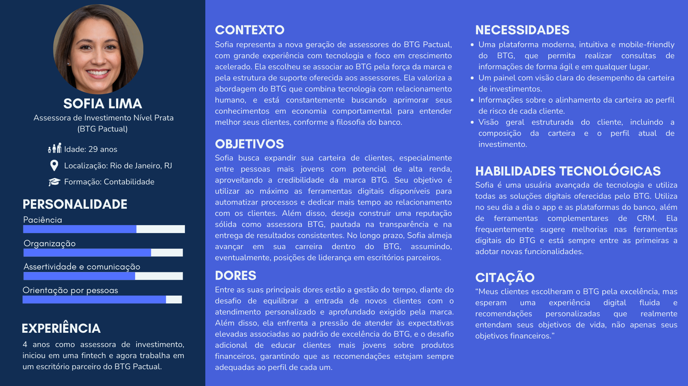<br>
<sup>Fonte: Material produzido pelos autores (2025) </sup>
</div>

### Persona Ana Oliveira

<div align="center">
<sub>Figura 3 - Persona 3 - Ana Oliveira</sub><br>
<br>
<sup>Fonte: Material produzido pelos autores (2025) </sup>
</div>

Além das personas, foram desenvolvidas jornadas do usuários que representam os processos realizados pelo assessor com o auxílio da plataforma que será desenvolvida. Segue abaixo essas jornadas.

### Jornada do Usuário Sofia Lima

<div align="center">
<sub>Figura 4 - Jornada do Usuário Sofia Lima</sub><br>
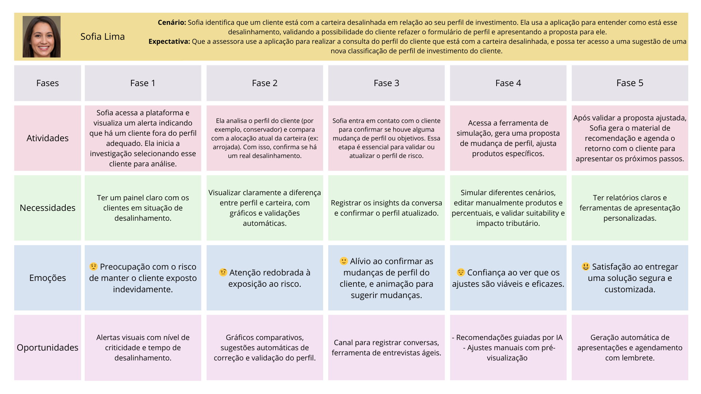<br>
<sup>Fonte: Material produzido pelos autores (2025) </sup>
</div>

### Jornada do Usuário Carlos Andrade

<div align="center">
<sub>Figura 5 - Jornada do Usuário Carlos Andrade</sub><br>
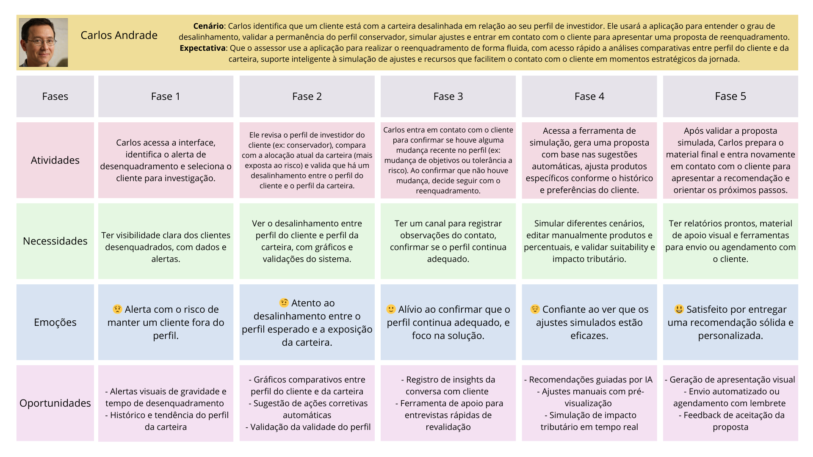<br>
<sup>Fonte: Material produzido pelos autores (2025) </sup>
</div>

## 2.5 Modelagem do Fluxo de Negócio

&emsp;Nesta seção, apresentamos a cadeia de valor e o modelo **AS-IS** e **TO-BE** do processo de análise de desenquadramento de investimentos, destacando as etapas críticas realizadas pelos assessores financeiros.

## 2.5.1 Cadeia de Valor

&emsp;A cadeia de valor do projeto INERI descreve as principais atividades que transformam dados de clientes e ativos em análises de conformidade regulatória, gerando valor para assessores e gestores do BTG Pactual.

**1. Atividades Primárias**

- Importação de Dados: Integração de informações de clientes e ativos através de arquivos CSV, XLSX ou APIs REST.

- Análise e Classificação de Perfis: Aplicação de categorização baseada nas diretrizes da CVM 175 para classificar os perfis de investidores.

- Identificação de Discrepâncias: Comparação entre os perfis de investidores e a alocação dos ativos para detectar inconsistências.

- Geração de Relatórios: Produção de relatórios visuais e exportáveis com os resultados da análise.

- Sugestão de Ajustes: Indicação de ações corretivas para adequação dos perfis à regulamentação vigente.

**2. Atividades de Suporte**

- Infraestrutura Tecnológica: Utilização da tech stack definida para o módulo para o desenvolvimento do projeto

- Desenvolvimento Ágil: Organização do trabalho em 5 sprints de duas semanas, garantindo entregas contínuas e incrementais.

- Design de Experiência do Usuário (UX/UI): Foco em uma interface móvel intuitiva para facilitar a adoção pelos usuários.

- Gestão de Projeto: Coordenação de equipe e recursos para cumprimento de prazos e objetivos de qualidade.

**3. Ganhos**

- Redução de discrepâncias: Diminuir o desenquadramento de perfis de investidores em relação a alocação de ativos em suas carteiras.

- Realocação de ativos: Recomendar uma nova composição de ativos para redefinir o posicionamento do investidor em seu perfil adequado.

- Análise de perfis de investimento: Análise dos perfis conforme composição atual da carteira.

- Geração de relatórios: Gerar relatórios com informações do investidor, que podem ser exportados em formatos apropriados.

- Gráficos: Gerar gráficos a partir dos dados de investimento.

<div align="center">
<sub>Figura 6 - Cadeia de Valor</sub><br>
<br>
<sup>Fonte: Material produzido pelos autores (2025) </sup>
</div>

## 2.5.2 Fluxo de Negócio Proposto (AS-IS e TO-BE)

A seguir, a descrição do fluxo de negócio **AS-IS** utilizando diagramação BPMN:

**Fluxo de Negócio AS-IS**

<div align="center">
<sub>Figura 7 - Diagrama do Fluxo de Negócio AS-IS</sub><br>
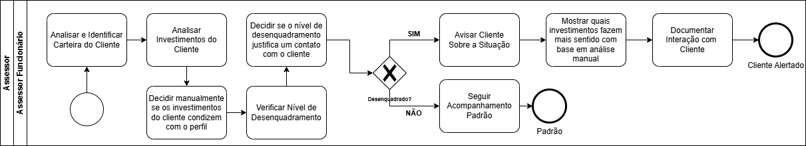<br>
<sup>Fonte: Material produzido pelos autores (2025) </sup>
</div>

**BPMN AS-IS**

Este diagrama representa o processo de análise e acompanhamento manual de carteiras de investimento pelo assessor financeiro:

**Fluxo do Processo:**

1. **Início do Processo**

   - O processo inicia com o assessor financeiro

2. **Analisar e Identificar Carteira do Cliente**

   - Primeira atividade onde o assessor identifica e examina a carteira de investimentos do cliente

3. **Analisar Investimentos do Cliente**

   - Avaliação detalhada dos investimentos específicos na carteira

4. **Decidir manualmente se os investimentos do cliente condizem com o perfil**

   - O assessor avalia a adequação dos investimentos ao perfil do cliente

5. **Verificar Nível de Desenquadramento**

   - Análise do grau de desalinhamento entre investimentos e perfil do cliente

6. **Decidir se o nível de desenquadramento justifica um contato com o cliente**

   - Avaliação se o desenquadramento é significativo a ponto de justificar comunicação

7. **Gateway de Decisão: Desenquadrado?**

   - Ponto de decisão com dois caminhos possíveis: "SIM" ou "NÃO"

8. **Caminho "SIM":**

   - **Avisar Cliente Sobre a Situação**
     - Comunicação com o cliente sobre o desenquadramento
   - **Mostrar quais investimentos fazem mais sentido com base em análise manual**
     - Recomendação de alternativas de investimentos mais adequadas
   - **Documentar Interação com Cliente**
     - Registro formal da comunicação e recomendações
   - **Fim do Processo: Cliente Alertado**

9. **Caminho "NÃO":**
   - **Seguir Acompanhamento Padrão**
     - Continuidade do monitoramento regular sem intervenção
   - **Fim do Processo: Padrão**

**Fluxo de Negócio TO-BE**

A seguir, a descrição do fluxo de negócio **TO-BE** utilizando diagramação BPMN, com o objetivo de reduzir o processo manual a fim de evitar erros e atrasos no processo de identificação de desenquadramentos:

<div align="center">
<sub>Figura 8 - Diagrama do Fluxo de Negócio TO-BE</sub><br>
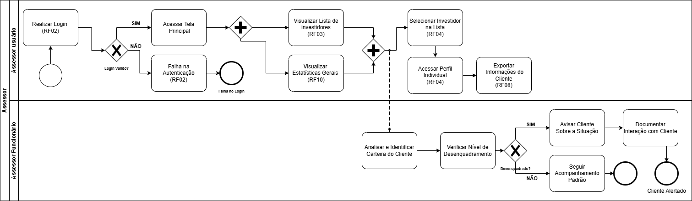<br>
<sup>Fonte: Material produzido pelos autores (2025) </sup>
</div>

A seguir, a descrição do fluxo de negócio representado no diagrama BPMN:

**Raia “Assessor Usuário”**

1. **Realizar Login (RF02)**

   - O usuário inicia o processo acessando a tela de login do sistema.
   - Evento de início: círculo simples.

2. **Gateway – Login Válido?**

   - **Sim** → prossegue para “Acessar Tela Principal”.
   - **Não** → segue para “Falha na Autenticação (RF02)”.

3. **Falha na Autenticação (RF02)**

   - Atividade que registra o erro de login.
   - Evento intermediário de término: círculo com borda grossa indicando fim prematuro (“Falha no Login”).

4. **Acessar Tela Principal**

   - Exibe ao usuário a página inicial do sistema.

5. **Gateway Paralelo inicial**

   - Dispara simultaneamente duas atividades:
     - **Visualizar Lista de Investidores (RF03)**
     - **Visualizar Estatísticas Gerais (RF10)**

6. **Gateway Paralelo de Sincronização**

   - Aguarda a conclusão de ambas as visualizações antes de avançar.

7. **Selecionar Investidor na Lista (RF04)**

   - O usuário escolhe um cliente-investidor da lista apresentada.

8. **Acessar Perfil Individual (RF04)**

   - Exibe os detalhes completos do perfil do investidor selecionado.

9. **Exportar Informações do Cliente (RF08)**
   - Permite ao usuário gerar um relatório ou arquivo com os dados do cliente.

**Raia “Assessor Funcionário”**

1. **Analisar e Identificar Carteira do Cliente**

   - Após o assessor usuário solicitar o perfil, um fluxo de mensagem (linha tracejada) dispara esta atividade no assessor funcional.

2. **Verificar Nível de Desenquadramento**

   - Checa se o perfil de investimento do cliente está fora das regras pré-definidas de adequação.

3. **Gateway – Desenquadrado?**

   - **Sim** → “Avisar Cliente Sobre a Situação”
   - **Não** → “Seguir Acompanhamento Padrão”

4. **Avisar Cliente Sobre a Situação**

   - Comunicação ativa ao cliente explicando o desvio detectado.

5. **Documentar Interação com Cliente**

   - Registro formal da conversa/aviso, encerrando o fluxo com um evento de fim (círculo grosso “Cliente Alertado”).

6. **Seguir Acompanhamento Padrão**
   - Procedimentos habituais de monitoramento para clientes que estão dentro dos padrões, também finalizando o processo.

## 2.6 Matriz de Risco do Projeto

<div align="center">
<sub>Figura 9 - Matriz de Risco</sub><br>
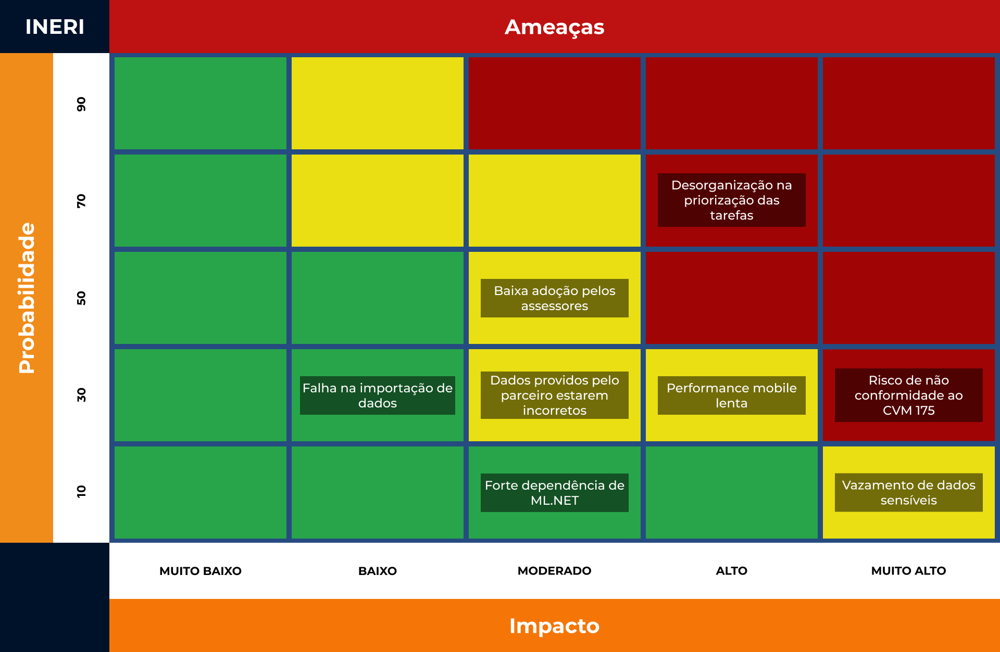<br>
<sup>Fonte: Material produzido pelos autores (2025) </sup>
</div>

### Descrição Geral dos Riscos

**Forte dependência de ML.NET**

- **Probabilidade:** 10 **Impacto:** Moderado
- O core de classificação embarcado usa ML.NET; mudanças ou bugs na biblioteca podem quebrar o modelo.
- **Mitigação:** fixar versão de ML.NET, criar testes de regressão do modelo e manter alternativos de inferência (ex. .NET Native).

**Vazamento de dados sensíveis**

- **Probabilidade:** 10 **Impacto:** Muito Alto
- Informações financeiras dos clientes expostas por falhas de segurança podem gerar sanções legais e reputacionais.
- **Mitigação:** Mascarar os dados.

**Falha na importação de dados**

- **Probabilidade:** 30 **Impacto:** Baixo
- Erros em CSV/XLSX ou respostas da API podem interromper o carregamento inicial.
- **Mitigação:** validação de schema, feedback claro ao usuário, retries e fallback para importação manual.

**Dados providos pelo parceiro estarem incorretos**

- **Probabilidade:** 30 **Impacto:** Moderado
- Valores fora do padrão (ex. alocações inválidas) geram inconsistências na análise de perfil.
- **Mitigação:** checagem de consistência, alertas de correção, painel de revisão antes de processar.

**Performance mobile lenta**

- **Probabilidade:** 30 **Impacto:** Alto
- Processamento de gráficos e relatórios no dispositivo pode travar em aparelhos mais antigos.
- **Mitigação:** offload de cálculo para backend, lazy-loading de componentes, profiling em dispositivos reais.

**Risco de não conformidade ao CVM 175**

- **Probabilidade:** 30 **Impacto:** Muito Alto
- Regras ou cálculos incorretos podem gerar sugestões fora da norma, implicando em penalidades.
- **Mitigação:** Modelagem de cenários reais – Capturar 5 carteiras-tipo (conservador, moderado, agressivo etc.) e definir alocações mínimas/máximas exigidas pela CVM 175.

**Baixa adoção pelos assessores**

- **Probabilidade:** 50 **Impacto:** Moderado
- Se o app não se encaixar no fluxo de trabalho, pode ser ignorado pelos usuários finais.
- **Mitigação:** Alinhamento de de co-design com assessores, testes de usabilidade e iterações rápidas de UI/UX.

**Desorganização na priorização de tarefas**

- **Probabilidade:** 70 **Impacto:** Alto
- Backlog mal estruturado leva a foco em funcionalidades periféricas antes do core.
- **Mitigação:** cerimônias Scrum/Kanban regulares, refinamento semanal do backlog.

---

### Plano de Mitigação

| Risco                     | Ação de Mitigação                                               |
| ------------------------- | --------------------------------------------------------------- |
| Dependência de ML.NET     | Versionamento fixo, testes de regressão, fallback de inferência |
| Vazamento de dados        | Criptografia, mascaramento dos dados                            |
| Falha na importação       | Validação de schema, retries, mensagens de erro UX              |
| Dados incorretos          | Checagem de consistência, alertas, painel de revisão            |
| Performance mobile lenta  | Offload backend, lazy-loading, profiling                        |
| Não conformidade CVM 175  | Modelagem baseada em cálculos de aplicação reais                |
| Baixa adoção              | Co-design, protótipos testados com assessores                   |
| Desorganização de backlog | Scrum/Kanban, refinamento contínuo, alinhamento PO/time         |

---

<div align="center">
<sub>Figura 10 - Matriz de Oportunidades</sub><br>
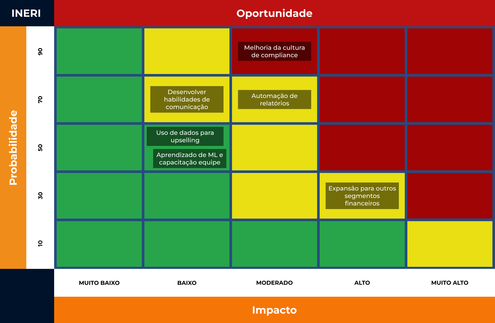<br>
<sup>Fonte: Material produzido pelos autores (2025) </sup>
</div>

### Descrição Geral das Oportunidades

**Melhoria da cultura de compliance**

- **Probabilidade:** 90 **Impacto:** Moderado
- Adoção do app reforça práticas CVM 175, elevando governança interna.
- **Ação:** divulgar resultados de conformidade em relatórios executivos e treinamentos.

**Desenvolver habilidades de comunicação**

- **Probabilidade:** 70 **Impacto:** Baixo
- Colaboração com stakeholders e apresentações fortalecem soft skills do time.
- **Ação:** promover sessões de feedback e demos regulares para toda a equipe.

**Automação de relatórios e dados**

- **Probabilidade:** 70 **Impacto:** Moderado
- Geração automática de sugestões, CSV e dashboards acelera insights e reduz trabalho manual.

**Uso de dados para upselling**

- **Probabilidade:** 50 **Impacto:** Baixo
- Insights de perfil permitem sugerir produtos BTG complementares.
- **Ação:** criar API interna para fornecer indicadores de cross-sell aos assessores.

**Aprendizado de ML e capacitação da equipe**

- **Probabilidade:** 50 **Impacto:** Baixo
- Implementação prática de ML.NET eleva expertise técnico do time.
- **Ação:** workshops internos e documentação de casos de uso ML.

**Expansão para outros segmentos financeiros**

- **Probabilidade:** 30 **Impacto:** Alto
- Adaptar a solução para fundos, previdência e outros ativos amplia mercado.
- **Ação:** parametrizar regras de negócio para múltiplos produtos e validar com área de negócios.

## 2.7 Ideação

&emsp;A ideação é a etapa em que se exploram ideias para resolver os problemas identificados. Com foco em gerar e filtrar o maior número possível de soluções.

## 2.7.1 Brainstorming de Features

&emsp;Durante a realização do brainstorming, o grupo definiu as principais funcionalidades da aplicação, assim como suas principais regras de negócio, listadas na imagem abaixo.

<div align="center">
<sub>Figura 11 - Brainstorming de features</sub><br>
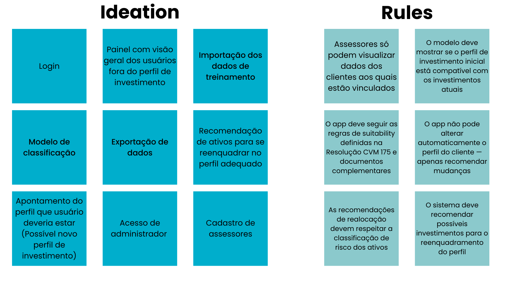<br>
<sup>Fonte: Material produzido pelos autores (2025) </sup>
</div>

**1. Lista de Features Identificadas (Ideation)**

- Login
- Painel com visão geral dos usuários fora do perfil de investimento
- Importação dos dados de treinamento
- Modelo de classificação
- Exportação de dados
- Recomendação de ativos para se reenquadrar no perfil adequado
- Apontamento do perfil que o usuário deveria estar (possível novo perfil)
- Acesso de administrador
- Cadastro de assessores

**2. Critérios de Priorização**

- **Alinhamento com a visão do produto:** foco na personalização da jornada de investimento e adequação ao perfil.
- **Dependências técnicas:** funcionalidades que suportam o motor de recomendação devem vir antes.
- **Valor entregue ao usuário:** priorizar o que gera impacto direto na experiência e conformidade regulatória.
- **Facilidade de implementação:** funcionalidades mais simples e fundamentais desenvolvidas inicialmente.

**3. Sequenciamento de Entregas (Backlog Prioritário)**

1. **Importação dos dados de treinamento**

   - Fundamenta o modelo de classificação e testes iniciais.

2. **Modelo de classificação**

   - Núcleo do sistema de recomendação, identifica perfil atual do usuário.

3. **Painel com visão geral dos usuários fora do perfil de investimento**

   - Dashboard para assessores visualizarem casos que demandam atenção.

4. **Recomendação de ativos para reenquadrar no perfil adequado**

   - Entrega valor direto ao usuário e assegura conformidade.

5. **Apontamento do perfil ideal para o usuário**

   - Indica possíveis mudanças de perfil com base na análise.

6. **Exportação de dados**

   - Suporte à auditoria e análises externas.

7. **Cadastro de assessores**

   - Controle de acesso e atribuição de responsabilidades.

8. **Acesso de administrador**

   - Gestão avançada do sistema e parametrizações globais.

9. **Login**
   - Implementação de autenticação e segurança após principais fluxos de negócio estarem validados.

## 2.8 Canvas do Projeto

&emsp; A seguir o Canvas MVP do **INERI:**

<div align = center>
<sub>Figura 12 - Canvas MVP</sub><br>
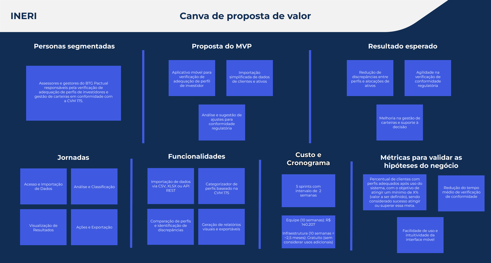
</div>

Veja o Canvas em maior resolução clicando [aqui](https://drive.google.com/file/d/1880PJDaW0aXl4MwCrVR6a9PqpkkGQw-Q/view?usp=sharing).

## 2.9 Custo Estimado de Desenvolvimento e Manutenção

### Equipe de Desenvolvimento

| Cargo                 | Qtde | Valor Mensal (R$) | Total 12 meses (R$) |
| --------------------- | ---- | ----------------- | ------------------- |
| Analista de TI Júnior | 6    | 3.500             | 252.000             |
| Head de TI            | 1    | 33.333            | 399.996             |
| **Total equipe**      |      |                   | **R$ 651.996**      |

> Durante o desenvolvimento (10 semanas), o custo estimado com equipe é de **R$ 140.207**, e para os 12 meses completos (manutenção + evolução), é projetado um custo de **R$ 651.996**.

---

### Software e Ferramentas

| Ferramenta           | Licença  | Custo Mensal (R$) | Total Anual (R$) |
| -------------------- | -------- | ----------------- | ---------------- |
| Trello               | Gratuito | 0                 | 0                |
| GitHub               | Gratuito | 0                 | 0                |
| Figma (free + 1 Pro) | R$ 120   | 120               | 1.440            |
| Notion               | Gratuito | 0                 | 0                |
| **Total software**   |          |                   | **R$ 1.440**     |

---

### Infraestrutura AWS (com base em Free Tier e escalabilidade)

Utilização do **AWS Free Tier por 12 meses**, com upgrade gradual conforme uso real:

| Serviço                         | Plano Inicial         | Estimativa Anual (R$)   | Observações                     |
| ------------------------------- | --------------------- | ----------------------- | ------------------------------- |
| EC2                             | t3.micro (Free Tier)  | 0                       | 750 horas/mês gratuitas         |
| S3                              | Até 5GB + 20k GET     | 0                       | Custo sobe com muito upload/log |
| Lambda                          | 1 milhão de execuções | 0                       | Free Tier cobre MVP             |
| RDS                             | db.t3.micro mono-AZ   | 0                       | Até 20GB SSD + backups          |
| CloudWatch + ALB                | Básico                | 200/mês após Free Tier  | Previsão pós-MVP                |
| **Reserva de contingência AWS** | N/A                   | **R$ 2.400** (provisão) | Para picos e uso real           |

---

### Custo Total Estimado - 1 Ano

| Categoria              | Valor Total (R$) |
| ---------------------- | ---------------- |
| Equipe (12 meses)      | 651.996          |
| Software e Ferramentas | 1.440            |
| Infraestrutura AWS     | 2.400 (provisão) |
| **Total Geral**        | **R$ 655.836**   |

---

### Cronograma de Desenvolvimento

| Fase                       | Duração    | Entregas                                         |
| -------------------------- | ---------- | ------------------------------------------------ |
| Fase 1 - MVP Inicial       | 10 semanas | Importação, categorização, análise               |
| Fase 2 - Melhoria e escala | 10 meses   | Otimizações, novos relatórios, suporte à decisão |

---

### Observações Finais

- O custo com equipe é o principal componente do orçamento (aprox. 99%).
- A infraestrutura AWS foi pensada com Free Tier e escalabilidade moderada.
- Trello e Figma (mínimo pago) garantem boa gestão com baixo custo.
- Considera base de até 10.000 usuários, podendo escalar gradualmente.

# 3. Requisitos do Projeto

Esta seção contém os requisitos funcionais e os requisitos não funcionais do projeto.

## 3.1 Requisitos Funcionais (RFs)

| Requisito                                                                                                                                                                                     | Teste Necessário                                                                                                                                                | Pré-condição                                                                       | Procedimento                                                             | Resultado Esperado                                                           | Pós-condição                                                             | Critérios de Aceitação                                                                                                                                                                                                                                                                                                  |
| --------------------------------------------------------------------------------------------------------------------------------------------------------------------------------------------- | --------------------------------------------------------------------------------------------------------------------------------------------------------------- | ---------------------------------------------------------------------------------- | ------------------------------------------------------------------------ | ---------------------------------------------------------------------------- | ------------------------------------------------------------------------ | ----------------------------------------------------------------------------------------------------------------------------------------------------------------------------------------------------------------------------------------------------------------------------------------------------------------------- |
| **RF01** – O usuário deve poder realizar login com email e senha cadastrados.                                                                                                                 | Verificar se o login ocorre corretamente com dados válidos.                                                                                                     | Conta de usuário cadastrada previamente.                                           | Inserir email e senha na tela de login.                                  | Acesso liberado à tela principal.                                            | Usuário autenticado.                                                     | Eu, como assessor de investimentos sênior, desejo acessar a plataforma com meu login, para otimizar meu tempo e iniciar a análise de carteiras de forma rápida e segura.                                                                                                                                                |
| **RF02** – O sistema deve exibir, na tela principal, apenas os usuários que estão desenquadrados do perfil de investidor definido previamente.                                                | Verificar se a lista mostra somente usuários desenquadrados.                                                                                                    | Login efetuado com sucesso.                                                        | Acessar a tela principal.                                                | Lista com usuários desenquadrados visível.                                   | Lista atualizada com base nos dados importados.                          | Eu, como assessora de investimentos, quero visualizar rapidamente apenas os clientes desenquadrados em relação ao seu perfil de investidor, para poder agir com agilidade e oferecer a melhor orientação possível.                                                                                                      |
| **RF03** – O usuário poderá acessar o perfil individual de qualquer usuário da lista para visualizar mais informações.                                                                        | Verificar se o botão/perfil da lista leva à tela de detalhes do usuário.                                                                                        | Tela principal acessada.                                                           | Clicar no item de um usuário desenquadrado.                              | Tela com dados detalhados do usuário exibida.                                | Usuário visualizado em detalhes.                                         | Eu, como assessora de investimentos, desejo acessar rapidamente o perfil completo de qualquer cliente desenquadrado para obter informações detalhadas — como nome, categoria atual, ideal e sugestões de reenquadramento — para personalizar melhor minhas orientações.                                                 |
| **RF04** – O sistema deve informar em qual categoria o usuário está e o quanto ele se distancia da mesma, segundo a análise da carteira.                                                      | Verificar se a tela de perfil mostra corretamente a categoria atual e o valor de distanciamento.                                                                | Dados importados corretamente.                                                     | Acessar o perfil de um usuário.                                          | Categorias exibidas corretamente.                                            | Informações disponíveis para o assessor.                                 | Eu, como assessor de investimentos sênior, quero que o sistema mostre claramente a categoria atual do cliente e o quanto ele está distante dela, de acordo com a CVM 175, para oferecer soluções de reenquadramento de forma assertiva.                                                                                 |
| **RF05** – O sistema deve recomendar ativos para que o usuário possa reenquadrar sua carteira dentro do perfil ideal, sem sugerir mudança de perfil.                                          | Verificar se há recomendações de compra/venda de ativos.                                                                                                        | Perfil do usuário acessado.                                                        | Visualizar sugestões na tela de perfil.                                  | Recomendações exibidas conforme perfil atual.                                | Recomendação registrada na tela do usuário.                              | Eu, como assessora de investimentos, desejo ver recomendações que ajudem o cliente a reenquadrar sua carteira dentro do perfil ideal, sem mudar sua classificação, para garantir que ele continue alinhado aos seus objetivos financeiros.                                                                              |
| **RF06** – O sistema deve sugerir um cliente prioritário para atendimento do assessor, de acordo com as preferências de atendimento configuradas pelo assessor (perfil de atendimento).       | Verificar se o sistema sugere corretamente o cliente prioritário baseado nas preferências configuradas pelo assessor e se a sugestão aparece na tela principal. | Assessor logado no sistema e preferências de atendimento configuradas previamente. | Acessar a tela principal após configurar as preferências de atendimento. | Cliente prioritário sugerido na tela principal conforme critérios definidos. | Sugestão de cliente prioritário exibida e atualizada na home do sistema. | Eu, como assessor de investimentos sênior, desejo que o sistema sugira automaticamente na tela inicial qual cliente devo priorizar para atendimento, baseado nas minhas preferências configuradas (como nível de desenquadramento, valor da carteira, etc.), para otimizar meu tempo e focar nos casos mais relevantes. |
| **RF07** – O usuário deve ser capaz de exportar as análises e recomendações em formato CSV.                                                                                                   | Verificar se o botão de exportação gera um arquivo CSV válido com os dados visíveis.                                                                            | Análise realizada com sucesso.                                                     | Clicar no botão de exportação.                                           | Arquivo CSV gerado e salvo.                                                  | Dados disponíveis para download.                                         | Eu, como assessora de investimentos, quero exportar as análises e recomendações em formato CSV para poder compartilhar facilmente com minha equipe e clientes, mantendo todos os dados organizados e acessíveis.                                                                                                        |
| **RF08** – O sistema deve permitir visualizar as informações dos usuários em formatos gráficos.                                                                                               | Verificar se a visualização apresenta corretamente gráficos que relacionem categorias de investidor, distanciamento ao perfil ideal e recomendações de ativos.  | Importação de dados concluída.                                                     | Acessar a tela de visualização gráfica do perfil do usuário.             | Tela de perfil com gráficos interativos exibida.                             | Gráficos claros e interativos disponíveis para análise.                  | Eu, como assessor de investimentos sênior, desejo ver as informações dos meus clientes em gráficos interativos, para entender de forma rápida e visual o distanciamento ao perfil ideal e as recomendações de ativos.                                                                                                   |
| **RF09** – O sistema deve mostrar estatísticas sobre os usuários desenquadrados na tela principal, como média de distanciamento do perfil ideal, número total de usuários desenquadrados etc. | Verificar se a tela principal exibe corretamente todas as estatísticas definidas.                                                                               | Usuário logado no sistema.                                                         | Acessar tela principal.                                                  | Estatísticas carregadas e visíveis.                                          | Estatísticas coerentes com os dados importados.                          | Eu, como assessora de investimentos (Sofia Lima), desejo visualizar na tela inicial estatísticas resumidas dos clientes desenquadrados — como média de distanciamento e total de casos — para monitorar rapidamente o panorama geral e priorizar minhas ações.                                                          |

## 3.2 Requisitos Não Funcionais (RNFs)

<div align="center">
<sub>Tabela 1 - Requisitos Não Funcionais </sub><br>

| Requisito                                                                                                                                                                                                                                                                                                                                                              | Teste Necessário                                                                                               | Pré-condição                                                                  | Procedimento                                                                                                                 | Resultado Esperado                                                                                 | Pós-condição                                                                                         | Critérios de Aceitação                                                                                                                                    |
| ---------------------------------------------------------------------------------------------------------------------------------------------------------------------------------------------------------------------------------------------------------------------------------------------------------------------------------------------------------------------- | -------------------------------------------------------------------------------------------------------------- | ----------------------------------------------------------------------------- | ---------------------------------------------------------------------------------------------------------------------------- | -------------------------------------------------------------------------------------------------- | ---------------------------------------------------------------------------------------------------- | --------------------------------------------------------------------------------------------------------------------------------------------------------- |
| **RNF01 - Segurança da Informação (Carlos Andrade)**<br>Como assessor, preciso que os dados dos meus clientes estejam protegidos contra acessos não autorizados, garantindo conformidade com regulamentações como a CVM 175. O sistema deve preservar a confidencialidade e integridade dos dados, bloqueando 100% das tentativas de ataque em testes de segurança.    | Realizar testes de segurança ativa (SQL Injection, XSS, CSRF) com ferramentas como OWASP ZAP e testes manuais. | Sistema populado com usuários, dados sensíveis e acesso restrito configurado. | Conduzir simulações de ataques explorando falhas conhecidas, capturar logs de tentativas e medir sucesso/falha das invasões. | 100% das tentativas de ataque devem ser detectadas e bloqueadas pelo sistema.                      | Dados permanecem íntegros e protegidos, sem acesso indevido.                                         | O sistema deve garantir **segurança**, detectando e impedindo ≥ 90% das tentativas de invasão, assegurando confidencialidade e integridade da informação. |
| **RNF02 - Compatibilidade e Portabilidade Multiplataforma Android (Sofia Lima)**<br>Como assessora em constante mobilidade, preciso acessar o sistema a partir de diferentes dispositivos móveis, mantendo consistência nas funcionalidades essenciais. O sistema deve ser compatível com Android (10+), garantindo experiência adequada e funcionalidade consistente. | Testar as principais funcionalidades em diferentes dispositivos.                                               | Aplicativo instalado nas plataformas indicadas.                               | Executar testes funcionais de cadastro, login, upload de arquivos e consultas em cada ambiente, validando operação e layout. | Funcionalidade básica e layout responsivo devem ser consistentes entre dispositivos especificados. | O app continua utilizável com a mesma experiência mínima esperada em todos os dispositivos testados. | O sistema deve demonstrar **portabilidade** e **interoperabilidade**, garantindo operação correta das funcionalidades principais em Android 10+.          |

<sup>Fonte: Material produzido pelos autores (2025)</sup>

</div>

## 3.3 Correlação RFs e RNFs

&emsp;A tabela a seguir ilustra o relacionamento entre RFs e RNFs, destacando os requisitos correlacionados:

### Relacionamento entre RFs e RNFs

| RNFs \ RFs                                          | RF01 | RF02 | RF03 | RF04 | RF05 | RF06 | RF07 | RF08 | RF09 | RF10 |
| --------------------------------------------------- | ---- | ---- | ---- | ---- | ---- | ---- | ---- | ---- | ---- | ---- |
| **RNF01 - Segurança de Dados**                      | ✔️   | ✔️   |      |      |      |      | ✔️   |      |      |      |
| **RNF02 - Compatibilidade Multiplataforma Android** | ✔️   | ✔️   | ✔️   | ✔️   | ✔️   | ✔️   | ✔️   | ✔️   | ✔️   | ✔️   |

### Explicações das Relações:

- **RNF01 - Segurança de Dados**:

  - Afeta principalmente RF01 (Cadastro de Assessor), RF02 (Login) e RF07 (Importação de Dados), que envolvem manipulação de credenciais, dados sensíveis e processos que poderiam ser alvo de ataques de segurança.

- **RNF02 - Compatibilidade Multiplataforma Android**:
  - Impacta todos os RFs, pois as operações principais (cadastro, login, consulta, visualizações, exportações) devem funcionar corretamente em diversos dispositivos móveis, garantindo uma experiência consistente para o usuário.

# 4. Modelagem de Dados

A seguir são apresentados os modelos conceitual e lógico.

## 4.2 Modelo Conceitual de Dados

Segue diagrama do modelo conceitual:

<div align="center">
<sub>Figura 13 - Diagrama Conceitual</sub><br>
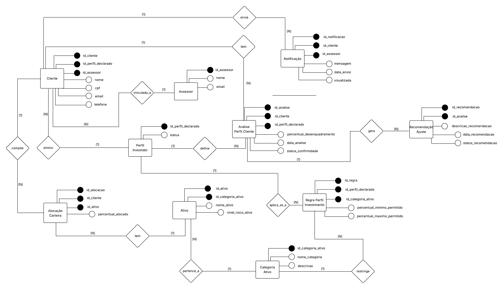<br>
<sup>Fonte: Material produzido pelos autores (2025)</sup>
</div>

Para visualizar em melhor resolução [clique aqui.](https://drive.google.com/file/d/1u8GxNCDJicl1eV8b0FW5zVqAZpN-d7sn/view?usp=sharing)

| Entidade                      | Descrição                                                                                                       |
| ----------------------------- | --------------------------------------------------------------------------------------------------------------- |
| **Cliente**                   | Representa o investidor cadastrado na plataforma, contendo seus dados pessoais e vínculo com perfil e assessor. |
| **Assessor**                  | Profissional responsável por acompanhar clientes, receber notificações e gerar recomendações.                   |
| **Notificacao**               | Mensagens recebidas pelo assessor sobre clientes desenquadrados.                                                |
| **Perfil_Investidor**         | Define o perfil de risco declarado do cliente (conservador, moderado, sofisticado, etc.).                       |
| **Analise_Perfil_Cliente**    | Registro da conferência do perfil declarado, com percentual de desenquadramento e status de conformidade.       |
| **Recomendacao_Ajuste**       | Sugestões de ajuste de carteira geradas a partir da análise de perfil do cliente.                               |
| **Alocacao_Carteira**         | Percentual de cada ativo alocado na carteira de um cliente.                                                     |
| **Ativo**                     | Representa um instrumento financeiro (ação, título, fundo etc.), com categoria e nível de risco.                |
| **Categoria_Ativo**           | Classificação dos ativos (renda fixa, renda variável, fundos, commodities etc.).                                |
| **Regra_Perfil_Investimento** | Limites mínimo e máximo de alocação por categoria de ativo para cada perfil de investidor.                      |

### **Atributos**

**Cliente**

`id_cliente` – Identificador único do cliente.
`nome` – Nome completo do cliente.
`cpf` – CPF do cliente.
`email` – E‑mail de contato.
`telefone` – Telefone de contato.
`id_perfil_declarado` – Referência ao perfil de investidor declarado.
`id_assessor` – Referência ao assessor responsável.

**Assessor**

`id_assessor` – Identificador único do assessor.
`nome` – Nome completo do assessor.
`email` – E‑mail de contato do assessor.

**Notificação**

`id_notificacao` – Identificador único da notificação.
`id_cliente` – Referência ao cliente.
`id_assessor` – Referência ao assessor.
`mensagem` – Conteúdo da notificação.
`data_envio` – Data e hora de envio.
`visualizada` – Indicador se o cliente já visualizou (Sim/Não).

**Perfil_Investidor**

`id_perfil_declarado` – Identificador do perfil.
`status` – Descrição do perfil (ex: conservador, moderado, agressivo).

**Análise_Perfil_Cliente**

`id_analise` – Identificador da análise.
`id_cliente` – Referência ao cliente analisado.
`id_perfil_declarado` – Perfil declarado referenciado.
`percentual_desenquadramento` – % fora dos limites permitidos.
`data_analise` – Data da análise.
`status_conformidade` – Situação da conformidade (Conforme/Não conforme).

**Recomendação_Ajuste**

`id_recomendacao` – Identificador da recomendação.
`id_analise` – Referência à análise que gerou a recomendação.
`descricao_recomendacao` – Texto da sugestão de ajuste.
`data_recomendacao` – Data da geração.
`status_recomendacao` – Estado da recomendação (Pendente/Aplicada).

**Alocação_Carteira**

`id_alocacao` – Identificador único da alocação.
`id_cliente` – Referência ao cliente.
`id_ativo` – Referência ao ativo.
`percentual_alocado` – % do ativo na carteira.

**Ativo**

`id_ativo` – Identificador do ativo.
`nome_ativo` – Nome ou código do ativo.
`id_categoria_ativo` – Referência à categoria do ativo.
`nivel_risco_ativo` – Grau de risco (1–5).

**Categoria_Ativo**

`id_categoria_ativo` – Identificador da categoria.
`nome_categoria` – Nome da categoria.
`descricao` – Descrição da categoria.

**Regra_Perfil_Investimento**

`id_regra` – Identificador da regra.
`id_perfil_declarado` – Perfil de investidor alvo.
`id_categoria_ativo` – Categoria de ativo alvo.
`percentual_minimo_permitido` – % mínimo permitido.
`percentual_maximo_permitido` – % máximo permitido.

### **Relações do Sistema**

| Relação                                           | Descrição                                                                                        | Cardinalidade |
| ------------------------------------------------- | ------------------------------------------------------------------------------------------------ | ------------- |
| **Cliente – Assessor**                            | Cada cliente está vinculado a um único assessor; um assessor atende vários clientes.             | (N:1)         |
| **Cliente – Notificação**                         | Um cliente pode gerar várias notificações; cada notificação pertence a um cliente.               | (1:N)         |
| **Assessor – Notificação**                        | Um assessor pode receber várias notificações; cada notificação tem um único remetente.           | (1:N)         |
| **Cliente – Análise_Perfil_Cliente**              | Um cliente pode passar por várias análises de perfil; cada análise refere‑se a um único cliente. | (1:N)         |
| **Perfil_Investidor – Análise_Perfil_Cliente**    | Um perfil pode ser analisado várias vezes; cada análise referencia um único perfil.              | (1:N)         |
| **Análise_Perfil_Cliente – Recomendação_Ajuste**  | Cada análise pode gerar várias recomendações; cada recomendação refere‑se a uma única análise.   | (1:N)         |
| **Cliente – Alocação_Carteira**                   | Um cliente possui várias alocações de ativos; cada alocação pertence a um cliente.               | (1:N)         |
| **Ativo – Alocação_Carteira**                     | Um ativo pode aparecer em várias carteiras; cada alocação referencia um único ativo.             | (1:N)         |
| **Perfil_Investidor – Regra_Perfil_Investimento** | Cada perfil tem várias regras de alocação; cada regra aplica‑se a um único perfil.               | (1:N)         |
| **Categoria_Ativo – Regra_Perfil_Investimento**   | Cada categoria de ativo tem várias regras; cada regra refere‑se a uma única categoria.           | (1:N)         |

**Detalhamento**

&emsp;Este modelo conceitual descreve a estrutura de dados para um sistema de gestão de carteiras de investimento, contemplando clientes, assessores, perfis de risco, análises de conformidade e recomendações de ajuste. A modelagem garante a integridade referencial entre clientes, seus perfis, análises e alocações de ativos, bem como o controle de notificações e regras de investimento por categoria de ativo.

&emsp;Na implementação, cada entidade será mapeada para uma tabela relacional, assegurando que os relacionamentos (FKs) reflitam as cardinalidades definidas. O sistema permitirá:

- Cadastro e manutenção de clientes e assessores.
- Envio e controle de notificações.
- Registro de análises de perfil e geração de recomendações.
- Definição de regras de alocação por perfil e categoria de ativo.
- Gerenciamento das alocações de ativos na carteira de cada cliente.

&emsp;Os requisitos funcionais incluem: RF01 – cadastro de cliente e assessor; RF02 – envio de notificações; RF03 – análise de perfil; RF04 – geração de recomendações; RF05 – alocação de carteira; RF06 – sugestão de cliente prioritário para atendimento, garantindo que o sistema suporte todo o fluxo de trabalho dos assessores — da criação de usuários até a priorização e recomendação de ativos alinhados ao perfil de risco.

&emsp;Os requisitos não funcionais incluem: RNF01 – segurança e controle de acesso, assegurando confidencialidade e integridade dos dados; RNF02 – auditoria de ações, permitindo rastreabilidade completa das operações; RNF03 – desempenho em consultas de alocação, com tempo de resposta inferior a 2 s para até 10 000 registros; RNF04 – escalabilidade para crescimento de base de clientes, suportando até 100 % de aumento anual sem degradação de performance.

### Contextualização do Sistema

Um cliente solicita uma solução para gestão de carteiras de investimentos que permita o cadastro de clientes, acompanhamento por assessores, definição de perfis de investimento, análise de conformidade e geração de recomendações de ajuste.

### Entidades e Lógica de Negócio

#### 1. Cliente

Uma entidade que representa o investidor no sistema. Possui:

- Identificador único
- Nome completo
- CPF
- E-mail de contato
- Telefone
- Vínculo com um perfil de investidor declarado
- Associação a um assessor específico

#### 2. Assessor

Profissional responsável pelo acompanhamento dos clientes. Caracteriza-se por:

- Identificador único
- Nome completo
- E-mail de contato
- Capacidade de gerenciar múltiplos clientes
- Responsável pelo envio de notificações

#### 3. Perfil de Investidor

Classifica o perfil de risco do cliente:

- Identificador único do perfil
- Status do perfil (ex: conservador, moderado, agressivo)
- Define limites de alocação de investimentos

#### 4. Análise de Perfil do Cliente

Processo de verificação da conformidade do perfil de investimento:

- Identificador único da análise
- Vinculação ao cliente específico
- Referência ao perfil declarado
- Cálculo do percentual de desenquadramento
- Data da análise
- Status de conformidade (Conforme/Não Conforme)

#### 5. Recomendação de Ajuste

Sugestões geradas a partir da análise do perfil:

- Identificador único da recomendação
- Vinculação à análise que a gerou
- Descrição detalhada da recomendação
- Data da recomendação
- Status da recomendação (Pendente/Aplicada)

#### 6. Alocação de Carteira

Distribuição dos investimentos do cliente:

- Identificador único da alocação
- Vinculação ao cliente
- Referência ao ativo específico
- Percentual alocado do ativo na carteira

#### 7. Ativo

Instrumento financeiro individual:

- Identificador único
- Nome ou código do ativo
- Categoria do ativo
- Nível de risco (escala de 1 a 5)

#### 8. Categoria de Ativo

Classificação dos tipos de investimentos:

- Identificador único da categoria
- Nome da categoria
- Descrição detalhada

#### 9. Regra de Perfil de Investimento

Limites de alocação para cada perfil:

- Identificador único da regra
- Perfil de investidor alvo
- Categoria de ativo regulada
- Percentual mínimo permitido
- Percentual máximo permitido

#### 10. Notificação

Comunicações entre assessor e cliente:

- Identificador único
- Referência ao cliente
- Referência ao assessor destinatário
- Conteúdo da mensagem
- Data e hora de envio
- Status de visualização

### Fluxo Básico de Negócio

1. Cadastro do Cliente

- Cliente é registrado no sistema
- Perfil de investimento é declarado
- Assessor é vinculado ao cliente

2. Análise de Perfil

- Sistema realiza análise periódica da carteira
- Verifica conformidade com o perfil declarado
- Calcula percentual de desenquadramento

3. Geração de Recomendações

- Caso haja desenquadramento
- Sistema gera recomendações de ajuste
- Assessor é notificado

1. Acompanhamento

- Cliente pode visualizar recomendações
- Assessor auxilia na implementação dos ajustes
- Novas análises são realizadas

### Restrições Principais

- Um cliente tem apenas um perfil de investimento ativo
- Alocações devem respeitar os limites do perfil
- Assessor pode gerenciar múltiplos clientes
- Todas as movimentações são rastreáveis
- Notificações permitem acompanhamento contínuo

#### Exemplo Prático

Maria, cliente com perfil conservador:

- Carteira inicial com diferentes ativos
- Sistema identifica e notifica que Maria está com 40% da carteira em renda variável
- Perfil conservador permite apenas 30% em renda variável
- Sistema gera recomendação de ajuste
- Maria pode implementar recomendações

## 4.3 Modelo Lógico de Dados

O modelo lógico de dados representa, de forma estruturada, como os dados se relacionam em um sistema, sem entrar em detalhes físicos como índices ou tipos específicos de banco de dados. Ele é essencial para garantir que as informações sejam organizadas de maneira clara, facilitando tanto o desenvolvimento quanto a manutenção de aplicações que dependem de dados bem estruturados.

Confira a imagem abaixo para verificar o modelo lógico de dados:

<div align = center>
<sub>Figura 14 - Modelo Lógico</sub><br>
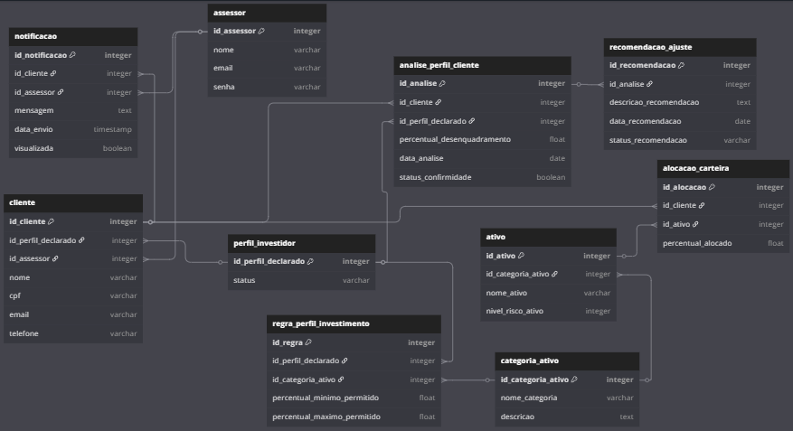
</div>

## 🧾 Tabelas e Relacionamentos

### **1. notificação**

Armazena mensagens recebidas de assessores sobre clientes desenquadrados.

- `id_notificacao`&emsp;_integer_&emsp;🔑
- `id_cliente`&emsp;_integer_&emsp;🔗
- `id_assessor`&emsp;_integer_&emsp;🔗
- `mensagem`&emsp;_text_
- `data_envio`&emsp;_timestamp_
- `visualizada`&emsp;_boolean_

---

### **2. assessor**

Contém informações dos assessores.

- `id_assessor`&emsp;_integer_&emsp;🔑
- `nome`&emsp;_varchar_
- `email`&emsp;_varchar_
- `senha`&emsp;_varchar_

---

### **3. cliente**

Contém os dados pessoais dos clientes.

- `id_cliente`&emsp;_integer_&emsp;🔑
- `id_perfil_declarado`&emsp;_integer_&emsp;🔗
- `id_assessor`&emsp;_integer_&emsp;🔗
- `nome`&emsp;_varchar_
- `cpf`&emsp;_varchar_
- `email`&emsp;_varchar_
- `telefone`&emsp;_varchar_

---

### **4. perfil_investidor**

Define os tipos de perfis disponíveis para os investidores.

- `id_perfil_declarado`&emsp;_integer_&emsp;🔑
- `status`&emsp;_varchar_

---

### **5. analise_perfil_cliente**

Registra os dados da análise do perfil do cliente.

- `id_analise`&emsp;_integer_&emsp;🔑
- `id_cliente`&emsp;_integer_&emsp;🔗
- `id_perfil_declarado`&emsp;_integer_&emsp;🔗
- `percentual_desenquadramento`&emsp;_float_
- `data_analise`&emsp;_date_
- `status_confirmidade`&emsp;_boolean_

---

### **6. recomendacao_ajuste**

Armazena recomendações feitas com base na análise de perfil.

- `id_recomendacao`&emsp;_integer_&emsp;🔑
- `id_analise`&emsp;_integer_&emsp;🔗
- `descricao_recomendacao`&emsp;_text_
- `data_recomendacao`&emsp;_date_
- `status_recomendacao`&emsp;_varchar_

---

### **7. alocacao_carteira**

Registra como os ativos estão alocados para cada cliente.

- `id_alocacao`&emsp;_integer_&emsp;🔑
- `id_cliente`&emsp;_integer_&emsp;🔗
- `id_ativo`&emsp;_integer_&emsp;🔗
- `percentual_alocado`&emsp;_float_

---

### **8. ativo**

Armazena os ativos disponíveis para investimento.

- `id_ativo`&emsp;_integer_&emsp;🔑
- `id_categoria_ativo`&emsp;_integer_&emsp;🔗
- `nome_ativo`&emsp;_varchar_
- `nivel_risco_ativo`&emsp;_integer_

---

### **9. categoria_ativo**

Define categorias para os ativos.

- `id_categoria_ativo`&emsp;_integer_&emsp;🔑
- `nome_categoria`&emsp;_varchar_
- `descricao`&emsp;_text_

---

### **10. regra_perfil_investimento**

Define as regras de alocação de ativos conforme o perfil.

- `id_regra`&emsp;_integer_&emsp;🔑
- `id_perfil_declarado`&emsp;_integer_&emsp;🔗
- `id_categoria_ativo`&emsp;_integer_&emsp;🔗
- `percentual_minimo_permitido`&emsp;_float_
- `percentual_maximo_permitido`&emsp;_float_

---

Este modelo lógico organiza os dados de forma eficiente, garantindo consistência e integridade no relacionamento entre clientes, assessores, perfis de investimento, ativos e alocações. Ele serve como base para a construção de sistemas que apoiam decisões financeiras personalizadas e conformes ao perfil do investidor.

## 4.4 Modelo Físico de Dados

O modelo físico de dados representa a estrutura definitiva de implementação do banco, incluindo detalhes como tipos de dados, chaves primárias, estrangeiras, restrições e relacionamentos entre as tabelas.

<div align = center>
<sub>Figura 15 - Modelo Físico de Dados</sub><br>
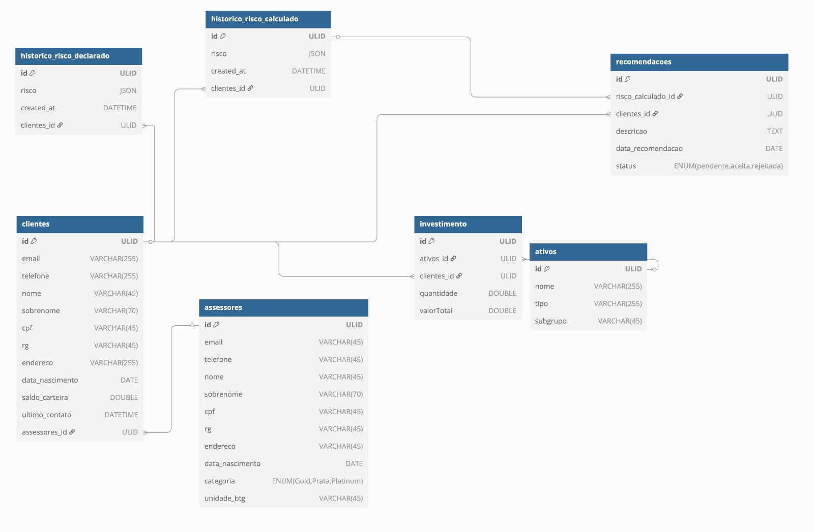
</div>

**Nota:**
O dicionário de dados completo, contendo todas as tabelas, campos, tipos, restrições e descrições detalhadas, está documentado no arquivo `readme.md` localizado na pasta `database` deste repositório.

Para consultar, acesse: [../src/database/readme.md](../src/database/readme.md)

# 5. Solução Técnica (Design)

A seguir, solução técnica desenvolvida pela equipe, incluindo: diagrama de classes, componentes e casos de uso, além de listagem das tecnologias e linguagens que serão utilizadas.

## 5.1 Diagrama de Classes

&emsp; A seguir, nosso modelo de diagrama de classes:

<div align = center>
<sub>Figura 16 - Diagrama de Classes</sub><br>
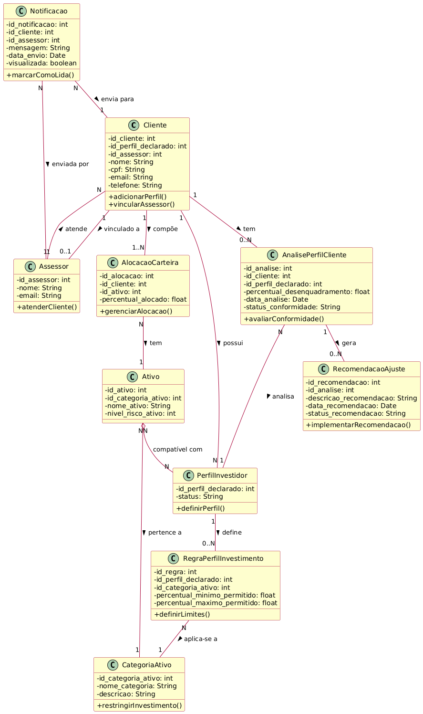
</div>

&emsp; Este modelo visa representar as entidades principais, relacionamentos, propriedades, relações e hierarquias:

### Cliente

**Atributos:**

- `id_cliente`: Identificador único.
- `id_perfil_declarado`: Perfil de investidor declarado.
- `id_assessor`: Assessor responsável.
- `nome`, `cpf`, `email`, `telefone`: Dados pessoais.

**Relacionamentos:**

- Pode receber várias **Notificações**.
- Vinculado a um único **Assessor**.
- Pode ter várias **AlocacoesCarteira**.
- Pode ter múltiplas **AnalisePerfilCliente**.

**Responsabilidades:**

- `adicionarPerfil()`
- `vincularAssessor()`

---

### Assessor

**Atributos:**

- `id_assessor`: Identificador único.
- `nome`, `email`: Dados de contato.

**Relacionamentos:**

- Pode atender vários **Clientes**.
- Está associado a várias **Notificações** que recebe.

**Responsabilidades:**

- `atenderCliente()`

---

### Notificacao

**Atributos:**

- `id_notificacao`: Identificador único.
- `id_cliente`, `id_assessor`: Referências.
- `mensagem`: Conteúdo da notificação.
- `data_envio`: Data de envio.
- `visualizada`: Indica se já foi lida.

**Responsabilidades:**

- `marcarComoLida()`

---

### AlocacaoCarteira

**Atributos:**

- `id_alocacao`: Identificador único.
- `id_cliente`, `id_ativo`: Referências.
- `percentual_alocado`: Percentual do ativo na carteira.

**Relacionamentos:**

- Relaciona **Clientes** a **Ativos**.

**Responsabilidades:**

- `gerenciarAlocacao()`

---

### Ativo

**Atributos:**

- `id_ativo`: Identificador único.
- `id_categoria_ativo`: Referência à categoria.
- `nome_ativo`, `nivel_risco_ativo`: Dados do ativo.

**Relacionamentos:**

- Pertence a uma **CategoriaAtivo**.
- Está associado a várias **AlocacaoCarteira**.

---

### CategoriaAtivo

**Atributos:**

- `id_categoria_ativo`: Identificador único.
- `nome_categoria`, `descricao`: Detalhes da categoria.

**Responsabilidades:**

- `restringirInvestimento()`

---

### PerfilInvestidor

**Atributos:**

- `id_perfil_declarado`: Identificador único.
- `status`: Situação do perfil.

**Relacionamentos:**

- Define múltiplas **RegraPerfilInvestimento**.

**Responsabilidades:**

- `definirPerfil()`

---

### RegraPerfilInvestimento

**Atributos:**

- `id_regra`: Identificador único.
- `id_perfil_declarado`, `id_categoria_ativo`: Referências.
- `percentual_minimo_permitido`, `percentual_maximo_permitido`: Limites definidos.

**Responsabilidades:**

- `definirLimites()`

---

### AnalisePerfilCliente

**Atributos:**

- `id_analise`: Identificador único.
- `id_cliente`, `id_perfil_declarado`: Referências.
- `percentual_desenquadramento`: Grau de desvio.
- `data_analise`, `status_conformidade`: Data e situação.

**Relacionamentos:**

- Está associada a um **Cliente**.
- Pode gerar várias **RecomendacaoAjuste**.

**Responsabilidades:**

- `avaliarConformidade()`

---

### 🛠 RecomendacaoAjuste

**Atributos:**

- `id_recomendacao`: Identificador único.
- `id_analise`: Referência.
- `descricao_recomendacao`, `data_recomendacao`, `status_recomendacao`: Detalhes da ação recomendada.

**Responsabilidades:**

- `implementarRecomendacao()`

## 5.2 Diagrama de Componentes da UML

&emsp; Um Diagrama de Componentes UML é essencial para a identificação dos principais módulos de uma aplicação, seus relacionamentos e suas responsabilidades dentro de uma arquitetura de software. Esse tipo de diagrama permite visualizar, de forma modular, como cada parte do sistema se comunica, garantindo organização, coesão e clareza estrutural.

&emsp; A seguir, apresenta-se o Diagrama de Componentes para o sistema de recomendação para assessores de investimento.

<div align="center">
<sub>Figura 17 - Diagrama de Componentes</sub><br>
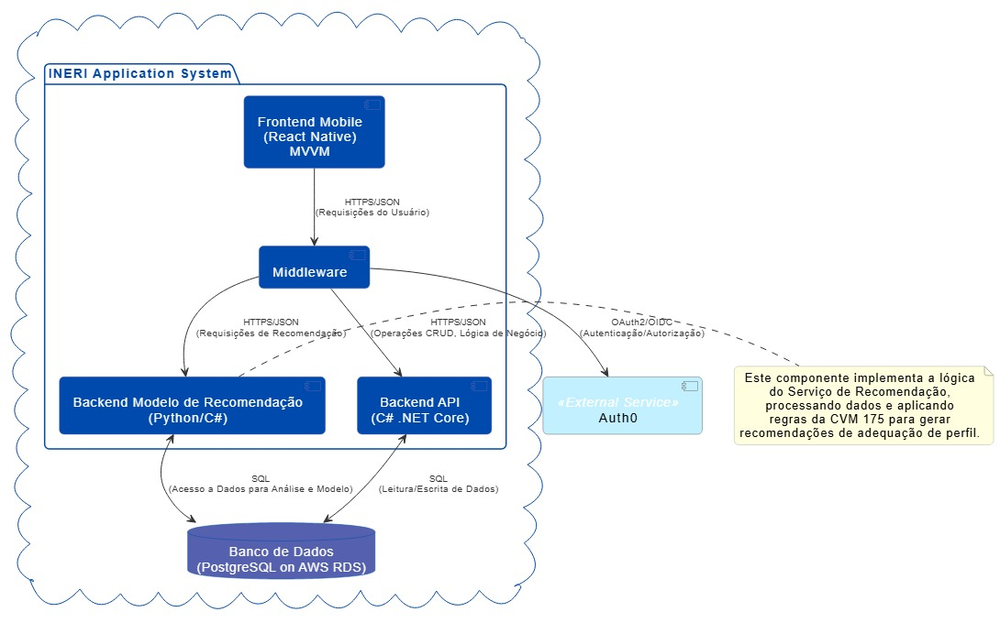<br>
<sup>Fonte: Material produzido pelos autores (2025) </sup>
</div>

| Componente                                     | Descrição                                                                                                                                                     |
| ---------------------------------------------- | ------------------------------------------------------------------------------------------------------------------------------------------------------------- |
| **INERI Application System**                   | Representa a aplicação INERI, que utiliza todos os componentes internos para fornecer as funcionalidades de verificação de adequação de perfil de investidor. |
| **Backend API (C# .NET Core)**                 | Interface que conecta a aplicação aos serviços de backend principais, responsável pela lógica de negócio geral e persistência de dados.                       |
| **Banco de Dados (PostgreSQL on AWS RDS)**     | Banco de dados onde são armazenadas informações sobre os perfis de investidor, alocações de ativos, recomendações e dados de auditoria. (AWS)                 |
| **Auth0**                                      | Serviço externo utilizado para autenticação e autorização dos usuários no sistema INERI, garantindo controle de acesso seguro.                                |
| **Backend Modelo de Recomendação (Python/C#)** | Componente responsável por aplicar as regras da CVM 175, analisar o perfil do investidor e os ativos, e gerar as recomendações de adequação.                  |

### **Divisão interna INERI Application System**

O **Frontend Mobile (React Native) MVVM** permite a interação do usuário final com a aplicação INERI, garantindo navegação e interatividade. O **Middleware** gerencia as requisições entre o frontend e os backends, garantindo autenticação via **Auth0** e comunicação com o **Backend API (C# .NET Core)** e o **Backend Modelo de Recomendação (Python/C#)**. Os **Backends** (API e Modelo de Recomendação) são responsáveis pelo processamento das requisições, acesso ao **Banco de Dados (PostgreSQL on AWS RDS)**, e aplicação das regras de negócio (incluindo CVM 175), garantindo que os dados sejam manipulados corretamente.

### **Relacionamentos Entre os Componentes**

1.  **Frontend Mobile (React Native) MVVM** → **INERI Application System (Middleware)**

    - O Frontend envia requisições do usuário para o Middleware para processamento.
      <br>

2.  **Auth0** ↔ **INERI Application System (Middleware)**
    - O Middleware interage com o Auth0 para autenticar usuários e gerenciar suas permissões.
      <br>
3.  **INERI Application System (Middleware)** → **INERI Application System (Backend API)**
    - O Middleware encaminha requisições de negócio para o Backend API.
      <br>
4.  **INERI Application System (Middleware)** → **INERI Application System (Backend Modelo de Recomendação)**
    - O Middleware encaminha requisições de análise e recomendação para o Backend Modelo de Recomendação.
      <br>
5.  **Banco de Dados (PostgreSQL on AWS RDS)** ↔ **INERI Application System (Backend API)**
    - O Backend API lê e grava informações no Banco de Dados, garantindo a persistência dos dados do sistema INERI.
      <br>
6.  **Banco de Dados (PostgreSQL on AWS RDS)** ↔ **INERI Application System (Backend Modelo de Recomendação)**
    - O Backend Modelo de Recomendação acessa o Banco de Dados para obter dados para análise e registrar resultados.

&emsp; Esse modelo modular permite fácil manutenção, reutilização de componentes e escalabilidade do sistema. A representação foi elaborada com auxílio da ferramenta PlantUML, facilitando a visualização da arquitetura da solução proposta. A seguir, diagrama de comunicação dos componentes:

<div align="center">
<sub>Figura 18 - Comunicação dos Componentes </sub><br>
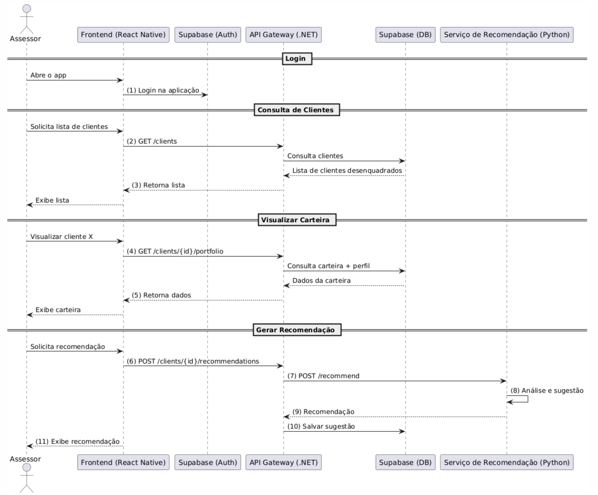<br>
<sup>Fonte: Material produzido pelos autores (2025) </sup>
</div>

## 5.3 Diagramas de Casos de Uso

&emsp; Esta seção apresenta o diagrama de casos de uso do projeto, que representa a interação do ator (usuário) com o sistema e suas funcionalidades. Elementos como `<<include>>` indicam funcionalidades obrigatórias complementares e `<<extend>>` funcionalidades opcionais, que ocorrem sob certas condições. Segue o diagrama desenvolvido.

<div align = center>
<sub>Figura 19 - Diagrama de Casos de Uso do Sistema</sub><br>
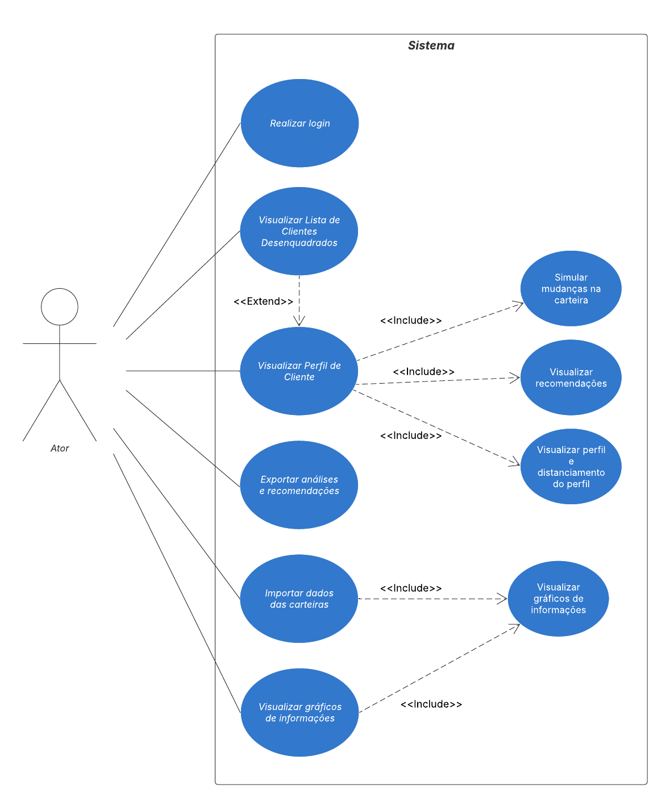
</div>

&emsp; A partir dos casos de uso mapeados, torna-se possível relacioná-los aos requisitos funcionais e às histórias de usuário previamente definidos para o sistema.

| Caso de Uso                                  | Requisito Funcional | História de Usuário                                                                                                                                                                                                      |
| -------------------------------------------- | ------------------- | ------------------------------------------------------------------------------------------------------------------------------------------------------------------------------------------------------------------------ |
| Realizar login                               | RF01                | Como assessor de investimentos sênior, quero acessar a plataforma com meu login, para otimizar meu tempo e iniciar a análise de carteiras de forma rápida e segura.                                                      |
| Visualizar Lista de Clientes Desenquadrados  | RF02, RF06, RF09    | Como assessora de investimentos, quero visualizar rapidamente apenas os clientes desenquadrados em relação ao seu perfil de investidor, para agir com agilidade e oferecer a melhor orientação possível.                 |
| Visualizar Perfil de Cliente                 | RF03                | Como assessora de investimentos, desejo acessar rapidamente o perfil completo de qualquer cliente desenquadrado para obter informações detalhadas — como nome, categoria atual, ideal e sugestões de reenquadramento.    |
| Visualizar perfil e distanciamento do perfil | RF04                | Como assessor de investimentos sênior, quero que o sistema mostre claramente a categoria atual do cliente e o quanto ele está distante dela, segundo a CVM 175, para oferecer soluções assertivas.                       |
| Visualizar recomendações                     | RF05                | Como assessora de investimentos, desejo ver recomendações que ajudem o cliente a reenquadrar sua carteira dentro do perfil ideal, sem mudar sua classificação, para garantir alinhamento com seus objetivos financeiros. |
| Exportar análises e recomendações            | RF07                | Como assessora de investimentos, quero exportar as análises e recomendações em formato CSV para poder compartilhar facilmente com minha equipe e clientes, mantendo todos os dados organizados e acessíveis.             |
| Visualizar gráficos de informações           | RF08, RF09          | Como assessor de investimentos sênior, desejo ver as informações dos meus clientes em gráficos interativos, para entender de forma rápida e visual o distanciamento ao perfil ideal e as recomendações de ativos.        |
| Simular mudanças na carteira                 | _Não especificado_  |

## 5.4 Lista de tecnologias e linguagens do projeto

&emsp; Esta seção tem como objetivo compilar as principais tecnologias e frameworks que serão utilizados no projeto, além de oferecer alternativas para cada aspecto do desenvolvimento. Todas as escolhas são justificadas com base nas especificações e restrições do projeto, além de dados do mercado.

### Linguagens e Tecnologias Selecionadas

#### Backend de APIs em C# (.NET Core)

**Justificativa:**
O C# com .NET Core é ideal para aplicações no setor financeiro, devido à sua segurança, desempenho e suporte a compliance. Ele permite a criação de APIs RESTful seguras, testáveis e facilmente escaláveis para lidar com o processamento de dados sensíveis como perfis de investidores.

**Framework:**

- ASP.NET Core Web API

**Vantagens:**

- Suporte nativo a autenticação, logging estruturado e versionamento de APIs (via Swagger)
- Facilidade de deploy com múltiplos provedores de nuvem
- Alta compatibilidade com serviços externos via HTTP, gRPC e Kafka

#### Backend do Modelo de Recomendação em C#

**Justificativa:**
Centralizar a lógica do modelo de recomendação no mesmo stack backend promove consistência, facilita a manutenção e a observação do código. A integração com modelos Python pode ser feita via APIs REST ou containers com serviços externos.

**Frameworks e Alternativas:**

- ML.NET: Para algoritmos simples de ML diretamente em C#
- API Flask/FastAPI em Python: Para modelos mais sofisticados
- Integração via REST com serviços em Docker

#### Frontend em React Native

**Justificativa:**
React Native garante portabilidade entre dispositos móveis, ideal para um MVP que será testado por usuários com diferentes dispositivos. O foco em mobilidade permite agilidade na coleta de dados e validação de hipóteses diretamente com stakeholders.

**Vantagens:**

- Base de código única para múltiplas plataformas
- Integração fluida com REST APIs
- Ecossistema maduro e atualizado

#### Padrão MVVM no Frontend

**Justificativa:**
O padrão MVVM (Model-View-ViewModel) facilita a separação entre lógica de apresentação e manipulação de dados, ideal para aplicações que trabalham com regras complexas de negócio.

**Componentes da Arquitetura**

1. **Model:** Representa as estruturas de dados da aplicação e encapsula a lógica de transformação dos dados recebidos da API. Pode incluir validações, mapeamento de campos e interfaces

2. **ViewModel:** É a camada intermediária que gera e mantém o estado da UI. Também centraliza a lógica de negócio, como:

   - Busca e atualização dos dados

   - Verificação de conformidade com regras da CVM

   - Geração de recomendações

   - Tratamento de erros e loading

3. **View:** A View é o componente React Native que renderiza os dados vindos da ViewModel. Ele observa os estados gerenciados e atualiza a interface de forma reativa.

&emsp; Exemplo de sequenciamento de componentes para arquitetura MVVM:

```plaintext
                        ┌────────────────────┐
                        │     API REST       │
                        │  (Backend C#/.NET) │
                        └────────┬───────────┘
                                 │
                                 ▼
                        ┌────────────────────┐
                        │      Model         │
                        │--------------------│
                        │ InvestorProfile.ts │
                        │ AssetAllocation.ts │
                        └────────┬───────────┘
                                 │
                                 ▼
                        ┌────────────────────┐
                        │    ViewModel       │
                        │--------------------│
                        │ fetchProfiles()    │
                        │ isLoading          │
                        │ investorProfiles[] │
                        │ nonCompliant()     │
                        └────────┬───────────┘
                                 │
                  Observa estado│
                                 ▼
                        ┌────────────────────┐
                        │       View         │
                        │--------------------│
                        │ ProfileListScreen  │
                        │ ProfileCard        │
                        └────────┬───────────┘
                                 │
                 Interação do usuário (UI Events)
                                 │
                                 ▼
                        ┌────────────────────┐
                        │    ViewModel       │
                        │(Atualiza estado)   │
                        └────────────────────┘


```

---

#### Software de Autenticação (Auth0)

**Justificativa:**
Auth0 garante conformidade com a LGPD, escalabilidade da autenticação e redução de riscos com segurança customizada. Oferece login social, SSO, MFA e integração com AD corporativo.

**Vantagens:**

- Integração rápida com React Native e ASP.NET
- Painel de gestão de usuários e políticas de acesso
- Logs de autenticação e falhas

#### Notebooks para Análise de Dados em Python

**Justificativa:**
Python é recomendado para prototipagem de modelos de recomendação e validação das regras da Resolução CVM 175. Os notebooks facilitam visualização e iteração com dados simulados.

**Bibliotecas utilizadas:**

- Pandas / NumPy – manipulação de dados
- Scikit-learn – protótipos de classificadores
- Matplotlib / Seaborn / Plotly – visualizações

#### Banco de Dados: PostgreSQL

**Justificativa:**
PostgreSQL é um banco relacional popular, com suporte a integridade transacional, triggers, views, JSONB e auditoria. É amplamente utilizado no setor financeiro.

**Vantagens:**

- Backup, replicação e segurança nativos
- Suporte a dados estruturados e semi-estruturados
- Alta compatibilidade com Entity Framework Core

#### Ferramentas de Versionamento: Git + GitHub

**Justificativa:**
Git com GitHub garante versionamento detalhado, colaboração eficiente, CI/CD e rastreabilidade das mudanças.

**Vantagens:**

- Automatização de testes e builds
- Controle de branches e code review
- Git Flow como estratégia de versionamento

#### Bibliotecas, Frameworks e APIs Adicionais

**Backend:**

- Swagger – documentação automatizada

**APIs Externas:**

- Auth0
- Gemini

&emsp; A solução integrará duas APIs externas, primeiramente, o Auth0 será utilizado como a plataforma de autenticação. A escolha do Auth0 visa garantir um processo de login seguro, gerenciando as identidades dos usuários e controlando o acesso à aplicação. Isso é fundamental para proteger dados sensíveis e assegurar a conformidade com regulamentações de privacidade, como a LGPD, fortalecendo a segurança geral do sistema.

&emsp;Adicionalmente, a API Gemini será incorporada para agregar relatórios às análises de carteiras. O Gemini será responsável por gerar automaticamente relatórios concisos sobre as carteiras de investimento sob demanda, com foco especial em explicar e sinalizar que ativos desequilíbrios ou desalinhamentos em relação aos perfis e objetivos definidos, auxiliando na gestão e monitoramento proativo dos investimentos.

**Testes:**

- xUnit / NUnit (backend)
- Jest + React Native Testing Library (frontend)
- Testcontainers

#### Conteinerização com Docker

**Justificativa:**
O uso do **Docker** permite isolar e padronizar os ambientes de desenvolvimento, teste e produção, garantindo que todos os serviços do projeto (frontend, backend, modelo de recomendação e banco de dados) rodem de forma consistente, independente do sistema operacional ou máquina do desenvolvedor.

Em um projeto que lida com dados sensíveis e normas da CVM, a conteinerização é essencial para reforçar o controle de segurança, rastreabilidade de ambientes e facilidade de deploy seguro em nuvens públicas ou privadas.

**Serviços que serão conteinerizados:**

- API em C# (.NET Core)
- Backend do modelo de recomendação (em C# ou Python)
- Banco de dados PostgreSQL
- Frontend React Native (em ambiente de build e CI/CD)
- Ambiente de notebooks Jupyter (para análise de dados e prototipação)

**Vantagens do uso de Docker:**

- **Ambiente padronizado:** Elimina problemas de "funciona na minha máquina"
- **Isolamento de dependências:** Cada componente roda em seu próprio container
- **Facilidade de orquestração:** Com Docker Compose, é possível subir todo o sistema com um único comando
- **Integração com CI/CD:** Permite pipelines automatizados e reprodutíveis (por exemplo, com GitHub Actions)
- **Segurança:** Containers são isolados e controlados, permitindo deploy em ambientes restritos conforme exigido pela LGPD

# 7. Projeto Visual da Solução

Nesta seção encontram-se os wireframes, o mockup e o guia visual da solução

## 7.1 Desenvolvimento de Wireframes

A seguir, são apresentadas imagens dos wireframes, [com link para o Figma](https://www.figma.com/design/bOUDROAilY7mE4KrWzV5Xa/ineri?node-id=324-652&t=UCc0exrrOQ07KKvf-1):

### Wireframe Tela de Início

Na Home, deve ser possível visualizar uma interface com o total de clientes, a quantidade de clientes desenquadrados e dropdowns com a quantidade de clientes que se encaixam em diferentes categorias.

<div align="center">
<sub>Figura 20 - Wireframe Tela de Início</sub><br>
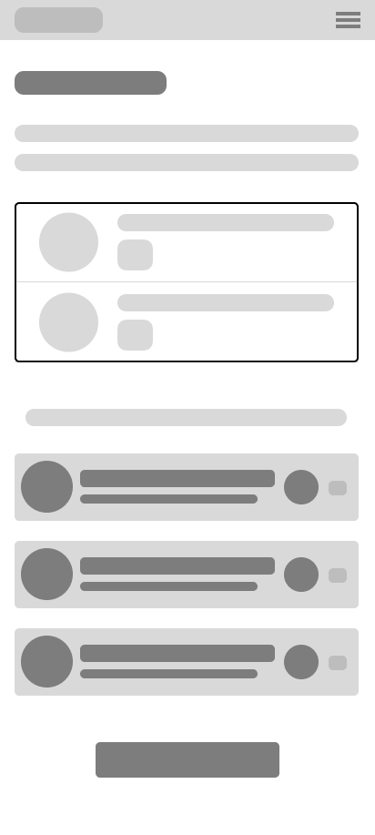<br>
<sup>Fonte: Material produzido pelos autores (2025) </sup>
</div>

### Wireframe Tela de Simulação

Na tela de Simulação, deve ser possível simular ajustes na carteira de um cliente.

<div align="center">
<sub>Figura 21 - Wireframe Tela de Simulação</sub><br>
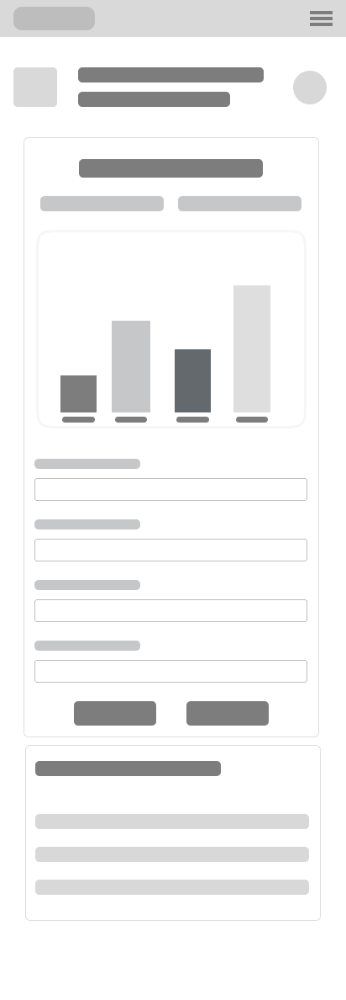<br>
<sup>Fonte: Material produzido pelos autores (2025) </sup>
</div>

### Wireframe Tela de Ajustes

Na tela de Ajustes, deve ser possível importar dados para a aplicação utilizando arquivos `.csv` ou importar carteiras.

<div align="center">
<sub>Figura 22 - Wireframe Tela de Ajustes</sub><br>
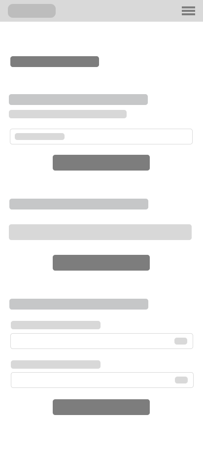<br>
<sup>Fonte: Material produzido pelos autores (2025) </sup>
</div>

## 7.2 Desenvolvimento de Mockups

A seguir, são apresentadas imagens dos mockups e componentes do projeto, [com link para o Figma](https://www.figma.com/design/bOUDROAilY7mE4KrWzV5Xa/ineri?node-id=0-1&t=UCc0exrrOQ07KKvf-1):

### Mockup Tela de Início

Na Home, deve ser possível visualizar uma interface com o total de clientes, a quantidade de clientes desenquadrados e dropdowns com a quantidade de clientes que se encaixam em diferentes categorias.

<div align="center">
<sub>Figura 23 - Mockup Tela de Início</sub><br>
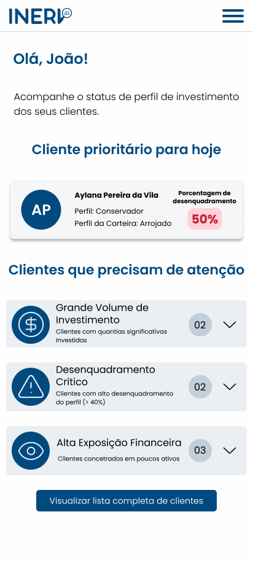<br>
<sup>Fonte: Material produzido pelos autores (2025) </sup>
</div>

### Mockup Tela de Simulação

Na tela de Simulação, deve ser possível simular ajustes na carteira de um cliente.

<div align="center">
<sub>Figura 24 - Mockup Tela de Simulação</sub><br>
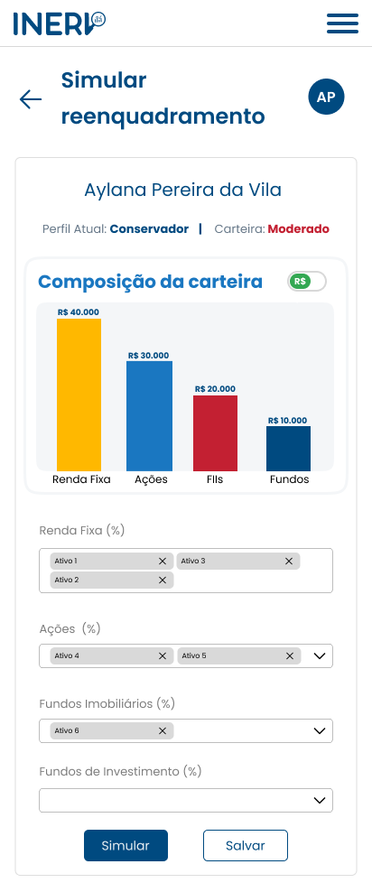<br>
<sup>Fonte: Material produzido pelos autores (2025) </sup>
</div>

### Flow Mockup Tela de Simulação

É dessa forma que a tela de Simulação apresenta o resultado da simulação para o assessor.

<div align="center">
<sub>Figura 25 - Flow Mockup Tela de Simulação</sub><br>
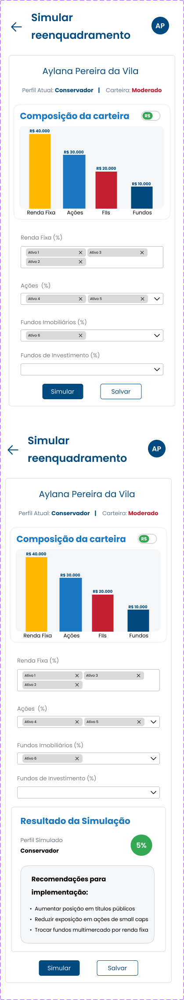<br>
<sup>Fonte: Material produzido pelos autores (2025) </sup>
</div>

### Mockup Tela de Ajustes

Na tela de Ajustes, deve ser possível importar dados para a aplicação utilizando arquivos `.csv` ou importar carteiras.

<div align="center">
<sub>Figura 26 - Mockup Tela de Ajustes</sub><br>
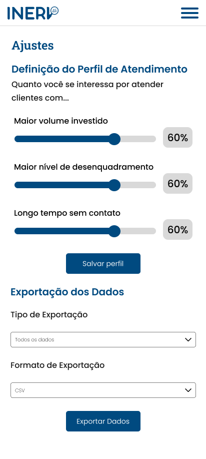<br>
<sup>Fonte: Material produzido pelos autores (2025) </sup>
</div>

### Mockup Componente DropDown Clientes

Os dropdowns devem ser clicáveis, exibindo uma lista após serem acionados. Variações do componente de dropdown para a tela de início que mostra uma lista de clientes para diferentes porcentagens de desenquadramento:

<div align="center">
<sub>Figura 27 - Mockup Componente Card Clientes</sub><br>
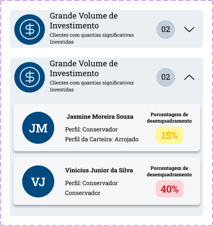<br>
<sup>Fonte: Material produzido pelos autores (2025) </sup>
</div>

## 7.3 Guia Visual

A seguir segue a descrição do guia visual do projeto com imagens de referência:

<div align="center">
<sub>Figura 28 - Guia Visual</sub><br>
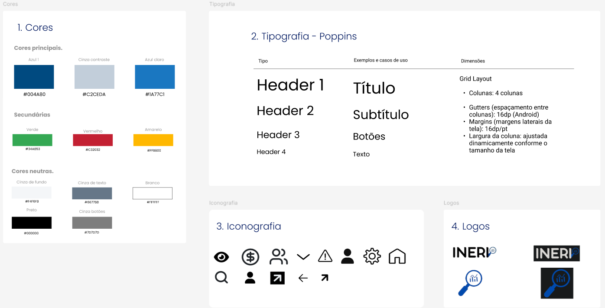<br>
<sup>Fonte: Material produzido pelos autores (2025) </sup>
</div>

### Paleta de cores

<div align="center">
  <sub>Figura 29 - Paleta de cores</sub><br>
  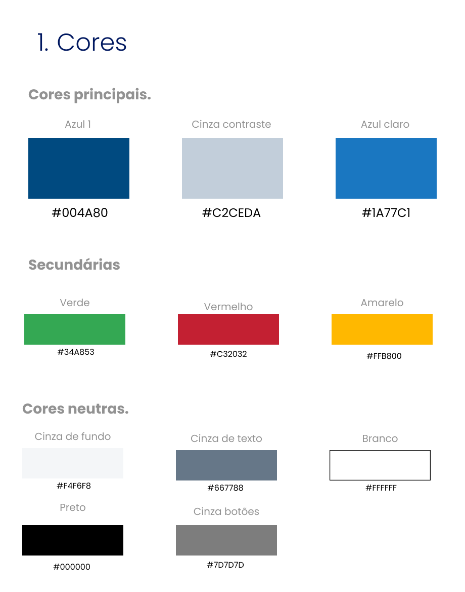<br>
  <sup>Fonte: Material produzido pelos autores (2025) </sup>
</div>

#### Cores principais

As cores principais são utilizadas para destacar elementos centrais do aplicativo e garantir consistência visual:

- **Azul 1** `#004A80`: Transmite confiança, seriedade e inovação. Ideal para cabeçalhos, logotipo e botões principais.
- **Cinza contraste** `#C2CEDA`: Ideal para ícones ou elementos que precisam de destaque sutil, sem comprometer o equilíbrio visual.
- **Azul claro** `#1A77C1`: Um tom sóbrio, ótimo para fundos e elementos secundários.

#### Cores secundárias

As cores secundárias ampliam a flexibilidade da identidade visual, sendo ideais para elementos de apoio e chamadas de atenção:

- **Verde** `#34A853`: Indica sucesso, conformidade ou permissões concedidas, sendo útil em confirmações e ações concluídas.
- **Vermelho** `#C32032`: Ideal para alertas ou chamadas urgentes, além de destacar informações críticas.
- **Amarelo** `#FFB800`: Destaca informações ou elementos que precisem de atenção, ou situações que possam escalar para estados críticos.

#### Cores neutras

Essas cores são fundamentais para a estrutura visual, servindo como base para fundos, textos e elementos de suporte:

- **Cinza de fundo** `#F4F6F8`: Ideal para fundos ou divisores sutis.
- **Cinza de texto** `#667788`: Usado para textos secundários, garantindo boa legibilidade sem alto contraste.
- **Branco** `#FFFFFF`: Cor de fundo predominante.
- **Preto** `#000000`: Aplicado para títulos, ícones e textos com necessidade de alto contraste.
- **Cinza botões** `#7D7D7D`: Utilizado em botões secundários ou estados neutros.

### Tipografia

<div align="center">
<sub>Figura 30 - Tipografia</sub><br>
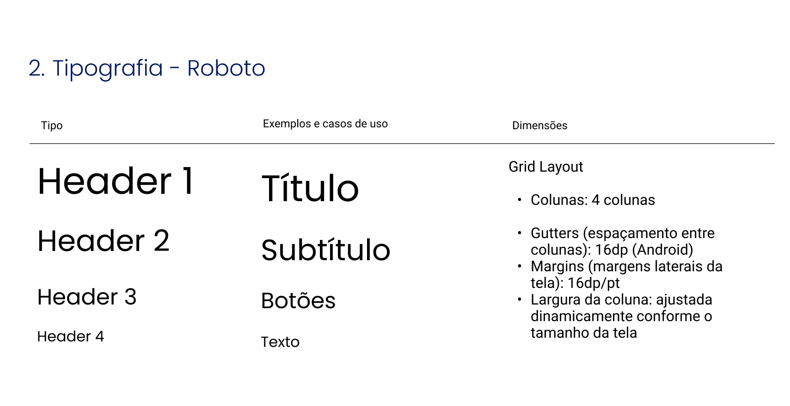<br>
<sup>Fonte: Material produzido pelos autores (2025) </sup>
</div>

#### Tipografia – Poppins

A tipografia utilizada é a fonte **Poppins**, escolhida por sua legibilidade, modernidade e compatibilidade com sistemas Android e web. A hierarquia tipográfica garante clareza na comunicação e consistência visual em todas as plataformas.

#### Hierarquia tipográfica

| Tipo         | Exemplo / Caso de uso |
| ------------ | --------------------- |
| **Header 1** | Título principal      |
| **Header 2** | Subtítulo             |
| **Header 3** | Botões                |
| **Header 4** | Texto                 |

Cada nível tipográfico possui um propósito específico, garantindo uma leitura fluida e intuitiva.

#### Dimensões e Grid Layout

Para garantir consistência visual entre os elementos tipográficos, utiliza-se uma estrutura de grid baseada nas seguintes diretrizes:

- **Colunas:** 4 colunas
- **Gutters (espaçamento entre colunas):** 16dp (Android)
- **Margins (margens laterais da tela):** 16dp/pt
- **Largura da coluna:** ajustada dinamicamente conforme o tamanho da tela

Essa abordagem responsiva assegura boa adaptação tipográfica em diferentes tamanhos de tela e dispositivos.

### Iconografia

<div align="center">
<sub>Figura 31 - Iconografia</sub><br>
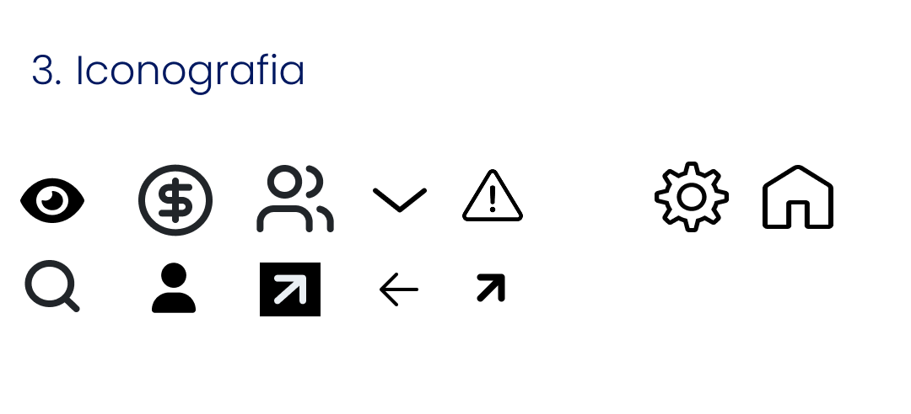<br>
<sup>Fonte: Material produzido pelos autores (2025) </sup>
</div>

A iconografia foi desenvolvida com o objetivo de reforçar a usabilidade e a comunicação visual da interface, utilizando ícones simples, objetivos e com traços bem definidos. Todos os ícones seguem o estilo flat (sem sombras ou degradês), garantindo consistência e fácil reconhecimento em diferentes tamanhos e resoluções.

#### Estilo dos ícones

- **Estilo:** Flat, preenchido e contornado
- **Cor padrão:** Preto (`#000000`) sobre fundo branco
- **Peso:** Traços médios, que equilibram leveza visual e clareza
- **Formato:** SVG ou PNG vetorial para melhor escalabilidade

#### Exemplos de ícones incluídos

- Ações: pesquisar.
- Navegação: home, voltar, acessar.
- Interface: ocultar, engrenagem, expandir, alerta.
- Usuário: perfil, grupo.

Esses ícones devem ser utilizados em botões, menus, cabeçalhos e demais elementos interativos da interface, sempre com espaçamento adequado e acompanhados de texto quando necessário para garantir acessibilidade.

### Logos

<div align="center">
<sub>Figura 32 - Logos</sub><br>
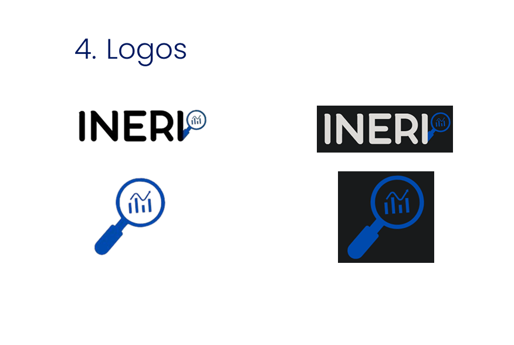<br>
<sup>Fonte: Material produzido pelos autores (2025) </sup>
</div>

As logos do INERI utilizam uma paleta de cores sóbria e moderna, composta principalmente por azul, preto, branco e cinza. A identidade visual é reforçada pelo uso da lupa com gráfico, símbolo de análise e precisão.

#### Cores Principais

- **Azul INERI**

  - `#0057B8`
  - Utilizado no ícone da lupa e nos detalhes gráficos, transmite confiança, tecnologia e seriedade.

- **Preto**

  - `#000000`
  - Usado no texto principal da logo, oferece contraste e legibilidade.

- **Branco**

  - `#FFFFFF`
  - Aplicado como fundo ou cor de destaque em versões alternativas, garantindo clareza e versatilidade.

- **Cinza Escuro**
  - `#23272A` (aproximado)
  - Presente em fundos para versões negativas da logo, proporcionando elegância e sofisticação.

#### Versões da Logo

- **Logo Principal:**
  Texto "INERI" em preto, com o ícone da lupa azul ao final, destacando o conceito de análise.

- **Logo Negativa:**
  Texto "INERI" em cinza claro sobre fundo escuro, mantendo o ícone da lupa azul para destaque.

- **Ícone:**
  Apenas a lupa azul com o gráfico, utilizada para aplicações reduzidas ou como favicon.

- **Ícone Negativo:**
  Lupa azul sobre fundo escuro, ideal para fundos coloridos ou aplicações que exigem contraste.

---

> **Recomendações de Uso:**
>
> - Mantenha sempre o espaço de respiro ao redor da logo.
> - Use a versão negativa apenas sobre fundos escuros.
> - Não altere as cores originais para preservar a identidade visual.

## 8.1 Arquitetura de Codificação e Estrutura de Diretórios

&emsp;A seguir há o diagrama de alto nivel da arquitetura do projeto, incluindo uma breve explicação de cada componente

<div align="center">
<sub>Figura 33 - Diagrama de Componentes</sub><br>
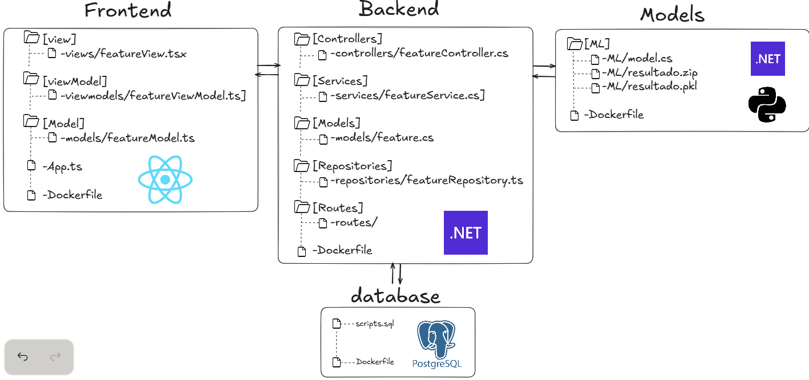<br>
<sup>Fonte: Material produzido pelos autores (2025) </sup>
</div>

### 1. Frontend (React Native com MVVM)

**📁 Pasta base:** `Frontend/`

Utiliza o padrão **MVVM (Model-View-ViewModel)** para separar responsabilidades.

#### Componentes

- **`views/featureView.tsx`**
  Representa a interface gráfica do usuário (UI).
  Interage com o ViewModel para exibir dados e responder a interações.

- **`viewmodels/featureViewModel.ts`**
  Faz a ponte entre View e Model.
  Contém a lógica de apresentação: manipula dados recebidos do backend e prepara para a View.
  Escuta eventos da View e realiza requisições (ex: via Axios ou Fetch).

- **`models/featureModel.ts`**
  Define a estrutura dos dados utilizados no frontend.
  Espelha a estrutura das respostas da API do backend.

- **`App.ts`**
  Ponto de entrada do app React Native.
  Responsável pela navegação, configuração inicial e renderização dos componentes.

- **`Dockerfile`**
  Permite containerizar o frontend para execução isolada, CI/CD e deploy.

---

### 2. 🔧 Backend (.NET)

**📁 Pasta base:** `Backend/`

Segue o padrão de **camadas tradicionais**: `Controller → Service → Repository`.

#### Componentes

- **`controllers/featureController.cs`**
  Recebe requisições HTTP (ex: `GET /features`).
  Encaminha para a camada de serviço.

- **`services/featureService.cs`**
  Camada de lógica de negócios.
  Orquestra chamadas a repositórios, regras, transformações e integração com ML.

- **`models/feature.cs`**
  Define a estrutura da entidade no domínio (ex: classe `Feature` com propriedades).

- **`repositories/featureRepository.ts`**
  Responsável pelo acesso ao banco de dados.
  Utiliza EF Core, Dapper ou SQL puro.
  Retorna dados para a camada de serviço.

- **`routes/`**
  Pode conter arquivos de rotas, middlewares ou configurações de endpoint (opcional em .NET).

- **`Dockerfile`**
  Containeriza o backend para facilitar desenvolvimento, testes e deploy.

---

### 3. 🤖 Models (Machine Learning)

**📁 Pasta base:** `Models/`

Contém os modelos de recomendação ou predição da aplicação.

#### Componentes

- **`ML/model.cs`**
  Código de integração com modelo ML.NET.
  Carrega o modelo `.zip`, executa previsões e trata os resultados.

- **`ML/resultado.zip`**
  Modelo treinado com ML.NET salvo em formato `.zip`.

- **`ML/resultado.pkl`**
  Modelo Python salvo em formato `.pkl`.
  Pode ser exposto via API Flask/FastAPI para integração.

- **`Dockerfile`**
  Containeriza o serviço de modelo (principalmente se estiver usando Python).

---

### 4. 🗄️ Database (PostgreSQL)

**📁 Pasta base:** `database/`

Responsável por armazenar os dados da aplicação.

#### Componentes

- **`scripts.sql`**
  Script de criação de tabelas, constraints e dados iniciais (seed).
  Pode ser executado automaticamente se montado em `/docker-entrypoint-initdb.d` do container.

- **`Dockerfile`**
  Não é obrigatório, mas pode ser usado para customizar a imagem PostgreSQL, instalar extensões ou configurar permissões adicionais.

---

## 8.2 Modelo de Recomendação

**Funcionamento do Modelo de Recomendação**

&emsp;O modelo de recomendação implementado no notebook `modelo_sprint2.ipynb` tem como objetivo sugerir ativos financeiros para clientes cujas carteiras de investimento atuais não estão alinhadas com seus perfis de risco declarados (Conservador, Moderado, Arrojado/Sofisticado). O processo utiliza uma abordagem de filtragem colaborativa baseada em fatoração de matriz, especificamente o algoritmo SVD (Singular Value Decomposition), fornecido pela biblioteca Python `Surprise`.

&emsp;O fluxo de trabalho do modelo inicia-se com o carregamento e preparação dos dados. São utilizados três conjuntos de dados principais: `carteiras.csv`, que contém informações sobre os ativos detidos por cada conta (cliente), incluindo o valor financeiro alocado; `ativos.csv`, que detalha os ativos; e `ativos_classificados.csv`, que categoriza os ativos segundo seu nível de risco (Renda Fixa, Renda Variável, Outros). As colunas são renomeadas para clareza e consistência.

&emsp;Após o carregamento, a próxima etapa é a identificação dos clientes "desenquadrados". O notebook explora duas abordagens para classificar os ativos e calcular as proporções na carteira: uma baseada no `Nome Ativo` e outra no `Tipo de Ativo`. A análise comparativa indicou que a classificação baseada no `Tipo de Ativo` (utilizando o mapeamento de `ativos_classificados.csv`) produziu resultados mais realistas e precisos, sendo esta a abordagem selecionada para o modelo final. O processo envolve a fusão dos dados das carteiras com a classificação de risco dos ativos. Em seguida, para cada conta, calcula-se o valor financeiro total investido e a proporção alocada em cada categoria de risco (Renda Fixa, Renda Variável, Outro). Essas proporções são então comparadas com as alocações ideais definidas para cada perfil de investidor (por exemplo, um perfil Conservador idealmente teria 90% em Renda Fixa e 10% no restante; um Moderado, 60% em Renda Fixa e 40% no restante; Arrojado/Sofisticado, 70% em Renda Variável e 30% no restante). As contas cujas alocações divergem significativamente desses ideais são marcadas como "desenquadradas".

&emsp;Com a identificação dos perfis desenquadrados, o modelo de recomendação entra em ação. Ele adota a filtragem colaborativa, tratando cada `Conta` como um "usuário" e cada `Nome Ativo` como um "item". Uma etapa fundamental é a transformação dos dados financeiros em "ratings" (avaliações) que o algoritmo SVD possa processar. Isso é feito normalizando o percentual de alocação financeira de cada ativo dentro da carteira de um cliente. Essa normalização cria uma escala numérica que representa o "interesse" ou "preferência" implícita do cliente por aquele ativo, permitindo que o SVD funcione.

&emsp;O algoritmo SVD, pertencente à categoria _model-based_ da filtragem colaborativa, não compara diretamente usuários ou itens. Em vez disso, ele decompõe a matriz esparsa de interações usuário-item (Conta-Ativo-Rating Normalizado) em matrizes de fatores latentes de menor dimensão. Essas dimensões latentes capturam características implícitas tanto dos usuários (perfis de investimento, preferências) quanto dos itens (características dos ativos, risco, popularidade). Ao treinar o modelo SVD com os dados existentes, ele aprende esses padrões latentes. Subsequentemente, o modelo pode prever a "nota" (rating normalizado previsto) que um usuário daria a um item que ele ainda não possui em sua carteira.

&emsp;O objetivo final é gerar recomendações personalizadas para os clientes desenquadrados. Para cada um desses clientes, o modelo SVD treinado prevê as notas para todos os ativos que ele não possui. Os ativos com as maiores notas previstas são selecionados como recomendações. è feita a recomendação de 5 ativos diferentes para cada cliente desenquadrado, visando auxiliar no realinhamento de sua carteira ao seu perfil de risco.

**Justificativa para o Escolha do SVD**

&emsp;A utilização do SVD (Singular Value Decomposition) neste sistema de recomendação baseia-se em sua eficácia para lidar com as particularidades da recomendação de ativos financeiros. Sendo uma técnica de fatoração de matriz _model-based_, o SVD é apropriado para trabalhar com a matriz esparsa de interações cliente-ativo, comum neste domínio onde clientes possuem apenas uma fração dos ativos disponíveis.

&emsp;O SVD decompõe essa matriz em fatores latentes, que representam características implícitas tanto dos clientes (como tolerância a risco ou preferências setoriais) quanto dos ativos (como volatilidade ou classe). Essa abordagem permite ao modelo identificar padrões que vão além das interações diretas. Para o balanceamento de carteiras, isso significa que o SVD pode recomendar ativos que se alinham ao perfil de risco desejado do cliente, mesmo que esses ativos não sejam os mais populares ou já presentes em carteiras similares. Por exemplo, ele pode identificar a necessidade de um cliente Moderado adicionar mais Renda Variável e sugerir ativos apropriados, mesmo que a maioria dos dados seja de Renda Fixa.

&emsp;Essa capacidade de focar nos fatores latentes, em vez de apenas na popularidade ou similaridade direta, ajuda a mitigar o viés de popularidade. Em um cenário com muitas carteiras concentradas em Renda Fixa, métodos mais simples poderiam tender a recomendar apenas mais Renda Fixa. O SVD, ao aprender as relações subjacentes, tem maior potencial para sugerir ativos diversificados e menos óbvios, mas que são relevantes para o objetivo de rebalanceamento da carteira do cliente específico. Adicionalmente, a redução de dimensionalidade inerente ao SVD contribui para a eficiência computacional e pode melhorar a generalização das previsões.

## 8.3 Desenvolvimento de Features

Esta seção descreve as principais funcionalidades a serem desenvolvidas ao longo do projeto, organizadas por Sprints. Cada Sprint contempla entregas incrementais que visam construir e validar partes da solução de forma iterativa.

### 8.3.1 Sprint 3

Entregas previstas:

- **Implementação da interface inicial da homepage**, com seus componentes principais para navegação. Priorizando as mudanças resquisitadas pelo parceiro, como o novo card de cliente em destaque.
- **Versão inicial da API de recomendação**, versão inicial da API de recomendação ainda em python e sem testes, apenas para definição de como serão os aspectos básicos dela.
- **Configuração e deploy do banco de dados via Docker**, com os scripts iniciais e parte das regras de negócio já inseridas no BD, assegurando um ambiente controlado e replicável para os dados da aplicação.
- **Planejamento de testes**, Planejamento dos testes de usabilidade e integração com testcontainers.
- **Testes Unitários FrontEnd Jest**, Testes unitários usando Jest cobrindo componentes de frontend da aplicação react-native.
- **RNF02:** Compatibilidade e Portabilidade Android.

#### Vídeo demonstrativo das features desenvolvidas durante a sprint 3

&emsp;O vídeo a seguir explora as funcionalidades do aplicativo e a navegação entre as telas, que compõem a entrega da Sprint 3.
**\*Disclaimer:** A tela incial padrão que é aberta assim que o app é iniciado é a tela de Login.

[Assista ao vídeo](https://youtu.be/I1M35AmgyF8)

---

### 8.3.2 Sprint 4

Entregas previstas:

- **RF02:** Exibir, na tela principal, apenas os usuários que se encontram desenquadrados do perfil de investidor previamente definido.
- **RF03:** Permitir o acesso ao perfil individual de qualquer usuário da lista para visualização detalhada de informações.
- **RF04:** Exibir a categoria de investidor em que o usuário se enquadra e o quanto ele se distancia dela, com base na análise da carteira.
- **RF09:** Apresentar estatísticas na tela principal sobre os usuários desenquadrados, incluindo média de distanciamento em relação ao perfil ideal e número total de usuários nessa situação. **(Removido a pedido do Parceiro)**

**Pontos Importantes:**

- Não realizamos testes de APIs externas, já que a integração delas ocorrerá na próxima sprint.
- Testes de RNFs não serão realizados essa Sprint, pois o principal RNF a ser testado será entregue na Sprint seguinte

#### Vídeo demonstrativo das features desenvolvidas durante a sprint 4

&emsp;O vídeo a seguir mostra a aplicação dockerizada rodando no servidor do inteli, e a integração entre back, front e BD realizado na sprint 4
**\*Disclaimer:** O vídeo inicia demonstrando a execução da aplicação dockerizada no servidor do Inteli. No entanto, como a próxima sprint prevê a integração com o Auth0, todas as comunicações precisarão ocorrer via HTTPS. Isso gera problemas relacionados a CORS ao tentar acessar dados do backend, pois ele já está configurado para aceitar apenas conexões seguras. Por esse motivo, embora a aplicação dockerizada seja a mesma, optamos por executar e demonstrar a aplicação localmente (localhost) durante o vídeo, de modo a contornar as restrições de HTTPS e evitar conflitos de CORS no ambiente atual.

[(Assista ao vídeo)](https://youtu.be/k9Cy1_7dbSo)

**Entregas Realizadas Sprint 4:**

- RFs prometidos;
- Dockerização completa de todos os pontos da apliacação, Front, Back e API;
- Novo modelo de recomendação;
- Nova API de recomendação usando Parquet e DuckDB;
- Integração Parcial do FrontEnd com Back;
- Testes de usabilidade SUS;
- Swagger para todos os EndPoints;
- Testes de carga do Banco e Explain Analyze;
- Banco no Servidor do Inteli e Backup em Render.

### 8.3.3 Sprint 5

Entregas previstas:

- **RF06:** Sugerir um cliente prioritário para atendimento pelo assessor, conforme as preferências configuradas (perfil de atendimento).
- **RF07:** Permitir a exportação das análises e recomendações geradas pelo sistema no formato CSV.
- **RF08:** Disponibilizar visualizações gráficas com informações dos usuários, facilitando a interpretação dos dados.
- **RNF01:** - Segurança da Informação.


#### Vídeo demonstrativo das features desenvolvidas durante a sprint 5

&emsp;O vídeo a seguir mostra a aplicação rodando, a integração da IA Gemini e login e autenticação com Clerk.

[(Assista ao vídeo)](https://youtu.be/Wx8LezTCkdo)

**Entregas Realizadas Sprint 5:**

- RFs prometidos;
- Autenticação com Clerk;
- Relatórios com Gemini;
- Integração Completa do FrontEnd com Back;
- Swagger para todos os EndPoints;


## 8.3.4 Desenvolvimento de Features — Controle de Entregas

| Sprint       | Entrega                                                  | Status |
| :----------- | :------------------------------------------------------- | :----- |
| **Sprint 3** | Front da homepage e componentes principais               | \[ ✔️ ]  |
|              | Versão inicial da API de recomendação                    | \[ ✔️ ]  |
|              | Banco de dados em Docker e deployado                     | \[ ✔️ ]  |
|              | RNF02 – Compatibilidade e Portabilidade Android.         | \[ ✔️ ]  |
|              | Testes Unitários FrontEnd Jest                           | \[ ✔️ ]  |
| **Sprint 4** | RF01 – Login com email e senha                           | \[ ✔️ ]  |
|              | RF02 – Exibir usuários desenquadrados na tela principal  | \[ ✔️ ]  |
|              | RF03 – Acessar perfil individual de usuário              | \[ ✔️ ]  |
|              | RF04 – Informar categoria e distanciamento do usuário    | \[ ✔️ ]  |
|              | RF09 – Exibir estatísticas dos usuários desenquadrados   | \[ ✔️ ]  |
| **Sprint 5** | RF06 – Sugerir cliente prioritário para atendimento      | \[ ✔️ ]  |
|              | RF07 – Exportar análises e recomendações em CSV          | \[ ✔️ ]  |
|              | RF08 – Visualização gráfica das informações dos usuários | \[ ✔️ ]  |
|              | RNF01 – Segurança da Informação.                         | \[ ✔️ ]  |

## 8.4 Testes Unitários e de Integração

&emsp;Esta seção apresenta um planejamento de testes de integração para o INERI. O objetivo principal deste plano é verificar se todos os componentes do sistema funcionam corretamente quando integrados, garantindo a
confiabilidade da aplicação como um todo.

&emsp;Os testes de integração são usados para identificar problemas que podem não ser detectados em testes unitários, como falhas na comunicação entre componentes, incompatibilidades de interface, problemas de configuração e questões de desempenho em um ambiente integrado.

---

### 8.4.1 Testes de Integração

### Estratégia Utilizada

A estratégia de testes de integração para o Sistema INERI seguirá uma abordagem bottom-up, testando primeiro as integrações de componentes de nível inferior (como Backend API e Banco de Dados) e progredindo para integrações de nível superior (como Frontend e Middleware). Esta abordagem permite identificar problemas fundamentais de integração antes de testar fluxos completos de ponta a ponta.

Adicionalmente, serão implementados testes de integração específicos para fluxos críticos de negócio, como o processo de recomendação de investimentos, desde a entrada de dados do usuário até a geração de recomendações baseadas nas regras da CVM 175.

### Níveis de Testes de Integração

Os testes de integração serão organizados em três níveis:

1.  **Integração de Componentes**: Testes que verificam a integração entre dois componentes adjacentes (ex: Backend API e Banco de Dados).
2.  **Integração de Subsistemas**: Testes que verificam a integração entre grupos de componentes que formam subsistemas funcionais (ex: Backend API, Middleware e Backend Modelo de Recomendação).
3.  **Integração de Sistema**: Testes que verificam fluxos completos de ponta a ponta, envolvendo todos os componentes do sistema.

### Ferramentas e Tecnologias

Para a execução dos testes de integração, serão utilizadas as seguintes ferramentas:

| Ferramenta     | Propósito                                                       |
| -------------- | --------------------------------------------------------------- |
| TestContainers | Criação e gerenciamento de containers isolados para testes      |
| xUnit          | Framework de testes para .NET                                   |
| WireMock       | Simulação de serviços externos (Auth0)                          |
| Memcached      | Implementação do módulo de caching (VHS)                        |
| Postman/Newman | Testes de API automatizados                                     |
| Docker Compose | Orquestração de múltiplos containers para testes de subsistemas |

### Implementação para Backend API e PostgreSQL

#### Descrição

A integração entre o Backend API e o banco de dados PostgreSQL é fundamental para o funcionamento do sistema. Os testes desta integração validam a persistência e recuperação de dados, garantindo que as operações CRUD funcionem corretamente.

#### Configuração do Ambiente de Teste

##### Pré-condições

- SDK .NET Core instalado
- Docker instalado e em execução
- Acesso à imagem PostgreSQL no Docker Hub
- Projeto configurado com Entity Framework Core

##### Instruções de Execução

1.  Executar `dotnet test` no diretório do projeto de testes
2.  TestContainers gerenciará automaticamente o ciclo de vida dos containers

```
// Classe: PostgreSqlFixture (Implementa IAsyncLifetime para gerenciamento do ciclo de vida)
// Propósito: Gerenciar um container Docker com PostgreSQL para testes de integração.

// Campos privados:
//   _postgreSqlContainer: Instância do container Testcontainers para PostgreSQL.

// Propriedades públicas:
//   ConnectionString: String de conexão para o banco de dados no container (obtida após inicialização).
//   DbContext: Instância do InvestorDbContext configurada para usar o banco de teste.

// Construtor (PostgreSqlFixture):
//   Configura o builder do Testcontainers:
//     - Define a imagem Docker: "postgres:13".
//     - Define variáveis de ambiente para o container:
//       - POSTGRES_USER: "test_user"
//       - POSTGRES_PASSWORD: "test_password"
//       - POSTGRES_DB: "ineri_test"
//     - Mapeia a porta interna 5432 do container para uma porta pública aleatória no host.
//   Constrói o objeto _postgreSqlContainer.

// Método assíncrono InitializeAsync (Parte do IAsyncLifetime):
//   Executado antes dos testes da classe que usa esta fixture.
//   1. Inicia o container PostgreSQL: `await _postgreSqlContainer.StartAsync()`.
//   2. Monta a ConnectionString:
//      - Obtém o Hostname do container.
//      - Obtém a porta pública mapeada para a porta 5432.
//      - Formata a string com Host, Porta, Nome do Banco, Usuário e Senha definidos no construtor.
//   3. Configura o DbContext:
//      - Cria um DbContextOptionsBuilder para InvestorDbContext.
//      - Configura o builder para usar Npgsql (provedor PostgreSQL) com a ConnectionString obtida.
//      - Instancia o InvestorDbContext passando as opções configuradas.
//   4. Aplica as migrações do Entity Framework:
//      - `await DbContext.Database.MigrateAsync()` para criar/atualizar o schema no banco de teste.

// Método assíncrono DisposeAsync (Parte do IAsyncLifetime):
//   Executado após todos os testes da classe que usa esta fixture.
//   1. Libera os recursos do DbContext: `await DbContext.DisposeAsync()`.
//   2. Para o container PostgreSQL: `await _postgreSqlContainer.StopAsync()`.
```

### Cenários de Teste
=======
#### Estrutura dos testes


##### Classes Principais

- **PostgreSqlFixture**: Gerencia o container PostgreSQL e configuração do DbContext
- **IntegrationTestBase**: Classe base para testes de integração
- **InfrastructureTests**: Testes de validação da infraestrutura
- **PerformanceTests**: Testes de performance do banco

##### Arquivos de Configuração

- **appsettings.Test.json**: Configurações específicas para testes
- **TestDbContextFactory**: Factory para criação do DbContext em testes


#### Funcionamento dos testes

##### 1. Inicialização (PostgreSqlFixture)

- Container PostgreSQL é iniciado automaticamente
- String de conexão dinâmica é gerada
- Migrações são aplicadas automaticamente
- DbContext é configurado e registrado

##### 2. Execução dos Testes

- Cada teste limpa o banco antes da execução
- Operações são executadas em escopo isolado
- Transações são gerenciadas automaticamente

##### 3. Limpeza

- Container é destruído após todos os testes
- Recursos são liberados automaticamente

#### Teste básico de integração

```
[Fact]
public async Task Should_PerformOperation_Successfully()
{
    // Arrange
    var entity = new YourEntity { Name = "Test" };

    // Act
    var result = await ExecuteInScopeAsync(async serviceProvider =>
    {
        var context = serviceProvider.GetRequiredService<YourDbContext>();
        context.YourEntities.Add(entity);
        await context.SaveChangesAsync();
        return entity.Id;
    });

    // Assert
    Assert.True(result > 0);
}
```

#### Teste com dados de setup

```
[Fact]
public async Task Should_QueryData_WithSetup()
{
    // Arrange - Seed data
    await ExecuteInScopeAsync(async serviceProvider =>
    {
        var context = serviceProvider.GetRequiredService<YourDbContext>();
        await context.SeedTestDataAsync();
    });

    // Act & Assert
    var count = await ExecuteInScopeAsync(async serviceProvider =>
    {
        var context = serviceProvider.GetRequiredService<YourDbContext>();
        return await context.YourEntities.CountAsync();
    });

    Assert.True(count > 0);
}
```

#### Logs e Debugging

##### Logs do container

&emsp;Os logs do container PostgreSQL são automaticamente exibidos no console durante a execução dos testes.

##### Logs do Entity Framework

&emsp;Configure o nível de log no appsettings.Test.json:
```
{
  "Logging": {
    "LogLevel": {
      "Microsoft.EntityFrameworkCore": "Information"
    }
  }
}
```

##### String de conexão
&emsp;A string de conexão é exibida no console durante a inicialização:

```
PostgreSQL container iniciado: Host=localhost;Port=32768;Database=testdb;Username=testuser;Password=testpass
```

#### Métricas Esperadas

- Inicialização do container: < 30 segundos
- Aplicação de migrações: < 10 segundos
- Limpeza entre testes: < 1 segundo
- Bulk insert (1000 registros): < 5 segundos

#### Otimizações Implementadas

- Container reutilizado entre testes da mesma classe
- TRUNCATE CASCADE para limpeza rápida
- Conexões pooled do Entity Framework
- Logs otimizados para ambiente de teste

#### Cenários de Teste


**1. T.DB.01 - Criação e Recuperação de Perfil (Positivo)**

- Pseudocódigo:

```
[Fact]
public async Task CreateAndRetrieveProfile_WorksCorrectly()
{
    // Arrange: Criar perfil válido
    // Act: Salvar e recuperar perfil
    // Assert: Verificar dados persistidos
}
```

- Teste implementado:

```csharp
[Fact]
public async Task CreateAndRetrieveProfile_WorksCorrectly()
{
  var clientId = 1;
  var expectedProfile = "Moderado";
  var client = CreateTestClient(clientId, "João Silva", "joao.silva@email.com", "12345678901", 35);

  client.HistoricosRiscoDeclarado.Add(new DeclaredRiskHistory
  {
    Id = 1,
    ClienteId = clientId,
    RiscoDeclarado = 5,
    DataDeclaracao = DateTime.Now.AddDays(-1)
  });

  _mockClientRepository
    .Setup(x => x.GetWithRiskHistoryAsync(clientId))
    .ReturnsAsync(client);

  var result = await _service.GetInvestorProfileAsync(clientId);

  Assert.NotNull(result);
  Assert.Equal(expectedProfile, result);
  _mockClientRepository.Verify(x => x.GetWithRiskHistoryAsync(clientId), Times.Once);
}
```

**2. T.DB.02 - E-mail Duplicado (Negativo)**
 
- Pseudocódigo:

```
[Fact]
public async Task CreateProfile_WithDuplicateEmail_ThrowsException()
{
    // Arrange: Criar perfil existente
    // Act: Tentar criar perfil com mesmo e-mail
    // Assert: Verificar exceção DbUpdateException
}
```

- Código implementado:

```csharp
[Fact]
public async Task CreateProfile_WithDuplicateEmail_ThrowsException()
{
  var existingClient = CreateTestClient(1, "Cliente Existente", "cliente@teste.com", "12345678901", 30);
  var duplicateClient = CreateTestClient(2, "Cliente Duplicado", "cliente@teste.com", "98765432109", 25);

  _mockClientRepository
    .Setup(x => x.GetByEmailAsync("cliente@teste.com"))
    .ReturnsAsync(existingClient);

  _mockClientRepository
    .Setup(x => x.AddAsync(It.IsAny<Client>()))
    .ThrowsAsync(new DbUpdateException("Email já cadastrado."));

  var exception = await Assert.ThrowsAsync<DbUpdateException>(
    async () => await _service.CreateProfile(duplicateClient)
  );

  Assert.Contains("email", exception.Message.ToLower());
  _mockClientRepository.Verify(x => x.AddAsync(It.IsAny<Client>()), Times.Once);
}
```

**3. T.DB.03 - Atualização de Perfil (Positivo)**

- Pseudocódigo

```
[Fact]
public async Task UpdateProfile_WithValidData_UpdatesCorrectly()
{
    // Arrange: Criar e salvar perfil
    // Act: Modificar e atualizar perfil
    // Assert: Verificar alterações persistidas
}

```

- Código implementado:

```csharp
[Fact]
    public async Task UpdateProfile_WithValidData_UpdatesCorrectly()    UpdateProfile_WithValidData_UpdatesCorrectly()
    {
        var clientId = 4;
        var initialProfile = "Conservador";
        var updatedProfile = "Moderado";        
        var updatedProfile = "Moderado";
        var client = CreateTestClient(clientId, "Carlos Lima", "carlos.lima@email.com", "12345678903", 45);

        client.HistoricosRiscoDeclarado.Add(new DeclaredRiskHistory
        {
            Id = 1,
            ClienteId = clientId,
            RiscoDeclarado = 2,
            DataDeclaracao = DateTime.Now.AddDays(-10)
        });

        client.HistoricosRiscoDeclarado.Add(new DeclaredRiskHistory
        {
            Id = 2,
            ClienteId = clientId,
            RiscoDeclarado = 5,
            DataDeclaracao = DateTime.Now.AddDays(-1)
        });

        _mockClientRepository
            .Setup(x => x.GetWithRiskHistoryAsync(clientId))
            .ReturnsAsync(client);

        var result = await _service.GetInvestorProfileAsync(clientId);

        Assert.NotEqual(initialProfile, result);
        Assert.Equal(updatedProfile, result);        
        Assert.Equal(updatedProfile, result);
        _mockClientRepository.Verify(x => x.GetWithRiskHistoryAsync(clientId), Times.Once);
    }
```

**4. T.DB.04 - Atualização Inválida (Negativo)**

- Pseudocódigo
```
[Fact]
public async Task UpdateProfile_WithInvalidData_ThrowsException()
{
    // Arrange: Criar perfil válido
    // Act: Tentar atualizar com dados inválidos
    // Assert: Verificar exceção ValidationException
}
```

- Código implementado

```csharp

[Fact]
    public async Task UpdateProfile_WithInvalidName_ThrowsException()     UpdateProfile_WithInvalidName_ThrowsException()
    {
        var client = CreateTestClient(1, "", "valido@email.com", "12345678901", 30);

        var exception = await Assert.ThrowsAsync<ValidationException>(
            async () => await _service.UpdateProfile(client)            
            async () => await _service.UpdateProfile(client)
        );

        Assert.Contains("Nome", exception.Message);
        _mockClientRepository.Verify(x => x.UpdateAsync(It.IsAny<Client>()), TimesNever);        _mockClientRepository.Verify(x => x.UpdateAsync(It.IsAny<Client>()), Times.Never);
    }

    [Fact]
    public async Task UpdateProfile_WithInvalidEmail_ThrowsException()     UpdateProfile_WithInvalidEmail_ThrowsException()
    {
        var client = CreateTestClient(1, "Nome Válido", "", "12345678901", 30);

        var exception = await Assert.ThrowsAsync<ValidationException>(
            async () => await _service.UpdateProfile(client)            
            async () => await _service.UpdateProfile(client)
        );

        Assert.Contains("Email", exception.Message);
        _mockClientRepository.Verify(x => x.UpdateAsync(It.IsAny<Client>()), TimesNever);        _mockClientRepository.Verify(x => x.UpdateAsync(It.IsAny<Client>()), Times.Never);
    }

    [Fact]
    public async Task UpdateProfile_WithInvalidCpf_ThrowsException()    UpdateProfile_WithInvalidCpf_ThrowsException()
    {
        var client = CreateTestClient(1, "Nome Válido", "valido@email.com", "", 30);

        var exception = await Assert.ThrowsAsync<ValidationException>(
            async () => await _service.UpdateProfile(client)            
            async () => await _service.UpdateProfile(client)
        );

        Assert.Contains("CPF", exception.Message);
        _mockClientRepository.Verify(x => x.UpdateAsync(It.IsAny<Client>()), TimesNever);        _mockClientRepository.Verify(x => x.UpdateAsync(It.IsAny<Client>()), Times.Never);
    } 

```

#### Logs obtidos:

```powershell
[xUnit.net 00:00:00.00] xUnit.net VSTest Adapter v2.8.2+699d445a1a (64-bit .NET 9.0.5)
[xUnit.net 00:00:00.11]   Discovering: INERI.Backend
[xUnit.net 00:00:00.19]   Discovered:  INERI.Backend
[xUnit.net 00:00:00.20]   Starting:    INERI.Backend
     Warning:
     The component "Fluent Assertions" is governed by the rules defined in the Xceed License Agreement and
     the Xceed Fluent Assertions Community License. You may use Fluent Assertions free of charge for
     non-commercial use only. An active subscription is required to use Fluent Assertions for commercial use.
     Please contact Xceed Sales mailto:sales@xceed.com to acquire a subscription at a very low cost.
     A paid commercial license supports the development and continued increasing support of
     Fluent Assertions users under both commercial and community licenses. Help us
     keep Fluent Assertions at the forefront of unit testing.
     For more information, visit https://xceed.com/products/unit-testing/fluent-assertions/
>>> GetPriorityClientsAsync chamado para advisorId: 1
>>> GetPriorityClientsAsync chamado para advisorId: 1
>>> GetPriorityClientsAsync chamado para advisorId: 1
>>> CalculatePriorityClientsAsync chamado para advisorId: 1
Pesos: Volume=0,33, Desenq=0,33, Tempo=0,34
Cliente 1 - Client A: mismatch=10, patrimonio=0, tempo=0, score=3,30
Cliente 2 - Client B: mismatch=10, patrimonio=0, tempo=0, score=3,30
>>> GetClientClassificationSummaryAsync chamado para advisorId: 1
>>> GetPriorityClientsAsync chamado para advisorId: 1
>>> CalculatePriorityClientsAsync chamado para advisorId: 1
Pesos: Volume=0,33, Desenq=0,33, Tempo=0,34
Cliente 1 - Client A: mismatch=10, patrimonio=0, tempo=0, score=3,30
Cliente 2 - Client B: mismatch=10, patrimonio=0, tempo=0, score=3,30
>>> GetPriorityClientsAsync chamado para advisorId: 1
>>> CalculatePriorityClientsAsync chamado para advisorId: 1
Pesos: Volume=0,33, Desenq=0,33, Tempo=0,34
Cliente 1 - Client A: mismatch=10, patrimonio=0, tempo=0, score=3,30
>>> GetPriorityClientsAsync chamado para advisorId: 1
>>> CalculatePriorityClientsAsync chamado para advisorId: 1
Pesos: Volume=0,33, Desenq=0,33, Tempo=0,34
>>> GetPriorityClientsAsync chamado para advisorId: 1
>>> CalculatePriorityClientsAsync chamado para advisorId: 1
>>> GetPriorityClientsAsync chamado para advisorId: 1
>>> GetPriorityClientsAsync chamado para advisorId: 1
>>> CalculatePriorityClientsAsync chamado para advisorId: 1
Pesos: Volume=0,33, Desenq=0,33, Tempo=0,34
Cliente 1 - Client A: mismatch=10, patrimonio=0, tempo=0, score=3,30
Cliente 2 - Client B: mismatch=10, patrimonio=0, tempo=0, score=3,30
>>> GetClientClassificationSummaryAsync chamado para advisorId: 1
Pesos: Volume=0,33, Desenq=0,33, Tempo=0,34
Cliente 1 - Client A: mismatch=50,0, patrimonio=155,00, tempo=103,3333342565900, score=102,7833336463443600       
[xUnit.net 00:00:00.46]   Finished:    INERI.Backend
  INERI.Backend teste êxito (2,1s)

Resumo do teste: total: 25; falhou: 0; bem-sucedido: 25; ignorado: 0; duração: 2,1s
Construir êxito(s) com 8 aviso(s) em 12,7s
Cliente 1 - Client A: mismatch=10, patrimonio=0, tempo=0, score=3,30
Cliente 2 - Client B: mismatch=10, patrimonio=0, tempo=0, score=3,30
>>> GetClientClassificationSummaryAsync chamado para advisorId: 1
Pesos: Volume=0,33, Desenq=0,33, Tempo=0,34
Cliente 1 - Client A: mismatch=50,0, patrimonio=155,00, tempo=103,3333342565900, score=102,7833336463443600       
[xUnit.net 00:00:00.46]   Finished:    INERI.Backend
  INERI.Backend teste êxito (2,1s)

Resumo do teste: total: 25; falhou: 0; bem-sucedido: 25; ignorado: 0; duração: 2,1s
Construir êxito(s) com 8 aviso(s) em 12,7s
[xUnit.net 00:00:00.46]   Finished:    INERI.Backend
  INERI.Backend teste êxito (2,1s)

Resumo do teste: total: 25; falhou: 0; bem-sucedido: 25; ignorado: 0; duração: 2,1s
```


### Testes de API Web ASP.NET Core

#### Descrição

Os testes de API validam os endpoints RESTful expostos pelo Backend API, garantindo que eles processem corretamente as requisições, apliquem regras de negócio e retornem respostas apropriadas.

#### Configuração do Ambiente de Teste

##### Pré-condições

- SDK .NET Core instalado
- Docker instalado e em execução
- Projeto ASP.NET Core configurado

##### Instruções de Execução

1.  Executar `dotnet test` no diretório do projeto de testes de API
2.  TestContainers e TestServer gerenciarão o ambiente de teste

```
// Classe: ApiTestFixture (Implementa IAsyncLifetime)
// Propósito: Configurar um ambiente de teste completo para a API ASP.NET Core, incluindo banco de dados e servidor web em memória.

// Campos privados:
//   _server: Instância do TestServer (servidor web em memória).
//   _dbFixture: Instância da PostgreSqlFixture (gerencia o banco de dados de teste).

// Propriedades públicas:
//   Client: Instância do HttpClient configurada para fazer requisições ao _server.

// Construtor (ApiTestFixture):
//   1. Instancia a `_dbFixture = new PostgreSqlFixture()`.
//   2. Configura um `WebHostBuilder` para criar o `TestServer`:
//      - Define o ambiente de execução como "Testing" (`UseEnvironment("Testing")`).
//      - Configura a aplicação (`ConfigureAppConfiguration`):
//        - Adiciona configurações em memória (`AddInMemoryCollection`) para sobrescrever valores do appsettings.json:
//          - "ConnectionStrings:DefaultConnection": Usa a `_dbFixture.ConnectionString` (será definida no InitializeAsync).
//          - "Auth:Issuer", "Auth:Audience": Define valores de teste para autenticação.
//      - Especifica a classe de Startup a ser usada para os testes (`UseStartup<TestStartup>`). `TestStartup` pode conter configurações específicas para o ambiente de teste (ex: mocks).
//   3. Cria a instância do `_server = new TestServer(builder)`.
//   4. Cria o `Client = _server.CreateClient()` para interagir com a API em memória.

// Método assíncrono InitializeAsync:
//   1. Inicializa o banco de dados de teste: `await _dbFixture.InitializeAsync()`.
//   2. Configura a autenticação para o `Client`:
//      - Gera um token JWT de teste usando uma função auxiliar `GenerateTestToken()`.
//      - Define o cabeçalho `Authorization` padrão do `Client` como "Bearer [token_gerado]".

// Método assíncrono DisposeAsync:
//   1. Libera os recursos do `Client`: `Client.Dispose()`.
//   2. Libera os recursos do `_server`: `_server.Dispose()`.
//   3. Libera os recursos do banco de dados: `await _dbFixture.DisposeAsync()`.

// Método privado GenerateTestToken:
//   - Contém a lógica para criar e retornar uma string de token JWT válida para ser usada nos testes (pode usar dados de usuário fixos, claims de teste, etc.).
```

#### Cenários de Teste

##### 1. Criação de Perfil via API (Cenário Positivo)

**Pré-condições:**

- API em execução (via TestServer na Fixture)
- Banco de dados acessível (via PostgreSqlFixture)
- Cliente autenticado com permissões adequadas (via token no HttpClient da Fixture)

**Passos:**

1.  Preparar payload JSON com dados válidos de perfil
2.  Enviar requisição POST para endpoint de criação
3.  Verificar código de status e resposta

**Pós-condições:**

- Resposta com código 201 (Created)
- Perfil criado no banco de dados
- Resposta contém ID do perfil criado e URI para acesso (Location header)

**Implementação:**

```
// Método de Teste: CreateProfile_WithValidData_ReturnsCreatedProfile (Decorado com [Fact])
// Depende da ApiTestFixture injetada.

// Arrange (Preparação):
//   1. Cria uma instância do objeto de requisição `CreateProfileRequest`.
//   2. Preenche as propriedades do objeto com dados válidos (Name, Email, RiskProfile, etc.).

// Act (Ação):
//   1. Usa o `_client` (HttpClient da ApiTestFixture) para enviar uma requisição POST.
//   2. Chama `_client.PostAsJsonAsync("/api/investor/profile", newProfile)`.
//      - O primeiro argumento é a rota da API.
//      - O segundo argumento é o objeto de requisição, que será serializado para JSON.
//   3. Armazena a resposta HTTP em `response`.

// Assert (Verificação):
//   1. Garante que a requisição foi bem-sucedida (status 2xx): `response.EnsureSuccessStatusCode()`.
//   2. Verifica se o código de status específico é 201 Created: `Assert.Equal(HttpStatusCode.Created, response.StatusCode)`.
//   3. Desserializa o corpo da resposta JSON para um objeto `ProfileCreationResponse`: `await response.Content.ReadFromJsonAsync<ProfileCreationResponse>()`.
//   4. Verifica se o objeto `result` não é nulo (`Assert.NotNull`).
//   5. Verifica se a propriedade `Id` do `result` não está vazia (`Assert.NotEmpty`).
//   6. Verifica se o cabeçalho `Location` na resposta não é nulo (`Assert.NotNull(response.Headers.Location)`).
//   7. Verifica se o valor do cabeçalho `Location` contém a URL esperada para o novo recurso (ex: `/api/investor/profile/{result.Id}`).

// Assert (Verificação Adicional - Opcional):
//   1. Envia uma requisição GET para a URL obtida do cabeçalho `Location` (ou construída com `result.Id`).
//   2. Garante que a resposta GET foi bem-sucedida (`getResponse.EnsureSuccessStatusCode()`), confirmando que o recurso foi criado e pode ser acessado.
```

##### 2. Tentativa de Criação de Perfil com Dados Inválidos (Cenário Negativo)

**Pré-condições:**

- API em execução
- Banco de dados acessível
- Cliente autenticado

**Passos:**

1.  Preparar payload JSON com dados inválidos (ex: e-mail mal formatado)
2.  Enviar requisição POST para endpoint de criação
3.  Verificar código de status e resposta de erro

**Pós-condições:**

- Resposta com código 400 (Bad Request)
- Nenhum perfil criado no banco de dados
- Resposta contém detalhes dos erros de validação

**Implementação:**

```
// Método de Teste: CreateProfile_WithInvalidData_ReturnsBadRequest (Decorado com [Fact])

// Arrange (Preparação):
//   1. Cria uma instância `invalidProfile` do objeto `CreateProfileRequest`.
//   2. Preenche as propriedades com dados inválidos (ex: Name vazio, Email mal formatado, RiskProfile não existente, InvestmentHorizon negativo).

// Act (Ação):
//   1. Envia uma requisição POST para "/api/investor/profile" com o `invalidProfile` como JSON usando `_client.PostAsJsonAsync()`.
//   2. Armazena a resposta HTTP em `response`.

// Assert (Verificação):
//   1. Verifica se o código de status é 400 Bad Request: `Assert.Equal(HttpStatusCode.BadRequest, response.StatusCode)`.
//   2. Desserializa o corpo da resposta JSON para um objeto de erro (ex: `ValidationErrorResponse`): `await response.Content.ReadFromJsonAsync<ValidationErrorResponse>()`.
//   3. Verifica se o objeto `errorResponse` não é nulo (`Assert.NotNull`).
//   4. Verifica se a coleção de erros dentro de `errorResponse` (ex: `errorResponse.Errors`) não está vazia (`Assert.NotEmpty`).
//   5. Verifica se existem mensagens de erro específicas para cada campo inválido enviado na requisição.
//      - Ex: `Assert.Contains(errorResponse.Errors, e => e.Field == "Name")`
//      - Ex: `Assert.Contains(errorResponse.Errors, e => e.Field == "Email")`
//      - ... e assim por diante para RiskProfile e InvestmentHorizon.
```

##### 3. Obtenção de Recomendações para Perfil (Cenário Positivo)

**Pré-condições:**

- API em execução
- Banco de dados acessível
- Perfil de investidor existente
- Cliente autenticado

**Passos:**

1.  Enviar requisição GET para endpoint de recomendações com ID de perfil válido
2.  Verificar código de status e resposta

**Pós-condições:**

- Resposta com código 200 (OK)
- Resposta contém recomendações de investimento adequadas ao perfil
- Logs de acesso registrados (verificação implícita ou explícita dependendo do teste)

**Implementação:**

```
// Método de Teste: GetRecommendation_WithValidProfile_ReturnsRecommendations (Decorado com [Fact])

// Arrange (Preparação):
//   1. Cria uma instância `profile` de `InvestorProfile` com dados válidos.
//   2. Cria este perfil no banco de dados. (Pode usar uma função auxiliar `CreateTestProfile(profile)` que interage diretamente com o repositório da `_dbFixture` ou faz uma chamada POST à API como no teste de criação).
//   3. Armazena o ID do perfil criado em `profileId`.

// Act (Ação):
//   1. Envia uma requisição GET para a rota de recomendações, incluindo o `profileId` na URL.
//      - Ex: `_client.GetAsync($"/api/recommendation/{profileId}")`.
//   2. Armazena a resposta HTTP em `response`.

// Assert (Verificação):
//   1. Garante que a requisição foi bem-sucedida: `response.EnsureSuccessStatusCode()` (verifica status 2xx, geralmente 200 OK).
//   2. Desserializa o corpo da resposta JSON para um objeto ou lista de recomendações (ex: `RecommendationResponse` ou `List<Recommendation>`): `await response.Content.ReadFromJsonAsync<RecommendationResponse>()`.
//   3. Realiza asserções sobre o conteúdo das `recommendations` para garantir que são válidas e apropriadas para o perfil de teste criado (a lógica exata depende da estrutura da resposta).
```


### Conclusão

A estratégia de testes de integração para o Sistema INERI tenta garantir a correta interação entre todos os componentes do sistema, com foco especial nos fluxos críticos de negócio relacionados à conformidade com a CVM 175. A abordagem bottom-up permite identificar problemas fundamentais de integração antes de testar fluxos completos de ponta a ponta.

A implementação do módulo de caching (VHS) com Memcached proporciona melhor desempenho e redução da carga nos serviços externos, enquanto os testes garantem seu correto funcionamento, incluindo cenários de falha e recuperação.

Os testes de integração, combinados com testes unitários e de sistema, fornecem uma cobertura abrangente que aumenta a confiabilidade do sistema e reduz o risco de problemas em produção.

---

### 8.4.2 Planejamento de Testes de APIs Externas

&emsp; Esta seção mostra o planejamento de testes para as APIs externas Auth0 (autenticação) e Gemini (relatórios), focando em garantir a comunicação eficiente e o tratamento de erros.

#### Testes da API Auth0

**Propósito:** Validar a integração segura com Auth0 para autenticação e autorização.

**Cenários Principais:**

- **Positivos:** Login bem-sucedido **(T.A.01)**, obtenção de token válido **(T.A.02)**, acesso a recurso protegido com token válido **(T.A.03)**.
- **Negativos:** Login com credenciais inválidas **(T.A.05, T.A.06)**, acesso a recurso protegido sem token ou com token inválido/expirado **(T.A.07, T.A.08)**.

**Expectativas e Validação:**

- **Positivos:** Respostas 200 OK, tokens JWT válidos, acesso concedido.
- **Negativos:** Respostas 401 Unauthorized ou 403 Forbidden, acesso negado. Validar códigos de status e respostas de erro.

**Execução:** Via clientes HTTP ou scripts automatizados, simulando requisições com diferentes credenciais/tokens.

**Justificativa:** Cobrir fluxos essenciais de autenticação e erros comuns para garantir segurança.

#### Testes da API Gemini

**Propósito:** Validar a comunicação com Gemini para gerar relatórios de carteira e o tratamento de erros.

**Cenários Principais:**

- **Positivo:** Geração de relatório para carteira válida (balanceada ou desbalanceada) **(T.G.01, T.G.02)**.
- **Negativos:** Requisição com dados inválidos **(T.G.03)**, simulação de erro na API Gemini **(T.G.05)**.

**Expectativas e Validação:**

- **Positivo:** Resposta 200 OK, relatório de texto conciso e relevante.
- **Negativos:** Respostas de erro apropriadas (e.g., 400, 5xx), tratamento adequado do erro pela aplicação cliente. Validar códigos de status e conteúdo das respostas/logs.

**Execução:** Via scripts automatizados, fornecendo dados de carteira variados e simulando erros.

**Justificativa:** Cobrir a funcionalidade principal e o tratamento de erros comuns para garantir resiliência.

### 8.4.3 Testes Unitários

## Introdução

&emsp; Esta seção traz o planejamento estratégico para a implementação de testes unitários no projeto, buscando assegurar a qualidade, a confiabilidade e a manutenibilidade das funcionalidades desenvolvidas tanto no backend quanto no frontend. A adoção de práticas de testes unitários é importante para identificar e corrigir erros precocemente no ciclo de desenvolvimento e garantir que o software atenda aos requisitos do projeto.

## Estratégia Geral de Testes

### Princípios Fundamentais

- **Test-Driven Development (TDD):** O desenvolvimento, especialmente das camadas críticas do backend (como Services), será guiado por testes. Escreveremos os testes antes da implementação do código funcional, garantindo que cada peça de lógica seja validada desde o início.
- **Behavior-Driven Development (BDD):** Para cenários de comportamento específicos no backend, utilizaremos a linguagem Gherkin para descrever os requisitos de forma clara e colaborativa, facilitando a comunicação entre desenvolvedores, testadores e stakeholders.
- **Testes Orientados a Componentes:** No frontend, o foco será testar os componentes de interface do usuário (UI) de forma isolada e em conjunto, verificando sua renderização, interações e gerenciamento de estado.

### Foco dos Testes

Priorizaremos os testes nas áreas mais críticas e complexas do sistema:

- **Backend:** Camada de `Services` (regras de negócio), validações importantes (autenticação, autorização, integridade de dados).
- **Frontend:** Renderização correta dos componentes, resposta a interações do usuário (eventos), transições de estado e fluxos críticos da interface.

### Requisitos de Qualidade e Documentação

- **Qualidade do Código de Teste:** Os testes devem seguir os mesmos padrões de qualidade do código de produção, apresentando organização clara, comentários adequados quando necessário e nomes de variáveis e métodos descritivos.
- **Documentação:** A estratégia de testes, a cobertura alcançada e os resultados da execução (incluindo casos de sucesso e falha) devem ser documentados de forma clara e acessível.

## Testes de Backend

### Metodologia

&emsp; Adotaremos primariamente o **Test-Driven Development (TDD)** para as camadas de serviço e lógica de negócio. Para cenários comportamentais mais complexos ou que envolvam a integração de múltiplos componentes, utilizaremos **Behavior-Driven Development (BDD)** com Gherkin.

### Definição de Cenários (BDD com Gherkin)

&emsp; A linguagem Gherkin será utilizada para descrever comportamentos esperados de forma estruturada e em linguagem natural, facilitando a compreensão por toda a equipe.

**Exemplo de Cenário Gherkin:**

```gherkin

Feature: Autenticação de Usuário

  Scenario: Login bem-sucedido com credenciais válidas
    Given que o usuário está na página de login
    And o usuário possui credenciais válidas
    When o usuário insere o nome de usuário e a senha
    And clica no botão de login
    Then o sistema deve redirecionar o usuário para o painel principal
    And exibir uma mensagem de boas-vindas

```

### Foco dos Testes

- **Services:** Validação completa das regras de negócio implementadas.
- **Validações:** Testes específicos para garantir que a autenticação, autorização e validação de dados de entrada funcionem conforme o esperado.

### Ferramentas

- **SpecFlow:** Framework para execução de testes baseados em cenários Gherkin (BDD).
- **xUnit:** Framework padrão para a escrita e execução de testes unitários em .NET.
- **Moq:** Biblioteca para criação de _mocks_ e _stubs_, permitindo isolar as unidades de código durante os testes.

### Cobertura Mínima

Exige-se uma cobertura mínima de **80%** nos testes unitários da camada de `Services`.

### Processo de Desenvolvimento Guiado por Testes (TDD Workflow)

1.  **Escrever Teste (Red):** Definir um novo requisito ou funcionalidade e escrever um teste unitário que falhe, pois a funcionalidade ainda não existe.
2.  **Implementar Funcionalidade (Green):** Escrever o código mínimo necessário para fazer o teste passar.
3.  **Refatorar (Refactor):** Melhorar a estrutura e a qualidade do código implementado, garantindo que todos os testes continuem passando.
4.  **Repetir:** Continuar o ciclo para as próximas funcionalidades ou requisitos.

### Testes Unitários de Backend

### AdvisorServiceTests

#### GetAdvisorById_ValidId_ReturnsAdvisor

**Descrição:** Verifica se o método retorna um assessor válido quando um ID válido é fornecido.

**Função:** Este teste garante que a função `GetAdvisorByIdAsync` no `AdvisorService` recupera corretamente os dados de um assessor do repositório, validando que o objeto retornado não é nulo e corresponde ao assessor esperado. Ele também verifica se o método do repositório foi chamado exatamente uma vez.

```
[Fact]
    public async Task GetAdvisorById_ValidId_ReturnsAdvisor()
    {
        var advisorId = 1;
        var expectedAdvisor = new Advisor
        {
            Id = 1,
            Nome = "João Silva",
            Email = "joao.silva@exemplo.com",
            CategoriaAssessor = CategoriaAssessor.Gold,
            DataCriacao = DateTime.Parse("2024-01-01"),
            Ativo = true,
            PreferenciaVolumeInvestido = 60,
            PreferenciaNivelDesenquadramento = 60,
            PreferenciaTempoSemContato = 60
        };

        _mockAdvisorRepository
            .Setup(x => x.GetAdvisorByIdAsync(advisorId))
            .ReturnsAsync(expectedAdvisor);

        var result = await _advisorService.GetAdvisorByIdAsync(advisorId);

        result.Should().NotBeNull();
        result.Should().BeEquivalentTo(expectedAdvisor);
        _mockAdvisorRepository.Verify(repo => repo.GetAdvisorByIdAsync(advisorId), Times.Once);
    }
```

#### GetAdivisorWithClients_ValidId_ReturnsAdvisorWithClients

**Descrição:** Garante que o método retorna um assessor com seus clientes associados para um ID válido.

**Função:** Este teste verifica a funcionalidade de `GetAdvisorWithClientsAsync`, assegurando que um assessor é retornado com sua lista de clientes corretamente populada. Ele valida que a lista de clientes não é nula, contém o número esperado de clientes e que todos os clientes estão associados ao ID do assessor correto. O teste também confirma que o método do repositório foi invocado uma única vez.

```
[Fact]
    public async Task GetAdivisorWithClients_ValidId_ReturnsAdvisorWithClients()
    {
        var advisorId = 1;
        var expectedAdvisor = new Advisor
        {
            Id = 1,
            Nome = "João Silva",
            Email = "joao.silva@exemplo.com",
            CategoriaAssessor = CategoriaAssessor.Gold,
            DataCriacao = DateTime.Parse("2024-01-01"),
            Ativo = true,
            PreferenciaVolumeInvestido = 60,
            PreferenciaNivelDesenquadramento = 60,
            PreferenciaTempoSemContato = 60,
            Clientes = new List<Client>
            {
                new Client
                {
                    Id = 1,
                    Nome = "Cliente 1",
                    Email = "cliente1@exemplo.com",
                    AssessorId = 1,
                    DataCriacao = DateTime.Parse("2024-01-15"),
                    Ativo = true
                },
                new Client
                {
                    Id = 2,
                    Nome = "Cliente 2",
                    Email = "cliente2@exemplo.com",
                    AssessorId = 1,
                    DataCriacao = DateTime.Parse("2024-01-20"),
                    Ativo = true
                }

            }
        };

        _mockAdvisorRepository
            .Setup(x => x.GetWithClientsAsync(advisorId))
            .ReturnsAsync(expectedAdvisor);

        var result = await _advisorService.GetAdvisorWithClientsAsync(advisorId);

        result.Should().NotBeNull();
        result.Should().BeEquivalentTo(expectedAdvisor);
        result!.Clientes.Should().HaveCount(2);
        result.Clientes.Should().OnlyContain(c => c.AssessorId == advisorId);

        _mockAdvisorRepository.Verify(repo => repo.GetWithClientsAsync(advisorId), Times.Once);
    }

```

#### GetAdvisorWithClientsAsync_ValidIdWithNoClients_ReturnsAdvisorWithEmptyClientsList

**Descrição:** Confirma que o método retorna um assessor com uma lista de clientes vazia se não houver clientes.

**Função:** Este teste avalia o comportamento de `GetAdvisorWithClientsAsync` quando um assessor não possui clientes associados. Ele verifica se o assessor é retornado corretamente e se a lista de clientes está vazia, conforme o esperado. A invocação única do método do repositório também é confirmada.

```
[Fact]
    public async Task GetAdvisorWithClientsAsync_ValidIdWithNoClients_ReturnsAdvisorWithEmptyClientsList()
    {
        var advisorId = 2;
        var expectedAdvisor = new Advisor
        {
            Id = 2,
            Nome = "Maria Santos",
            Email = "maria.santos@exemplo.com",
            CategoriaAssessor = CategoriaAssessor.Prata,
            DataCriacao = DateTime.Parse("2024-02-01"),
            Ativo = true,
            PreferenciaVolumeInvestido = 40,
            PreferenciaNivelDesenquadramento = 50,
            PreferenciaTempoSemContato = 30,
            Clientes = new List<Client>()
        };

        _mockAdvisorRepository
            .Setup(x => x.GetWithClientsAsync(advisorId))
            .ReturnsAsync(expectedAdvisor);

        var result = await _advisorService.GetAdvisorWithClientsAsync(advisorId);
        
        result.Should().NotBeNull();
        result.Should().BeEquivalentTo(expectedAdvisor);
        result!.Clientes.Should().BeEmpty();

        _mockAdvisorRepository.Verify(repo => repo.GetWithClientsAsync(advisorId), Times.Once);
    }
```

### AssetServiceTests

#### GetAssetsByClient_GivenValidClientId_WhenClientHasAssets_ThenReturnsClientAssets

**Descrição:** Verifica se o método retorna os ativos corretos quando um ID de cliente válido é fornecido e o cliente possui ativos.

**Função:** Este teste garante que a função `GetAssetsByClientAsync` no `AssetService` recupera com sucesso os ativos associados a um cliente específico. Ele valida que a lista de ativos retornada não é nula, contém o número esperado de ativos e que esses ativos correspondem aos dados esperados. Além disso, verifica se o método do repositório foi chamado exatamente uma vez.

```
[Fact]
    public async Task GetAssetsByClient_GivenValidClientId_WhenClientHasAssets_ThenReturnsClientAssets()
    {
        // Arrange - Given valid client ID and client has assets
        var clientId = 1;
        var expectedAssets = new List<Asset>
        {
            new Asset { Id = 1, Codigo = "PETR4", Nome = "Petrobras", Tipo = "Acao", PrecoAtual = 32.50m, Risco = 8.5m, Rentabilidade = 12.3m },
            new Asset { Id = 2, Codigo = "VALE3", Nome = "Vale", Tipo = "Acao", PrecoAtual = 65.80m, Risco = 7.2m, Rentabilidade = 15.7m }
        };

        _mockAssetRepository
            .Setup(x => x.GetAssetsByClientAsync(clientId))
            .ReturnsAsync(expectedAssets);

        // Act - When calling GetAssetsByClient
        var result = await _assetService.GetAssetsByClientAsync(clientId);

        // Assert - Then returns client's assets
        result.Should().NotBeNull();
        result.Should().HaveCount(2);
        result.Should().BeEquivalentTo(expectedAssets);
        _mockAssetRepository.Verify(x => x.GetAssetsByClientAsync(clientId), Times.Once);
    }
```

#### GetAssetsByClient_GivenValidClientId_WhenClientHasNoAssets_ThenReturnsEmptyList

**Descrição:** Garante que o método retorna uma lista vazia quando um ID de cliente válido é fornecido, mas o cliente não possui ativos.

**Função:** Este teste verifica o comportamento de `GetAssetsByClientAsync` quando um cliente válido não tem ativos. Ele assegura que uma lista vazia é retornada, confirmando que o serviço lida corretamente com cenários onde não há ativos para o cliente. A invocação única do método do repositório também é confirmada.

```
[Fact]
    public async Task GetAssetsByClient_GivenValidClientId_WhenClientHasNoAssets_ThenReturnsEmptyList()
    {
        // Arrange - Given valid client ID but client has no assets
        var clientId = 2;
        var expectedAssets = new List<Asset>();

        _mockAssetRepository
            .Setup(x => x.GetAssetsByClientAsync(clientId))
            .ReturnsAsync(expectedAssets);

        // Act - When calling GetAssetsByClient
        var result = await _assetService.GetAssetsByClientAsync(clientId);

        // Assert - Then returns empty list
        result.Should().NotBeNull();
        result.Should().BeEmpty();
        _mockAssetRepository.Verify(x => x.GetAssetsByClientAsync(clientId), Times.Once);
    }
```

#### GetAssetsByClient_GivenNonExistentClientId_WhenClientDoesNotExist_ThenReturnsEmptyList

**Descrição:** Confirma que o método retorna uma lista vazia quando um ID de cliente inexistente é fornecido.

**Função:** Este teste avalia a robustez de `GetAssetsByClientAsync` ao lidar com IDs de clientes que não existem. Ele verifica se uma lista vazia é retornada, indicando que o serviço não falha e lida graciosamente com IDs inválidos. A chamada ao método do repositório é validada.

```
[Fact]
    public async Task GetAssetsByClient_GivenNonExistentClientId_WhenClientDoesNotExist_ThenReturnsEmptyList()
    {
        // Arrange - Given non-existent client ID
        var nonExistentClientId = 999;
        var expectedAssets = new List<Asset>();

        _mockAssetRepository
            .Setup(x => x.GetAssetsByClientAsync(nonExistentClientId))
            .ReturnsAsync(expectedAssets);

        // Act - When calling GetAssetsByClient
        var result = await _assetService.GetAssetsByClientAsync(nonExistentClientId);

        // Assert - Then returns empty list
        result.Should().NotBeNull();
        result.Should().BeEmpty();
        _mockAssetRepository.Verify(x => x.GetAssetsByClientAsync(nonExistentClientId), Times.Once);
    }
```

#### GetAssetsByClient_GivenZeroClientId_WhenInvalidClientId_ThenReturnsEmptyList

**Descrição:** Assegura que o método retorna uma lista vazia quando um ID de cliente inválido (zero) é fornecido.

**Função:** Este teste foca na validação de entrada para `GetAssetsByClientAsync`, especificamente para um ID de cliente igual a zero. Ele confirma que o serviço retorna uma lista vazia, evitando comportamentos inesperados para entradas inválidas. A verificação da chamada ao repositório é incluída.

```
 [Fact]
    public async Task GetAssetsByClient_GivenZeroClientId_WhenInvalidClientId_ThenReturnsEmptyList()
    {
        // Arrange - Given invalid client ID (zero)
        var invalidClientId = 0;
        var expectedAssets = new List<Asset>();

        _mockAssetRepository
            .Setup(x => x.GetAssetsByClientAsync(invalidClientId))
            .ReturnsAsync(expectedAssets);

        // Act - When calling GetAssetsByClient
        var result = await _assetService.GetAssetsByClientAsync(invalidClientId);

        // Assert - Then returns empty list
        result.Should().NotBeNull();
        result.Should().BeEmpty();
        _mockAssetRepository.Verify(x => x.GetAssetsByClientAsync(invalidClientId), Times.Once);
    }
```

#### GetAssetsByClient_GivenNegativeClientId_WhenInvalidClientId_ThenReturnsEmptyList

**Descrição:** Verifica se o método retorna uma lista vazia quando um ID de cliente inválido (negativo) é fornecido.

**Função:** Similar ao teste anterior, este valida a manipulação de IDs de clientes negativos por `GetAssetsByClientAsync`. Ele garante que uma lista vazia é retornada, reforçando a robustez do serviço contra entradas inválidas. A chamada ao método do repositório é verificada.

```
[Fact]
    public async Task GetAssetsByClient_GivenNegativeClientId_WhenInvalidClientId_ThenReturnsEmptyList()
    {
        // Arrange - Given invalid client ID (negative)
        var invalidClientId = -1;
        var expectedAssets = new List<Asset>();

        _mockAssetRepository
            .Setup(x => x.GetAssetsByClientAsync(invalidClientId))
            .ReturnsAsync(expectedAssets);

        // Act - When calling GetAssetsByClient
        var result = await _assetService.GetAssetsByClientAsync(invalidClientId);

        // Assert - Then returns empty list
        result.Should().NotBeNull();
        result.Should().BeEmpty();
        _mockAssetRepository.Verify(x => x.GetAssetsByClientAsync(invalidClientId), Times.Once);
    }
```

#### GetAssetsByClient_GivenRepositoryThrowsException_WhenDatabaseError_ThenPropagatesException

**Descrição:** Garante que o método propaga exceções lançadas pelo repositório, simulando um erro de banco de dados.

**Função:** Este teste verifica a capacidade do `AssetService` de lidar e propagar exceções originadas na camada de repositório. Ele simula uma falha de banco de dados e assegura que a exceção é lançada e capturada corretamente, indicando que o serviço não "engole" erros críticos. A chamada ao repositório é confirmada.

```
[Fact]
    public async Task GetAssetsByClient_GivenRepositoryThrowsException_WhenDatabaseError_ThenPropagatesException()
    {
        // Arrange - Given repository throws exception
        var clientId = 1;
        var expectedException = new Exception("Database connection failed");

        _mockAssetRepository
            .Setup(x => x.GetAssetsByClientAsync(clientId))
            .ThrowsAsync(expectedException);

        // Act & Assert - When calling GetAssetsByClient, then exception is propagated
        await _assetService.Invoking(x => x.GetAssetsByClientAsync(clientId))
            .Should().ThrowAsync<Exception>()
            .WithMessage("Database connection failed");

        _mockAssetRepository.Verify(x => x.GetAssetsByClientAsync(clientId), Times.Once);
    }

```

#### GetAssetsByClient_GivenClientWithMixedAssetTypes_WhenClientHasVariousAssets_ThenReturnsAllAssetTypes

**Descrição:** Confirma que o método retorna todos os tipos de ativos (ações, renda fixa, ETFs) para um cliente com carteira diversificada.

**Função:** Este teste valida que `GetAssetsByClientAsync` é capaz de recuperar e retornar ativos de diferentes tipos para um único cliente. Ele verifica se a lista retornada contém os tipos de ativos esperados e se todos os ativos estão presentes, garantindo a integridade da carteira do cliente. A chamada ao repositório é verificada.

```
[Fact]
    public async Task GetAssetsByClient_GivenClientWithMixedAssetTypes_WhenClientHasVariousAssets_ThenReturnsAllAssetTypes()
    {
        // Arrange - Given client ID with various asset types
        var clientId = 3;
        var expectedAssets = new List<Asset>
        {
            new Asset { Id = 1, Codigo = "PETR4", Nome = "Petrobras", Tipo = "Acao", PrecoAtual = 32.50m, Risco = 8.5m, Rentabilidade = 12.3m },
            new Asset { Id = 2, Codigo = "LTN", Nome = "Letra do Tesouro Nacional", Tipo = "RendaFixa", PrecoAtual = 1000.00m, Risco = 2.1m, Rentabilidade = 10.5m },
            new Asset { Id = 3, Codigo = "HASH11", Nome = "Hashdex Nasdaq Crypto Index", Tipo = "ETF", PrecoAtual = 45.67m, Risco = 15.8m, Rentabilidade = 25.4m }
        };

        _mockAssetRepository
            .Setup(x => x.GetAssetsByClientAsync(clientId))
            .ReturnsAsync(expectedAssets);

        // Act - When calling GetAssetsByClient
        var result = await _assetService.GetAssetsByClientAsync(clientId);

        // Assert - Then returns all asset types
        result.Should().NotBeNull();
        result.Should().HaveCount(3);
        result.Should().Contain(a => a.Tipo == "Acao");
        result.Should().Contain(a => a.Tipo == "RendaFixa");
        result.Should().Contain(a => a.Tipo == "ETF");
        result.Should().BeEquivalentTo(expectedAssets);
        _mockAssetRepository.Verify(x => x.GetAssetsByClientAsync(clientId), Times.Once);
    }
```

#### GetAssetsByClient_GivenClientWithInactiveAssets_WhenRepositoryReturnsInactiveAssets_ThenReturnsOnlyActiveAssets

**Descrição:** Assegura que o método filtra e retorna apenas ativos ativos, mesmo que o repositório retorne ativos inativos.

**Função:** Este teste verifica a lógica de filtragem de ativos ativos em `GetAssetsByClientAsync`. Ele simula um cenário onde o repositório pode retornar ativos inativos e garante que o serviço processa essa informação, retornando apenas os ativos com status ativo. A chamada ao repositório é confirmada.

```
[Fact]
    public async Task GetAssetsByClient_GivenClientWithInactiveAssets_WhenRepositoryReturnsInactiveAssets_ThenReturnsOnlyActiveAssets()
    {
        // Arrange - Given client ID with mix of active and inactive assets
        var clientId = 4;
        var expectedAssets = new List<Asset>
        {
            new Asset { Id = 1, Codigo = "PETR4", Nome = "Petrobras", Tipo = "Acao", PrecoAtual = 32.50m, Risco = 8.5m, Rentabilidade = 12.3m, Ativo_Status = true },
            new Asset { Id = 2, Codigo = "VALE3", Nome = "Vale", Tipo = "Acao", PrecoAtual = 65.80m, Risco = 7.2m, Rentabilidade = 15.7m, Ativo_Status = true }
        };

        _mockAssetRepository
            .Setup(x => x.GetAssetsByClientAsync(clientId))
            .ReturnsAsync(expectedAssets);

        // Act - When calling GetAssetsByClient
        var result = await _assetService.GetAssetsByClientAsync(clientId);

        // Assert - Then returns only active assets
        result.Should().NotBeNull();
        result.Should().HaveCount(2);
        result.Should().OnlyContain(a => a.Ativo_Status == true);
        _mockAssetRepository.Verify(x => x.GetAssetsByClientAsync(clientId), Times.Once);
    }

```

#### GetAssetsList_GivenRepositoryCall_WhenCalled_ThenReturnsAllAssets

**Descrição:** Verifica se o método retorna todos os ativos disponíveis quando chamado.

**Função:** Este teste garante que a função `GetAssetsListAsync` no `AssetService` recupera corretamente todos os ativos do repositório. Ele valida que a lista de ativos retornada corresponde aos dados esperados e que o método do repositório foi chamado exatamente uma vez.

```
[Fact]
    public async Task GetAssetsList_GivenRepositoryCall_WhenCalled_ThenReturnsAllAssets()
    {
        // Arrange - Given repository returns assets
        var expectedAssets = new List<Asset>
        {
            new Asset { Id = 1, Codigo = "PETR4", Nome = "Petrobras", Tipo = "Acao" },
            new Asset { Id = 2, Codigo = "VALE3", Nome = "Vale", Tipo = "Acao" }
        };

        _mockAssetRepository
            .Setup(x => x.GetAssetsListAsync())
            .ReturnsAsync(expectedAssets);

        // Act - When calling GetAssetsList
        var result = await _assetService.GetAssetsListAsync();

        // Assert - Then returns all assets
        result.Should().BeEquivalentTo(expectedAssets);
        _mockAssetRepository.Verify(x => x.GetAssetsListAsync(), Times.Once);
    }

```


### ClientClassificationServiceTests

#### GetPriorityClientsAsync_ShouldReturnClientsFromClientService

**Descrição:** Verifica se o método retorna clientes prioritários do serviço de cliente.

**Função:** Este teste garante que `GetPriorityClientsAsync` no `ClientClassificationService` recupera e retorna corretamente uma lista de clientes, conforme esperado do `ClientService`. Ele valida que a contagem de clientes está correta e que os dados dos clientes são equivalentes aos esperados, excluindo certos campos que são calculados dinamicamente. As chamadas aos repositórios e serviços mockados são verificadas para garantir a interação correta.

```
[Fact]
        public async Task GetPriorityClientsAsync_ShouldReturnClientsFromClientService()
        {
            // Arrange
            var advisorId = 1;
            var expectedClients = new List<ClientResponseDTO>
            {
                new ClientResponseDTO { Id = 1, Nome = "Client A" },
                new ClientResponseDTO { Id = 2, Nome = "Client B" }
            };

            _mockClientRepository.Setup(r => r.GetByAdvisorIdAsync(advisorId))
                .ReturnsAsync(new List<Client> { 
                    new Client { Id = 1, Nome = "Client A", AssessorId = advisorId, DataCriacao = DateTime.UtcNow.AddMonths(-1) },
                    new Client { Id = 2, Nome = "Client B", AssessorId = advisorId, DataCriacao = DateTime.UtcNow.AddMonths(-2) }
                });
            _mockClientRepository.Setup(r => r.GetWithRiskHistoryAsync(It.IsAny<int>()))
                .ReturnsAsync((int clientId) => new Client { Id = clientId, Nome = "Client " + (char)('A' + clientId - 1), Investimentos = new List<Investment>(), HistoricosRiscoCalculado = new List<CalculatedRiskHistory>(), HistoricosRiscoDeclarado = new List<DeclaredRiskHistory>() });

            _mockRiskProfileService.Setup(s => s.GetMismatchPercentageAsync(It.IsAny<int>()))
                .ReturnsAsync(10M);
            _mockRiskProfileService.Setup(s => s.GetInvestorProfileAsync(It.IsAny<int>()))
                .ReturnsAsync("Perfil");
            _mockRiskProfileService.Setup(s => s.GetPortfolioProfileAsync(It.IsAny<int>()))
                .ReturnsAsync("Perfil");
            _mockRiskProfileService.Setup(s => s.IsClientMismatchedAsync(It.IsAny<int>()))
                .ReturnsAsync(false);

            _mockAdvisorRepository.Setup(r => r.GetByIdAsync(advisorId))
                .ReturnsAsync(new Advisor { Id = advisorId, PreferenciaVolumeInvestido = 33, PreferenciaNivelDesenquadramento = 33, PreferenciaTempoSemContato = 34 });

            // Act
            var result = await _service.GetPriorityClientsAsync(advisorId);

            // Assert
            result.Should().HaveCount(2);
            result.Should().BeEquivalentTo(expectedClients, options => options.Excluding(c => c.Patrimonio).Excluding(c => c.PerfilDeInvestidor).Excluding(c => c.PerfilCarteira).Excluding(c => c.RiscoCarteiraAtual).Excluding(c => c.PercentualDesenquadramento).Excluding(c => c.IsDesenquadrado).Excluding(c => c.RiscoCalculado).Excluding(c => c.RiscoDeclarado).Excluding(c => c.UltimaAtualizacaoRisco).Excluding(c => c.ScorePrioridade));
        }

```

#### GetHighInvestmentVolumeClientsAsync_ShouldReturnClientsWithHighInvestment

**Descrição:** Garante que o método retorna clientes com alto volume de investimento.

**Função:** Este teste verifica a funcionalidade de `GetHighInvestmentVolumeClientsAsync`, assegurando que apenas clientes com um volume de investimento elevado são identificados e retornados. Ele simula investimentos para clientes e valida que o cliente com o maior patrimônio é corretamente selecionado, e que o valor do patrimônio está correto. As interações com os repositórios e serviços mockados são confirmadas.

```
[Fact]
        public async Task GetHighInvestmentVolumeClientsAsync_ShouldReturnClientsWithHighInvestment()
        {
            // Arrange
            var advisorId = 1;
            var client1 = new Client { Id = 1, Nome = "Client A", AssessorId = advisorId };
            var client2 = new Client { Id = 2, Nome = "Client B", AssessorId = advisorId };

            var asset1 = new Asset { Id = 1, PrecoAtual = 1000M };
            var asset2 = new Asset { Id = 2, PrecoAtual = 500M };

            client1.Investimentos.Add(new Investment { Quantidade = 1000, Ativo = asset1 }); // 1,000,000
            client2.Investimentos.Add(new Investment { Quantidade = 100, Ativo = asset2 });   // 50,000

            _mockClientRepository.Setup(r => r.GetByAdvisorIdAsync(advisorId))
                .ReturnsAsync(new List<Client> { client1, client2 });
            _mockClientRepository.Setup(r => r.GetByIdAsync(client1.Id)).ReturnsAsync(client1); 
            _mockClientRepository.Setup(r => r.GetByIdAsync(client2.Id)).ReturnsAsync(client2); 
            _mockClientRepository.Setup(r => r.GetWithInvestmentsAsync(client1.Id))
                .ReturnsAsync(client1);
            _mockClientRepository.Setup(r => r.GetWithInvestmentsAsync(client2.Id))
                .ReturnsAsync(client2);

            _mockRiskProfileService.Setup(s => s.GetInvestorProfileAsync(It.IsAny<int>()))
                .ReturnsAsync("Perfil");
            _mockRiskProfileService.Setup(s => s.GetPortfolioProfileAsync(It.IsAny<int>()))
                .ReturnsAsync("Perfil");
            _mockRiskProfileService.Setup(s => s.GetPortfolioRiskAsync(It.IsAny<int>()))
                .ReturnsAsync(5);
            _mockRiskProfileService.Setup(s => s.GetMismatchPercentageAsync(It.IsAny<int>()))
                .ReturnsAsync(0);
            _mockRiskProfileService.Setup(s => s.IsClientMismatchedAsync(It.IsAny<int>()))
                .ReturnsAsync(false);

            // Act
            var result = await _service.GetHighInvestmentVolumeClientsAsync(advisorId);

            // Assert
            result.Should().ContainSingle(c => c.Id == client1.Id);
            result.First().Patrimonio.Should().Be(1000000M);
            result.First().Nome.Should().Be("Client A");
        }

```

#### GetCriticalMismatchClientsAsync_ShouldReturnClientsWithCriticalMismatch

**Descrição:** Confirma que o método retorna clientes com desenquadramento crítico.

**Função:** Este teste avalia o comportamento de `GetCriticalMismatchClientsAsync` ao identificar clientes com um percentual de desenquadramento crítico. Ele simula diferentes níveis de desenquadramento para clientes e verifica se apenas aqueles com desenquadramento crítico são retornados, e se o percentual de desenquadramento está correto. As chamadas aos serviços mockados são validadas.

```
[Fact]
        public async Task GetCriticalMismatchClientsAsync_ShouldReturnClientsWithCriticalMismatch()
        {
            // Arrange
            var advisorId = 1;
            var client1 = new Client { Id = 1, Nome = "Client A", AssessorId = advisorId };
            var client2 = new Client { Id = 2, Nome = "Client B", AssessorId = advisorId };

            _mockClientRepository.Setup(r => r.GetByAdvisorIdAsync(advisorId))
                .ReturnsAsync(new List<Client> { client1, client2 });
            _mockClientRepository.Setup(r => r.GetByIdAsync(client1.Id)).ReturnsAsync(client1); 
            _mockClientRepository.Setup(r => r.GetByIdAsync(client2.Id)).ReturnsAsync(client2); 
            _mockClientRepository.Setup(r => r.GetWithInvestmentsAsync(client1.Id))
                .ReturnsAsync(new Client { Id = client1.Id, Nome = client1.Nome, Investimentos = new List<Investment>() });
            _mockClientRepository.Setup(r => r.GetWithInvestmentsAsync(client2.Id))
                .ReturnsAsync(new Client { Id = client2.Id, Nome = client2.Nome, Investimentos = new List<Investment>() });

            _mockRiskProfileService.Setup(s => s.GetMismatchPercentageAsync(client1.Id))
                .ReturnsAsync(50M); // Critical mismatch
            _mockRiskProfileService.Setup(s => s.GetMismatchPercentageAsync(client2.Id))
                .ReturnsAsync(10M); // No critical mismatch

            _mockRiskProfileService.Setup(s => s.GetInvestorProfileAsync(It.IsAny<int>()))
                .ReturnsAsync("Perfil");
            _mockRiskProfileService.Setup(s => s.GetPortfolioProfileAsync(It.IsAny<int>()))
                .ReturnsAsync("Perfil");
            _mockRiskProfileService.Setup(s => s.GetPortfolioRiskAsync(It.IsAny<int>()))
                .ReturnsAsync(5);
            _mockRiskProfileService.Setup(s => s.IsClientMismatchedAsync(It.IsAny<int>()))
                .ReturnsAsync(true);

            // Act
            var result = await _service.GetCriticalMismatchClientsAsync(advisorId);

            // Assert
            result.Should().ContainSingle(c => c.Id == client1.Id);
            result.First().PercentualDesenquadramento.Should().Be(50M);
            result.First().Nome.Should().Be("Client A");
        }
```

#### GetHighFinancialExposureClientsAsync_ShouldReturnClientsWithHighExposure

**Descrição:** Assegura que o método retorna clientes com alta exposição financeira.

**Função:** Este teste verifica a capacidade de `GetHighFinancialExposureClientsAsync` de identificar clientes com alta exposição a determinados tipos de ativos. Ele simula carteiras de investimento com diferentes exposições e garante que o cliente com a maior exposição é corretamente retornado. As interações com os repositórios e serviços mockados são confirmadas.

```
[Fact]
        public async Task GetHighFinancialExposureClientsAsync_ShouldReturnClientsWithHighExposure()
        {
            // Arrange
            var advisorId = 1;
            var client1 = new Client { Id = 1, Nome = "Client A", AssessorId = advisorId };
            var client2 = new Client { Id = 2, Nome = "Client B", AssessorId = advisorId };

            var assetA = new Asset { Id = 1, Tipo = "Ações", PrecoAtual = 100M };
            var assetB = new Asset { Id = 2, Tipo = "Renda Fixa", PrecoAtual = 100M };

            client1.Investimentos.Add(new Investment { Quantidade = 80, Ativo = assetA }); // 80% Ações
            client1.Investimentos.Add(new Investment { Quantidade = 20, Ativo = assetB }); // 20% Renda Fixa

            client2.Investimentos.Add(new Investment { Quantidade = 50, Ativo = assetA }); // 50% Ações
            client2.Investimentos.Add(new Investment { Quantidade = 50, Ativo = assetB }); // 50% Renda Fixa

            _mockClientRepository.Setup(r => r.GetByAdvisorIdAsync(advisorId))
                .ReturnsAsync(new List<Client> { client1, client2 });
            _mockClientRepository.Setup(r => r.GetByIdAsync(client1.Id)).ReturnsAsync(client1); 
            _mockClientRepository.Setup(r => r.GetByIdAsync(client2.Id)).ReturnsAsync(client2); 
            _mockClientRepository.Setup(r => r.GetWithInvestmentsAsync(client1.Id))
                .ReturnsAsync(client1);
            _mockClientRepository.Setup(r => r.GetWithInvestmentsAsync(client2.Id))
                .ReturnsAsync(client2);

            _mockRiskProfileService.Setup(s => s.GetInvestorProfileAsync(It.IsAny<int>()))
                .ReturnsAsync("Perfil");
            _mockRiskProfileService.Setup(s => s.GetPortfolioProfileAsync(It.IsAny<int>()))
                .ReturnsAsync("Perfil");
            _mockRiskProfileService.Setup(s => s.GetPortfolioRiskAsync(It.IsAny<int>()))
                .ReturnsAsync(5);
            _mockRiskProfileService.Setup(s => s.GetMismatchPercentageAsync(It.IsAny<int>()))
                .ReturnsAsync(0);
            _mockRiskProfileService.Setup(s => s.IsClientMismatchedAsync(It.IsAny<int>()))
                .ReturnsAsync(false);

            // Act
            var result = await _service.GetHighFinancialExposureClientsAsync(advisorId);

            // Assert
            result.Should().ContainSingle(c => c.Id == client1.Id);
            result.First().Nome.Should().Be("Client A");
        }

```

#### GetClientClassificationSummaryAsync_ShouldReturnCorrectSummary

**Descrição:** Verifica se o método retorna um resumo correto da classificação de clientes.

**Função:** Este teste abrangente valida a funcionalidade de `GetClientClassificationSummaryAsync`, que consolida várias classificações de clientes (alto volume de investimento, desenquadramento crítico, alta exposição). Ele simula um cenário com múltiplos clientes e seus respectivos dados de investimento e risco, e verifica se o resumo retornado contém as contagens corretas para cada categoria de classificação. As interações com os repositórios e serviços mockados são extensivamente verificadas para garantir a precisão do resumo.

```
[Fact]
        public async Task GetClientClassificationSummaryAsync_ShouldReturnCorrectSummary()
        {
            // Arrange
            var advisorId = 1;
            var advisor = new Advisor { Id = advisorId, PreferenciaVolumeInvestido = 33, PreferenciaNivelDesenquadramento = 33, PreferenciaTempoSemContato = 34 };

            var asset1 = new Asset { Id = 1, Tipo = "Ações", PrecoAtual = 1000M, Risco = 8 };
            var asset2 = new Asset { Id = 2, Tipo = "Renda Fixa", PrecoAtual = 500M, Risco = 3 };

            var client1 = new Client 
            { 
                Id = 1, 
                Nome = "Client A", 
                AssessorId = advisorId, 
                DataCriacao = DateTime.UtcNow.AddMonths(-1),
                Investimentos = new List<Investment>
                {
                    new Investment { Quantidade = 1500, Ativo = asset1 }, // 1,500,000
                    new Investment { Quantidade = 100, Ativo = asset2 }   // 50,000
                },
                HistoricosRiscoDeclarado = new List<DeclaredRiskHistory>
                {
                    new DeclaredRiskHistory { RiscoDeclarado = 3, DataDeclaracao = DateTime.UtcNow }
                },
                HistoricosRiscoCalculado = new List<CalculatedRiskHistory>
                {
                    new CalculatedRiskHistory { RiscoCalculado = 8, DataCalculo = DateTime.UtcNow }
                }
            };

            var client2 = new Client 
            { 
                Id = 2, 
                Nome = "Client B", 
                AssessorId = advisorId, 
                DataCriacao = DateTime.UtcNow.AddMonths(-2),
                Investimentos = new List<Investment>
                {
                    new Investment { Quantidade = 10, Ativo = asset1 }, // 10,000
                    new Investment { Quantidade = 5, Ativo = asset2 }   // 2,500
                },
                HistoricosRiscoDeclarado = new List<DeclaredRiskHistory>
                {
                    new DeclaredRiskHistory { RiscoDeclarado = 5, DataDeclaracao = DateTime.UtcNow }
                },
                HistoricosRiscoCalculado = new List<CalculatedRiskHistory>
                {
                    new CalculatedRiskHistory { RiscoCalculado = 5, DataCalculo = DateTime.UtcNow }
                }
            };


            _mockAdvisorRepository.Setup(r => r.GetByIdAsync(advisorId)).ReturnsAsync(advisor);

            var clients = new List<Client> { client1, client2 };

            // Use MockQueryable for proper EF async support
            var mockQueryable = new MockAsyncQueryable<Client>(clients);
            _mockClientRepository.Setup(r => r.GetQueryable())
                .Returns(mockQueryable);

            // Mock the individual client lookups that might be needed
            _mockClientRepository.Setup(r => r.GetByAdvisorIdAsync(advisorId))
                .ReturnsAsync(clients);
            
            foreach (var client in clients)
            {
            _mockClientRepository.Setup(r => r.GetByIdAsync(client.Id))
                .ReturnsAsync(client);
            _mockClientRepository.Setup(r => r.GetWithInvestmentsAsync(client.Id))
                .ReturnsAsync(client); 
            _mockClientRepository.Setup(r => r.GetWithRiskHistoryAsync(client.Id))
                .ReturnsAsync(client);
            }

            // Mock risk profile service calls
            _mockRiskProfileService.Setup(s => s.GetMismatchPercentageAsync(client1.Id))
                .ReturnsAsync(50M); // Critical mismatch
            _mockRiskProfileService.Setup(s => s.GetMismatchPercentageAsync(client2.Id))
                .ReturnsAsync(5M); // Low mismatch

            _mockRiskProfileService.Setup(s => s.GetInvestorProfileAsync(It.IsAny<int>()))
                .ReturnsAsync("Perfil");
            _mockRiskProfileService.Setup(s => s.GetPortfolioProfileAsync(It.IsAny<int>()))
                .ReturnsAsync("Perfil");
            _mockRiskProfileService.Setup(s => s.GetPortfolioRiskAsync(It.IsAny<int>()))
                .ReturnsAsync(5);
            _mockRiskProfileService.Setup(s => s.IsClientMismatchedAsync(client1.Id))
                .ReturnsAsync(true);
            _mockRiskProfileService.Setup(s => s.IsClientMismatchedAsync(client2.Id))
                .ReturnsAsync(false);

            // Act
            var result = await _service.GetClientClassificationSummaryAsync(advisorId);

            // Assert
            result.Should().NotBeNull();
            result.HighInvestmentCount.Should().Be(1); // Client A and Client C
            result.CriticalMismatchCount.Should().Be(1); // Client A
            result.HighExposureCount.Should().Be(1); // Client A

            result.Classifications.Should().HaveCount(3);

            var highInvestmentClassification = result.Classifications.First(c => c.Title == "Grande Volume de Investimento");
            highInvestmentClassification.Clients.Should().HaveCount(1);
            highInvestmentClassification.Clients.Should().Contain(c => c.Id == client1.Id);

            var criticalMismatchClassification = result.Classifications.First(c => c.Title == "Desenquadramento Crítico");
            criticalMismatchClassification.Clients.Should().HaveCount(1);
            criticalMismatchClassification.Clients.Should().Contain(c => c.Id == client1.Id);

            var highExposureClassification = result.Classifications.First(c => c.Title == "Alta Exposição Financeira");
            highExposureClassification.Clients.Should().HaveCount(1);
            highExposureClassification.Clients.Should().Contain(c => c.Id == client1.Id);

            result.PriorityClient.Should().NotBeNull();
            result.PriorityClient.Id.Should().Be(client1.Id);
        }
```

### ClientServiceTests

#### GetClientDetailsAsync_ClienteExiste_DeveMapearCorretamente

**Descrição:** Verifica se o método retorna os detalhes do cliente corretamente quando o cliente existe.

**Função:** Este teste garante que a função `GetClientDetailsAsync` no `ClientService` recupera e mapeia corretamente os detalhes de um cliente existente, incluindo seus investimentos. Ele valida que o objeto `ClientResponseDTO` retornado não é nulo, que os campos básicos do cliente (nome, email, cpf) estão corretos, que o saldo da carteira é calculado apropriadamente e que a lista de investimentos está populada conforme o esperado. A interação com o repositório mockado é verificada para assegurar que o método `GetWithInvestmentsAsync` foi chamado uma vez.

```
[Fact]
        public async Task GetClientDetailsAsync_ClienteExiste_DeveMapearCorretamente()
        {
            // Arrange
            var clientId = 1;
            var investimentos = new List<Investment>
            {
                new Investment { Id = 10, ClienteId = 1, AtivoId = 99, Quantidade = 2m, PrecoCompra = 100m, DataCompra = DateTime.UtcNow },
                new Investment { Id = 11, ClienteId = 1, AtivoId = 100, Quantidade = 1.5m, PrecoCompra = 200m, DataCompra = DateTime.UtcNow }
            };
            var fakeClient = new Client
            {
                Id = clientId,
                Nome = "Maria",
                Email = "maria@teste.com",
                Cpf = "99988877766",
                DataNascimento = new DateTime(1990,5,5),
                AssessorId = 2,
                DataCriacao = DateTime.Parse("2025-01-01T12:00:00Z"),
                Investimentos = investimentos
            };
            _clientRepoMock
                .Setup(r => r.GetWithInvestmentsAsync(It.IsAny<long>()))
                .ReturnsAsync(fakeClient);

            // Act
            var result = await _service.GetClientDetailsAsync(clientId);

            // Assert
            result.Should().NotBeNull();
            result!.Id.Should().Be(clientId);
            result.NomeCompleto.Should().Be("Maria");
            result.Email.Should().Be("maria@teste.com");
            result.Cpf.Should().Be("99988877766");
            // saldoCarteira = 2*100 + 1.5*200 = 200 + 300 = 500
            result.SaldoCarteira.Should().Be(500m);
            result.UltimoContato.Should().Be(DateTime.Parse("2025-01-01T12:00:00Z"));
            result.Investments.Should().HaveCount(2);
            result.Investments.First(i => i.Id == 10).Quantidade.Should().Be(2m);
        }

```

#### GetClientDetailsAsync_ClienteNaoExiste_DeveRetornarNull

**Descrição:** Garante que o método retorna nulo quando o cliente solicitado não existe.

**Função:** Este teste verifica o comportamento de `GetClientDetailsAsync` quando um ID de cliente que não corresponde a nenhum cliente é fornecido. Ele assegura que o método retorna `null`, indicando que o serviço lida corretamente com a ausência de um cliente. A chamada ao repositório mockado é confirmada para garantir que a tentativa de recuperação foi feita.

```
[Fact]
        public async Task GetClientDetailsAsync_ClienteNaoExiste_DeveRetornarNull()
        {
            // Arrange
            _clientRepoMock
                .Setup(r => r.GetWithInvestmentsAsync(It.IsAny<long>()))
                .ReturnsAsync((Client?)null);

            // Act
            var result = await _service.GetClientDetailsAsync(999);

            // Assert
            result.Should().BeNull();
        }
```

### RecommendationServiceTests

#### GetRecommendationsByClientIdAsync_ReturnsCorrectRecommendations

**Descrição:** Verifica se o método retorna as recomendações corretas para um ID de cliente específico.

**Função:** Este teste garante que a função `GetRecommendationsByClientIdAsync` no `RecommendationService` recupera com sucesso todas as recomendações associadas a um determinado `clientId`. Ele valida que o resultado não é nulo, que a contagem de recomendações está correta e que todas as recomendações pertencem ao cliente especificado. Além disso, verifica se os produtos recomendados (ativos) estão presentes na lista.

```
[Fact]
        public async Task GetRecommendationsByClientIdAsync_ReturnsCorrectRecommendations()
        {
            var result = await _service.GetRecommendationsByClientIdAsync(10);

            Assert.NotNull(result);
            var list = result.ToList();
            Assert.Equal(2, list.Count);
            Assert.All(list, r => Assert.Equal(10, r.ClienteId));
            Assert.Contains(list, r => r.Produto.Nome == "Ativo A");
            Assert.Contains(list, r => r.Produto.Nome == "Ativo B");
        }
```

#### GetRecommendationsByClientIdAsync_ReturnsEmptyForNonexistentClient

**Descrição:** Garante que o método retorna uma lista vazia para um ID de cliente inexistente.

**Função:** Este teste verifica o comportamento de `GetRecommendationsByClientIdAsync` quando um `clientId` que não existe no banco de dados é fornecido. Ele assegura que uma lista vazia de recomendações é retornada, confirmando que o serviço lida graciosamente com IDs de clientes inválidos ou não encontrados.

```
        [Fact]
        public async Task GetRecommendationsByClientIdAsync_ReturnsEmptyForNonexistentClient()
        {
            var result = await _service.GetRecommendationsByClientIdAsync(999);
            Assert.Empty(result);
        }
```

#### GetRecommendationsByClientIdAsync_IgnoresRecommendationsFromOtherClients

**Descrição:** Confirma que o método ignora recomendações pertencentes a outros clientes.

**Função:** Este teste avalia a capacidade de `GetRecommendationsByClientIdAsync` de filtrar recomendações, retornando apenas aquelas que são específicas para o `clientId` solicitado. Ele garante que recomendações de outros clientes não são incluídas no resultado, assegurando a segregação correta dos dados.

```
        [Fact]
        public async Task GetRecommendationsByClientIdAsync_IgnoresRecommendationsFromOtherClients()
        {
            var result = await _service.GetRecommendationsByClientIdAsync(20);

            Assert.Single(result);
            Assert.All(result, r => Assert.Equal(20, r.ClienteId));
            Assert.Contains(result, r => r.Produto.Nome == "Ativo A");
        }
```

#### GetRecommendationsByClientIdAsync_ReturnsEmptyIfClientExistsButNoRecommendations

**Descrição:** Assegura que o método retorna uma lista vazia se o cliente existe, mas não possui recomendações.

**Função:** Este teste verifica um cenário onde um cliente válido está presente no sistema, mas não há recomendações associadas a ele. Ele confirma que `GetRecommendationsByClientIdAsync` retorna uma lista vazia, demonstrando que o serviço lida corretamente com a ausência de recomendações para um cliente existente.

```
        [Fact]
        public async Task GetRecommendationsByClientIdAsync_ReturnsEmptyIfClientExistsButNoRecommendations()
        {
            _context.Clients.Add(new Client { Id = 30, Nome = "Cliente Sem Recomendações" });
            _context.SaveChanges();

            var result = await _service.GetRecommendationsByClientIdAsync(30);
            Assert.Empty(result);
        }
```

#### GetRecommendationsByClientIdAsync_HandlesEmptyDatabase

**Descrição:** Verifica se o método lida corretamente com um banco de dados vazio de recomendações.

**Função:** Este teste extremo simula um banco de dados sem nenhuma recomendação. Ele garante que `GetRecommendationsByClientIdAsync` retorna uma lista vazia, confirmando que o serviço não falha e se comporta de forma robusta mesmo em um ambiente de dados mínimos.

```
        [Fact]
        public async Task GetRecommendationsByClientIdAsync_HandlesEmptyDatabase()
        {
            _context.Recommendations.RemoveRange(_context.Recommendations);
            _context.SaveChanges();

            var result = await _service.GetRecommendationsByClientIdAsync(10);
            Assert.Empty(result);
        }
```


### RiskProfileServiceTests

#### GetInvestorProfileAsync_ReturnsIndefinido_WhenClientNotFound

**Descrição:** Verifica se o método retorna "Indefinido" quando o cliente não é encontrado.

**Função:** Este teste garante que a função `GetInvestorProfileAsync` no `RiskProfileService` lida corretamente com o cenário em que um cliente não é encontrado no repositório. Ele verifica se a string "Indefinido" é retornada, indicando um tratamento adequado para IDs de cliente inválidos ou inexistentes.

```
[Fact]
        public async Task GetInvestorProfileAsync_ReturnsIndefinido_WhenClientNotFound()
        {
            _clientRepositoryMock.Setup(r => r.GetWithRiskHistoryAsync(It.IsAny<int>()))
                                 .ReturnsAsync((Client?)null);

            var result = await _service.GetInvestorProfileAsync(1);

            Assert.Equal("Indefinido", result);
        }
```

#### GetInvestorProfileAsync_ReturnsLatestCalculatedRisk_WhenCalculatedIsRecent

**Descrição:** Garante que o método retorna o risco calculado mais recente quando este é o mais atual.

**Função:** Este teste verifica a lógica de `GetInvestorProfileAsync` ao determinar o perfil de risco do investidor. Ele simula um cliente com histórico de risco declarado e calculado, onde o risco calculado é mais recente. O teste assegura que o perfil retornado corresponde ao risco calculado mais recente, demonstrando que o serviço prioriza os dados mais atualizados.

```
[Fact]
        public async Task GetInvestorProfileAsync_ReturnsLatestCalculatedRisk_WhenCalculatedIsRecent()
        {
            var client = new Client
            {
                HistoricosRiscoDeclarado = new List<DeclaredRiskHistory> {
                    new DeclaredRiskHistory { DataDeclaracao = DateTime.Now.AddDays(-2), RiscoDeclarado = 2 }
                },
                HistoricosRiscoCalculado = new List<CalculatedRiskHistory> {
                    new CalculatedRiskHistory { DataCalculo = DateTime.Now.AddDays(-1), RiscoCalculado = 3 }
                },
                Investimentos = new List<Investment>() // necessário para o mock completo
            };
            SetupClientMocks(client);

            var result = await _service.GetInvestorProfileAsync(1);

            Assert.Equal("Conservador", result);
        }

```

#### GetInvestorProfileAsync_ReturnsLatestDeclaredRisk_WhenDeclaredIsRecent

**Descrição:** Confirma que o método retorna o risco declarado mais recente quando este é o mais atual.

**Função:** Similar ao teste anterior, este avalia `GetInvestorProfileAsync` quando o risco declarado é o mais recente. Ele verifica se o perfil de risco do investidor é determinado com base no risco declarado mais atual, confirmando a priorização correta dos dados pelo serviço.

```
[Fact]
        public async Task GetInvestorProfileAsync_ReturnsLatestDeclaredRisk_WhenDeclaredIsRecent()
        {
            var client = new Client
            {
                HistoricosRiscoDeclarado = new List<DeclaredRiskHistory> {
                    new DeclaredRiskHistory { DataDeclaracao = DateTime.Now.AddDays(-1), RiscoDeclarado = 2 }
                },
                HistoricosRiscoCalculado = new List<CalculatedRiskHistory> {
                    new CalculatedRiskHistory { DataCalculo = DateTime.Now.AddDays(-2), RiscoCalculado = 3 }
                },
                Investimentos = new List<Investment>()
            };
            SetupClientMocks(client);

            var result = await _service.GetInvestorProfileAsync(1);

            Assert.Equal("Conservador", result);
        }
```

#### GetPortfolioRiskAsync_ReturnsZero_WhenClientNotFound

**Descrição:** Assegura que o método retorna zero para o risco da carteira quando o cliente não é encontrado.

**Função:** Este teste verifica o comportamento de `GetPortfolioRiskAsync` quando um cliente não é encontrado. Ele garante que o método retorna 0, indicando que não há risco de carteira a ser calculado para um cliente inexistente, e que o serviço lida com essa situação sem erros.

```
 [Fact]
        public async Task GetPortfolioRiskAsync_ReturnsZero_WhenClientNotFound()
        {
            _clientRepositoryMock.Setup(r => r.GetWithInvestmentsAsync(It.IsAny<int>()))
                                 .ReturnsAsync((Client?)null);

            var result = await _service.GetPortfolioRiskAsync(1);

            Assert.Equal(0, result);
        }
```

#### IsClientMismatchedAsync_ReturnsFalse_WhenClientNotFound

**Descrição:** Verifica se o método retorna falso para desenquadramento quando o cliente não é encontrado.

**Função:** Este teste garante que `IsClientMismatchedAsync` retorna `false` quando o cliente não é encontrado no repositório. Isso confirma que o serviço não tenta determinar um desenquadramento para um cliente inexistente e retorna um valor padrão seguro.

```
[Fact]
        public async Task IsClientMismatchedAsync_ReturnsFalse_WhenClientNotFound()
        {
            _clientRepositoryMock.Setup(r => r.GetWithRiskHistoryAsync(It.IsAny<int>()))
                                 .ReturnsAsync((Client?)null);

            var result = await _service.IsClientMismatchedAsync(1);

            Assert.False(result);
        }

```

#### GetAllRiskDataAsync_ReturnsExpectedTuple_WhenClientExists

**Descrição:** Garante que o método retorna uma tupla com todos os dados de risco esperados quando o cliente existe.

**Função:** Este teste abrangente verifica a função `GetAllRiskDataAsync`, que consolida várias informações de risco para um cliente. Ele simula um cliente com histórico de risco e investimentos e valida que a tupla retornada contém o perfil de investidor e o perfil da carteira esperados, confirmando a correta agregação de dados pelo serviço.

```
 [Fact]
        public async Task GetAllRiskDataAsync_ReturnsExpectedTuple_WhenClientExists()
        {
            var client = new Client
            {
                HistoricosRiscoDeclarado = new List<DeclaredRiskHistory> {
                    new DeclaredRiskHistory { DataDeclaracao = DateTime.Now.AddDays(-2), RiscoDeclarado = 2 }
                },
                HistoricosRiscoCalculado = new List<CalculatedRiskHistory> {
                    new CalculatedRiskHistory { DataCalculo = DateTime.Now.AddDays(-1), RiscoCalculado = 3 }
                },
                Investimentos = new List<Investment>()
            };

            SetupClientMocks(client);

            var result = await _service.GetAllRiskDataAsync(1);

            Assert.Equal("Conservador", result.investorProfile);
            Assert.NotNull(result.portfolioProfile);
        }
```

#### IsRiskMismatchSignificantAsync_ReturnsFalse_WhenClientNotFound

**Descrição:** Confirma que o método retorna falso para desenquadramento significativo quando o cliente não é encontrado.

**Função:** Similar a `IsClientMismatchedAsync`, este teste verifica `IsRiskMismatchSignificantAsync` para o caso de um cliente não encontrado. Ele assegura que o método retorna `false`, indicando que não há desenquadramento significativo a ser avaliado para um cliente inexistente.

```
[Fact]
        public async Task IsRiskMismatchSignificantAsync_ReturnsFalse_WhenClientNotFound()
        {
            _clientRepositoryMock.Setup(r => r.GetWithRiskHistoryAsync(It.IsAny<int>()))
                                 .ReturnsAsync((Client?)null);

            var result = await _service.IsRiskMismatchSignificantAsync(1);

            Assert.False(result);
        }
```

#### GetRiskFactorsAsync_ReturnsEmpty_WhenClientNotFound

**Descrição:** Assegura que o método retorna uma lista vazia de fatores de risco quando o cliente não é encontrado.

**Função:** Este teste verifica o comportamento de `GetRiskFactorsAsync` quando um cliente não é encontrado. Ele garante que uma lista vazia de fatores de risco é retornada, confirmando que o serviço lida com a ausência de dados do cliente de forma adequada.

```
[Fact]
        public async Task GetRiskFactorsAsync_ReturnsEmpty_WhenClientNotFound()
        {
            _clientRepositoryMock.Setup(r => r.GetWithInvestmentsAsync(It.IsAny<int>()))
                                 .ReturnsAsync((Client?)null);

            var result = await _service.GetRiskFactorsAsync(1);

            Assert.Empty(result);
        }
```

#### CalculateAdvancedRiskScoreAsync_ReturnsScore_WhenClientExists

**Descrição:** Verifica se o método calcula e retorna uma pontuação de risco avançada quando o cliente existe.

**Função:** Este teste garante que `CalculateAdvancedRiskScoreAsync` calcula corretamente uma pontuação de risco avançada para um cliente existente com base em seus investimentos e idade. Ele valida que a pontuação retornada está dentro de um intervalo esperado, confirmando a lógica de cálculo do serviço.

```
[Fact]
        public async Task CalculateAdvancedRiskScoreAsync_ReturnsScore_WhenClientExists()
        {
            var client = new Client
            {
                DataNascimento = DateTime.Now.AddYears(-30),
                Investimentos = new List<Investment> {
                    new Investment {
                        Quantidade = 10,
                        Ativo = new Asset { Risco = 5, PrecoAtual = 100, Tipo = "Ação" }
                    }
                },
                HistoricosRiscoDeclarado = new List<DeclaredRiskHistory>(),
                HistoricosRiscoCalculado = new List<CalculatedRiskHistory>()
            };

            _clientRepositoryMock.Setup(r => r.GetWithInvestmentsAsync(It.IsAny<int>()))
                                 .ReturnsAsync(client);

            var result = await _service.CalculateAdvancedRiskScoreAsync(1);

            Assert.InRange(result, 0, 10);
        }
```

## Testes de Frontend

### Metodologia

&emsp; Utilizaremos uma abordagem de **testes orientados a componentes**, focando na verificação individual e integrada dos elementos da interface do usuário.

### Foco dos Testes

- **Renderização:** Garantir que os componentes sejam exibidos corretamente em diferentes cenários e com diferentes props.
- **Interações:** Validar o comportamento dos componentes em resposta a ações do usuário (cliques, digitação, etc.).
- **Estados e Eventos:** Verificar o gerenciamento de estado interno dos componentes e a emissão correta de eventos.

### Ferramentas

- **Jest:** Framework de testes JavaScript amplamente utilizado, padrão para aplicações React/React Native.
- **React Native Testing Library:** Biblioteca que facilita a escrita de testes que interagem com os componentes da maneira como o usuário faria, focando no comportamento e acessibilidade.

### Cobertura

Deve-se garantir a cobertura de testes para todos os componentes da aplicação e os fluxos de interação considerados críticos para a experiência do usuário.

## Organização dos Arquivos de Testes

Para facilitar a localização e manutenção, os arquivos de teste serão organizados em diretórios específicos (`__tests__` ou similar), localizados próximos aos arquivos de código-fonte que eles testam.

**Estrutura de Exemplo:**

```plaintext
src/
├── services/
│   ├── usuario.service.cs
│   └── __tests__/             # Testes para usuario.service.cs
│       └── usuario.service.spec.cs
├── controllers/
│   ├── usuario.controller.cs
│   └── __tests__/             # Testes para usuario.controller.cs
│       └── usuario.controller.spec.cs
├── frontend/                # Front React Native
│   └── __tests__/
│       ├── ButtonComponent.test.tsx   # Testes para ButtonComponent.tsx

```

## Execução e Documentação dos Testes

- **Execução:** Os testes unitários e de componentes devem ser executados regularmente durante a elaboração e finalização da implementação de novas funcionalidades.
- **Comprovação:** É fundamental documentar a execução dos testes, apresentando evidências dos resultados obtidos, incluindo casos de sucesso e falha identificados. Ferramentas de cobertura de código serão utilizadas para medir a porcentagem do código que está sendo exercitada pelos testes.

## Resultados Obtidos - Testes Unitários Frontend

&emsp; Conforme planejado, foram desenvolvidos testes unitários orientados a componentes, com o objetivo de verificar o funcionamento individual e integrado dos elementos da interface do frontend do projeto. Foram criados testes para todos os componentes React Native do projeto, garantindo que cada um deles seja renderizado corretamente, responda a interações do usuário (cliques, digitação, seleção, etc.) e execute as transições de estado esperadas.

- **Organização:** Os arquivos de teste foram centralizados na pasta `src/__tests__`, facilitando a localização, manutenção e execução dos testes.

- **Como realizar a execução dos testes:** Os testes podem ser executados facilmente via comando `npm test` ou `npm run test:coverage` (verificação da cobertura dos testes), permitindo a verificação rápida do funcionamento dos componentes a cada alteração no código.

- **Resultados dos Testes:** Após pequenos ajustes, todos os testes implementados passaram com sucesso, indicando que os componentes estão funcionando conforme o esperado em seus cenários principais de uso.

<div align="center">
<sub>Figura 34 - Resultados Testes Unitários Frontend</sub><br>
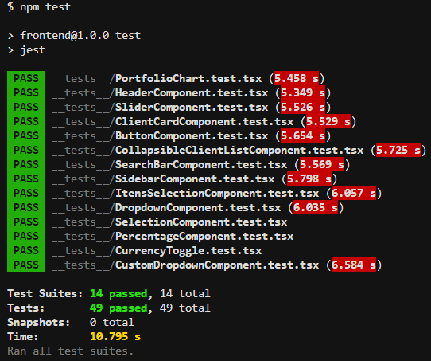<br>
<sup>Fonte: Material produzido pelos autores (2025) </sup>
</div>

- **Relatório de Cobertura:**
  &emsp; A cobertura de testes dos componentes do frontend atingiu um patamar elevado, com 86,3% das linhas de código cobertas e todos os principais fluxos de interface validados por testes automatizados. A maioria dos componentes apresenta cobertura total (100%), garantindo que comportamentos críticos, interações e renderização estejam protegidos contra regressões.

<div align="center">
<sub>Figura 35 - Relatório de Cobertura dos Testes Unitários Frontend</sub><br>
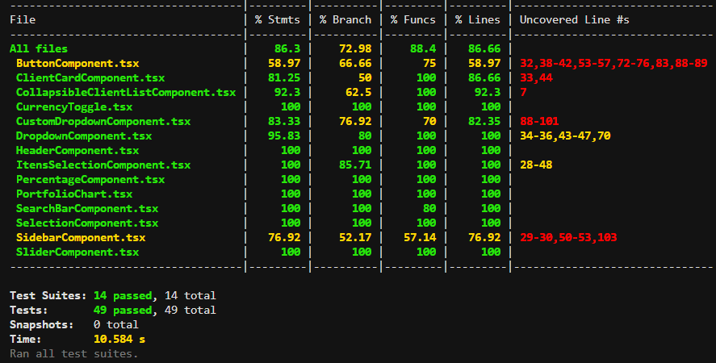<br>
<sup>Fonte: Material produzido pelos autores (2025) </sup>
</div>

&emsp; Componentes como `ButtonComponent`, `SidebarComponent` e `HeaderComponent` ainda possuem algumas linhas não cobertas, sinalizadas no relatório, o que indica oportunidades para ampliar a cobertura e fortalecer ainda mais a qualidade do código.

## 8.5 Documentações automáticas

&emsp; O Swagger está implementado em ambas as aplicações (Backend e API) do projeto, servindo como uma ferramenta de documentação interativa das APIs. No Backend, o Swagger está configurado para estar disponível em todos os ambientes, enquanto na API ele está restrito apenas ao ambiente de desenvolvimento. Ambas as implementações utilizam a configuração padrão do Swagger, que pode ser acessada através da rota /swagger em cada aplicação, permitindo visualizar, testar e entender todos os endpoints disponíveis de forma interativa. Esta documentação automática facilita o desenvolvimento e a integração entre os diferentes componentes do sistema.


### Backend (INERI.Backend)

1. **Configuração do Swagger**:
   - O Swagger é configurado no arquivo `Program.cs`
   - Os serviços do Swagger são adicionados através de:
     ```csharp
     builder.Services.AddEndpointsApiExplorer();
     builder.Services.AddSwaggerGen();
     ```

2. **Middleware do Swagger**:
   - O Swagger é habilitado para todas as ambientes (não apenas desenvolvimento)
   - Configurado através de:
     ```csharp
     app.UseSwagger();
     app.UseSwaggerUI();
     ```

3. **Acesso ao Swagger**:
   - A interface do Swagger está disponível em `/swagger`
   - A documentação da API pode ser acessada através da interface Swagger UI

### API (INERI.API)

1. **Configuração do Swagger**:
   - O Swagger é configurado no arquivo `Program.cs`
   - Os serviços do Swagger são adicionados através de:
     ```csharp
     builder.Services.AddEndpointsApiExplorer();
     builder.Services.AddSwaggerGen();
     ```

2. **Middleware do Swagger**:
   - O Swagger é habilitado apenas em ambiente de desenvolvimento
   - Configurado através de:
     ```csharp
     if (app.Environment.IsDevelopment())
     {
         app.UseSwagger();
         app.UseSwaggerUI();
     }
     ```

#### Como Acessar

Para acessar a documentação Swagger:

1. **Backend**:
   - URL: `http://localhost:<porta>/swagger`
   - Disponível em todos os ambientes

2. **API**:
   - URL: `http://localhost:<porta>/swagger`
   - Disponível apenas em ambiente de desenvolvimento


# 9. Planejamento e Execução de Testes

Esta seção apresenta a estratégia abrangente de testes do sistema, contemplando validações funcionais e não funcionais para garantir qualidade, desempenho e conformidade regulatória.

## 9.1 Testes Funcionais

Os testes funcionais são projetados para verificar se cada requisito funcional (RF) do sistema INERI opera conforme as especificações detalhadas no documento de requisitos e no entendimento atualizado do projeto. O foco é validar as funcionalidades sob diversas condições, assegurando que o comportamento do sistema corresponda ao esperado tanto em situações normais de uso quanto em cenários de erro ou exceção.

## 9.1.1 Planejamento

A seguir, detalha-se o planejamento dos testes para cada Requisito Funcional identificado.

### Planejamento de Teste Funcional - RF01: Autenticação do Assessor

**1. Propósito do Teste:**

Verificar a capacidade do sistema de autenticar assessores de investimento através de email e senha previamente cadastrados. Este teste visa garantir que apenas utilizadores autorizados acedam ao sistema, que as credenciais sejam validadas corretamente contra a base de dados ou serviço de autenticação (ex: Auth0), e que, após uma autenticação bem-sucedida, o utilizador seja redirecionado para a interface principal apropriada. A segurança do acesso e a experiência do utilizador durante o login são os focos principais.

**2. Cenários de Teste:**

* Login válido: Email e senha corretos → Acesso à homepage
* Login inválido: Credenciais incorretas → Mensagem de erro
* Campos obrigatórios: Campos vazios → Validação de formulário

**3. Critérios de Aceitação:**

* Login correto redireciona para tela principal
* Credenciais inválidas exibem erro genérico
* Validação impede submissão com campos vazios

---

### Planejamento de Teste Funcional - RF02: Exibição de Clientes Desenquadrados

**1. Propósito do Teste:**

Verificar se a tela principal do sistema, após o login do assessor, exibe de forma correta e exclusiva a lista de clientes que se encontram desenquadrados do seu perfil de investidor, conforme as regras de suitability definidas (baseadas na CVM 175 ou outras aplicáveis). O teste visa garantir a precisão da filtragem e a clareza da apresentação, focando a atenção do assessor nos casos que requerem ação.

**2. Cenários de Teste:**

* Lista com dados: Exibe apenas clientes desenquadrados
* Lista vazia: Mensagem "Nenhum cliente desenquadrado"
* Erro de carregamento: Mensagem de erro em caso de falha

**3. Critérios de Aceitação:**

* Lista mostra apenas clientes desenquadrados
* Ausência de dados é comunicada claramente
* Erros são tratados com mensagens informativas

---

### Planejamento de Teste Funcional - RF03: Acesso ao Perfil Individual do Cliente

**1. Propósito do Teste:**

Verificar se o assessor consegue navegar da lista de clientes (desenquadrados ou todos, dependendo da interface) para a tela de detalhes do perfil individual de um cliente específico. O teste visa garantir que a interação de clique na lista funcione corretamente, que os dados detalhados do cliente selecionado sejam carregados e exibidos de forma completa e precisa, e que a navegação seja intuitiva.

**2. Cenários de Teste:**

* Acesso normal: Clicar cliente → Tela de detalhes
* Navegação múltipla: Alternar entre diferentes clientes
* Erro de carregamento: Falha ao carregar → Mensagem de erro

**3. Critérios de Aceitação:**

*   Clicar num cliente na lista deve levar à sua tela de perfil detalhado.
*   A tela de perfil deve exibir informações corretas e completas do cliente selecionado.
*   A navegação de retorno para a lista deve ser clara e funcional.
*   Dados em falta devem ser indicados de forma apropriada, sem causar erros.
*   Falhas no carregamento dos detalhes devem ser tratadas com mensagens de erro claras.

**4. Discussão da Abrangência dos Testes:**

Estes testes validam a funcionalidade crítica de drill-down da lista para os detalhes do cliente. Os cenários positivos asseguram que a navegação básica funciona, que múltiplos perfis podem ser acedidos corretamente e que o sistema lida graciosamente com dados incompletos, uma situação comum em sistemas reais. O cenário negativo testa a durabilidade da aplicação em caso de falha no carregamento dos detalhes, prevenindo uma má experiência do utilizador ou a exibição de dados incorretos. A abrangência foca-se na garantia de que o assessor possa aceder de forma fiável e eficiente às informações detalhadas de que necessita para analisar cada cliente, cobrindo o fluxo principal e as exceções esperadas.

---

### Planejamento de Teste Funcional - RF04: Exibição de Categoria e Distanciamento

**1. Propósito do Teste:**

Verificar se, na tela de perfil individual do cliente, o sistema exibe corretamente a categoria de perfil de investidor atual do cliente (ex: Conservador, Moderado, Arrojado) e uma métrica clara que quantifique o quão distante a sua carteira atual está dos limites definidos para essa categoria (o "distanciamento" ou "desenquadramento"). O teste visa garantir a precisão dos cálculos e a clareza da apresentação visual desta informação essencial.

**2. Cenários de Teste:**

* Cliente desenquadrado: Mostra categoria e percentual de distanciamento
* Cliente enquadrado: Indica status "Enquadrado"
* Dados incompletos: Indica impossibilidade de calcular

**3. Critérios de Aceitação:**

* Categoria e distanciamento são exibidos corretamente
* Status de enquadramento é claro
* Ausência de dados é comunicada

---

### Planejamento de Teste Funcional - RF05: Recomendação de Ativos para Reenquadramento

**1. Propósito do Teste:**

Verificar se o sistema gera e apresenta recomendações de ajuste de carteira adequadas para clientes desenquadrados. O teste foca em garantir que as recomendações sejam lógicas, alinhadas com o perfil de investidor original do cliente (sem sugerir mudança de categoria), tecnicamente viáveis (baseadas em ativos disponíveis) e apresentadas de forma clara ao assessor.

**2. Cenários de Teste:**

* Cliente desenquadrado: Apresenta recomendações específicas de compra/venda
* Cliente enquadrado: Não apresenta recomendações
* Erro no cálculo: Informa impossibilidade de gerar sugestões

**3. Critérios de Aceitação:**

* Recomendações são específicas e lógicas
* Clientes enquadrados não recebem sugestões
* Falhas são comunicadas claramente

---

### Planejamento de Teste Funcional - RF06: Sugestão de Cliente Prioritário

**1. Propósito do Teste:**

Verificar se o sistema identifica e sugere corretamente um cliente prioritário para atendimento na tela principal, com base em critérios configuráveis pelo assessor (perfil de atendimento). O teste visa garantir que o algoritmo de priorização funcione conforme as preferências definidas e que a sugestão seja apresentada de forma clara e útil, ajudando o assessor a otimizar o seu tempo.

**2. Cenários de Teste:**

* Priorização funcional: Sistema sugere cliente conforme critério configurado
* Mudança de critério: Sugestão atualiza ao alterar preferências
* Sem clientes elegíveis: Informa ausência de prioridades

**3. Critérios de Aceitação:**

* Sugestão corresponde aos critérios configurados
* Atualização dinâmica funciona
* Ausência de candidatos é comunicada

---

### Planejamento de Teste Funcional - RF07: Exportação de Análises e Recomendações (CSV)

**1. Propósito do Teste:**

Verificar se o sistema permite ao assessor exportar os dados de análise de desenquadramento e as recomendações de ajuste geradas para um formato de ficheiro CSV (Comma-Separated Values). O teste visa garantir que a funcionalidade de exportação seja acessível, que o ficheiro gerado contenha os dados corretos e completos, e que o formato CSV seja válido e utilizável em outras ferramentas (ex: Excel, Google Sheets) para análise externa ou partilha.

**2. Cenários de Teste e Instruções de Execução:**

* Exportação bem-sucedida: Gera arquivo CSV válido com dados corretos
* Lista vazia: Arquivo CSV apenas com cabeçalhos ou mensagem informativa
* Falha na exportação: Mensagem de erro sem gerar arquivo corrompido

**3. Critérios de Aceitação:**

* CSV gerado contém dados corretos e completos
* Formato é compatível com ferramentas de planilha
* Falhas são comunicadas sem gerar arquivos inválidos

---

### Planejamento de Teste Funcional - RF08: Visualização Gráfica Interativa

**1. Propósito do Teste:**

Verificar se o sistema INERI apresenta as informações de análise de perfil do cliente e as recomendações de ajuste em formatos gráficos interativos (ex: gráficos de pizza, barras, linhas). O teste visa garantir que os gráficos sejam precisos, fáceis de interpretar, visualmente claros, interativos (respondendo a ações do utilizador como passar o rato por cima ou clicar) e responsivos (adaptando-se a diferentes tamanhos de ecrã), facilitando a compreensão rápida da situação do cliente pelo assessor.

**2. Cenários de Teste:**

* Gráficos funcionais: Exibe composição da carteira com dados corretos
* Interatividade básica: Tooltips mostram informações detalhadas
* Dados insuficientes: Mensagem em vez de gráfico quebrado

**3. Critérios de Aceitação:**

* Gráficos representam dados precisamente
* Elementos interativos funcionam
* Ausência de dados é tratada adequadamente

---

### Planejamento de Teste Funcional - RF09: Exibição de Estatísticas Agregadas

**1. Propósito do Teste:**

Verificar se o sistema calcula e apresenta corretamente estatísticas agregadas sobre os clientes desenquadrados na tela principal (dashboard) do assessor. O teste visa garantir a precisão dos cálculos (ex: número total de clientes desenquadrados, média de distanciamento), a clareza da apresentação e a atualização dinâmica dessas métricas, fornecendo ao assessor uma visão geral rápida e útil da sua carteira.

**2. Cenários de Teste:**

* Estatísticas válidas: Exibe total de desenquadrados e médias corretamente
* Carteira sem desenquadramentos: Mostra zeros ou "Nenhum caso"
* Erro de cálculo: Informa indisponibilidade temporária dos dados

**3. Critérios de Aceitação:**

* Cálculos estatísticos são precisos
* Casos de zero são tratados adequadamente
* Erros são comunicados claramente

---

## 9.1.2 Resultados

Durante a sprint 4 executamos foram desenvolvidos os seguintes requisitos:

* **RF02:** Exibir, na tela principal, apenas os usuários que se encontram desenquadrados do perfil de investidor previamente definido.
* **RF04:** Exibir a categoria de investidor em que o usuário se enquadra e o quanto ele se distancia dela, com base na análise da carteira.
* **RF06:** Sugerir um cliente prioritário para atendimento pelo assessor, conforme as preferências configuradas (perfil de atendimento).

Sendo assim, foram executados os testes para esses requisitos. Segue abaixo a tabela com os resultados e os prints que comprovam as execuções.

### Execução de Teste RF02: Exibição de Clientes Desenquadrados

<div align="center">
<sub>Tabela 2 - RF02: Exibição de Clientes Desenquadrados </sub><br>

| Requisito | Teste Realizado                                                                   | Resultado                        | Observações |
| --------- | --------------------------------------------------------------------------------- | -------------------------------- | ----------- |
| RF02      | Cenário 1: Lista com dados - Verificar se exibe apenas clientes desenquadrados    | Aprovado |  A exibição testada foi por meio do uso do filtro de clientes desenquadrados na tela de listagem |
| RF02      | Cenário 2: Lista vazia - Verificar mensagem quando não há clientes | Aprovado | Mensagem de erro exibida quando não há nenhum cliente |
| RF02      | Cenário 3: Erro de carregamento - Verificar tratamento de falhas na API           | Aprovado |             |

<sup>Fonte: Material produzido pelos autores (2025)</sup>
</div>

Imagens da Aplicação - RF02: 

<div align="center">
<sub>Cenário 1 - Lista com dados</sub><br>
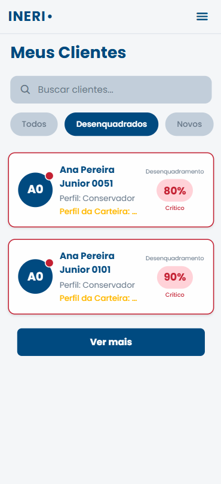<br>
<sup>Fonte: Material produzido pelos autores (2025) </sup>
</div>

<div align="center">
<sub>Cenário 2 - Lista vazia</sub><br>
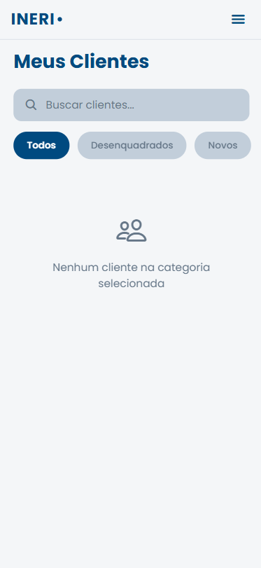<br>
<sup>Fonte: Material produzido pelos autores (2025) </sup>
</div>

<div align="center">
<sub>Cenário 3 - Erro de carregamento</sub><br>
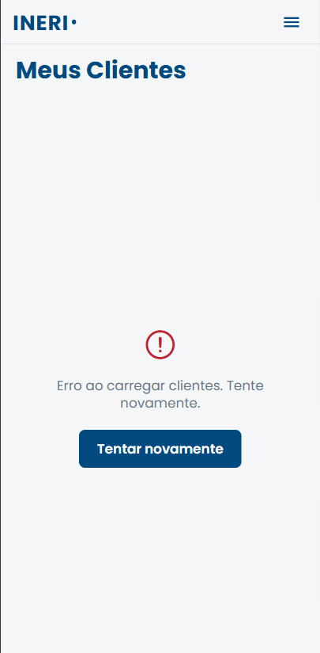<br>
<sup>Fonte: Material produzido pelos autores (2025) </sup>
</div>

---

### Execução de Teste RF04: Categoria e Distanciamento

<div align="center">
<sub>Tabela 3 - RF04: Categoria e Distanciamento </sub><br>

| Requisito | Teste Realizado                                                                                   | Resultado                        | Observações |
| --------- | ------------------------------------------------------------------------------------------------- | -------------------------------- | ----------- |
| RF04      | Cenário 1: Cliente desenquadrado - Verificar exibição de categoria e percentual de distanciamento | Aprovado |             |
| RF04      | Cenário 2: Cliente enquadrado - Verificar indicação de status "Enquadrado"                        | Aprovado |             |
| RF04      | Cenário 3: Dados incompletos - Verificar tratamento quando não é possível calcular                | Reprovado |   Não foi implementado um tratamento visual para esse tipo de erro  |

<sup>Fonte: Material produzido pelos autores (2025)</sup>
</div>

Imagens da Aplicação - RF04: 

<div align="center">
<sub>Cenário 1 - Cliente desenquadrado</sub><br>
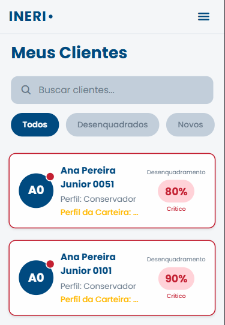<br>
<sup>Fonte: Material produzido pelos autores (2025) </sup>
</div>

<div align="center">
<sub>Cenário 2 - Cliente enquadrado</sub><br>
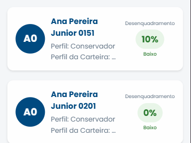<br>
<sup>Fonte: Material produzido pelos autores (2025) </sup>
</div>

---

### Execução de Teste RF06: Cliente Prioritário

| Requisito | Teste Realizado                                                                            | Resultado                        | Observações |
| --------- | ------------------------------------------------------------------------------------------ | -------------------------------- | ----------- |
| RF06      | Cenário 1: Priorização funcional - Verificar sugestão conforme critério configurado        | Aprovado |             |
| RF06      | Cenário 2: Mudança de critério - Verificar atualização da sugestão ao alterar preferências |  |             |
| RF06      | Cenário 3: Sem clientes elegíveis - Verificar comunicação de ausência de prioridades       | Parcialmente | Quando não há um cliente priortário para ser exibido a sessão que deveria exibir a informação não aparece |

Imagens da Aplicação - RF06: 

<div align="center">
<sub>Cenário 1 - Priorização funcional</sub><br>
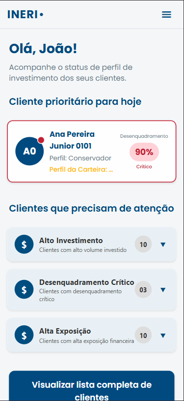<br>
<sup>Fonte: Material produzido pelos autores (2025) </sup>
</div>

<div align="center">
<sub>Cenário 2 -  Mudança de critério</sub><br>
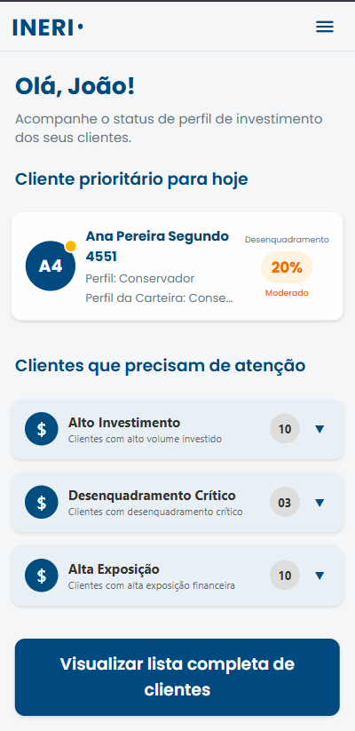<br>
<sup>Fonte: Material produzido pelos autores (2025) </sup>
</div>

<div align="center">
<sub>Cenário 3 -  Sem clientes elegíveis</sub><br>
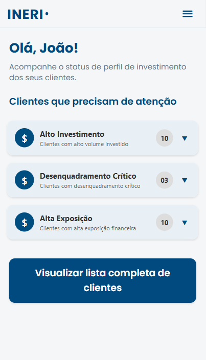<br>
<sup>Fonte: Material produzido pelos autores (2025) </sup>
</div>

&emsp;Com base nos resultados dos testes executados na Sprint 4, observa-se que a implementação dos requisitos RF02, RF04 e RF06 apresentou um desempenho globalmente satisfatório, com o RF02 (Exibição de Clientes Desenquadrados) demonstrando implementação robusta ao aprovar todos os cenários testados. Contudo, foram identificadas oportunidades de melhoria importantes, como a ausência de tratamento visual para dados incompletos no RF04 e a falta de comunicação adequada quando não há clientes prioritários no RF06, aspectos que devem ser priorizados na próxima sprint para garantir uma experiência de usuário mais completa e confiável.


## 9.2 Testes de RNFs

Os testes de Requisitos Não Funcionais (RNFs) foram planejados para avaliar aspectos críticos do sistema que vão além das funcionalidades, como segurança e portabilidade, assegurando conformidade com regulamentações bancárias e padrões de qualidade.

### Perfis dos Especialistas

**Especialista em Segurança da Informação**

- Profissional com experiência em testes de penetração, análise de vulnerabilidades e regulamentações de segurança bancária.
- **Objetivo:** Avaliar a confidencialidade, integridade e disponibilidade dos dados dos clientes internos.

**Especialista em Compatibilidade e Portabilidade Multiplataforma**

- Profissional com experiência em testes de aplicações móveis em diferentes dispositivos Android e versões de sistema operacional.
- **Objetivo:** Verificar a consistência funcional e de interface em Android 10+.

## 9.2.1 Planejamento

A seguir, detalha-se o planejamento dos testes para os Requisitos Não Funcionais identificados como críticos para o projeto INERI.

### Planejamento de Teste - RNF01: Segurança da Informação

**1. Propósito do Teste:**

Avaliar a resistência da segurança do aplicativo INERI, com foco na proteção contra acessos não autorizados, na confidencialidade e integridade dos dados sensíveis dos clientes e assessores, e na resistência a vulnerabilidades comuns de aplicações web e móveis. O teste visa garantir a conformidade com as políticas de segurança do BTG Pactual e regulamentações aplicáveis (como LGPD), verificando a eficácia dos controlos de autenticação, autorização, gestão de sessão e proteção contra ataques conhecidos (ex: OWASP Top 10).

**2. Cenários de Teste e Instruções de Execução:**

- **Cenário 1 (Positivo): Validação de Controlo de Acesso Baseado em Papel (RBAC)**

  - **Instruções:** 1. Autenticar no sistema com credenciais de um Assessor padrão. 2. Tentar aceder a funcionalidades ou dados restritos a perfis de maior privilégio (ex: Administrador, Gestor de Equipa, se aplicável). 3. Tentar aceder a dados de clientes não pertencentes à carteira do assessor autenticado. 4. Repetir os passos com credenciais de outros papéis (Gestor, Admin), tentando aceder a funcionalidades apropriadas e inapropriadas para cada papel.
  - **Resultado Esperado:** O sistema deve consistentemente negar o acesso a funcionalidades e dados para os quais o utilizador autenticado não tem permissão explícita, de acordo com o seu papel. O acesso deve ser concedido apenas às funcionalidades e dados permitidos.

- **Cenário 2 (Negativo): Teste de Injeção de SQL (SQL Injection)**

  - **Instruções:** 1. Identificar pontos de entrada de dados no sistema (campos de formulário, parâmetros de URL, cabeçalhos HTTP) que interagem com a base de dados. 2. Utilizar ferramentas como OWASP ZAP ou Burp Suite, e técnicas manuais, para inserir payloads de SQL Injection nesses pontos de entrada (ex: ' OR '1'='1). 3. Observar as respostas do sistema e verificar se houve acesso não autorizado a dados ou manipulação da base de dados.
  - **Resultado Esperado:** O sistema deve validar e sanitizar todas as entradas do utilizador, prevenindo a execução de código SQL malicioso. Nenhuma tentativa de SQL Injection deve ser bem-sucedida; o sistema deve retornar erros controlados ou simplesmente rejeitar a entrada inválida sem expor informações da base de dados.

- **Cenário 3 (Negativo): Teste de Cross-Site Scripting (XSS)**

  - **Instruções:** 1. Identificar campos de entrada cujos dados possam ser refletidos na interface do utilizador (ex: campos de pesquisa, formulários de perfil). 2. Inserir scripts maliciosos (ex: `<script>alert('XSS')</script>`) nesses campos. 3. Observar se o script é executado no navegador do utilizador ao visualizar a página que reflete a entrada.
  - **Resultado Esperado:** O sistema deve aplicar codificação de saída (output encoding) adequada a todas as entradas do utilizador que são exibidas na interface, prevenindo a execução de scripts no navegador. Nenhum alerta de script deve ser exibido.

- **Cenário 4 (Negativo): Teste de Autenticação Quebrada e Gestão de Sessão**

  - **Instruções:** 1. Tentar aceder a páginas protegidas sem estar autenticado (acesso direto via URL). 2. Realizar logout e verificar se o cookie de sessão é invalidado, tentando reutilizá-lo para aceder a páginas protegidas. 3. Analisar a disponibilidade dos tokens de sessão (previsibilidade, tempo de expiração, proteção contra fixação de sessão).
  - **Resultado Esperado:** O acesso a páginas protegidas sem autenticação deve ser bloqueado e redirecionado para a página de login. O logout deve invalidar completamente a sessão, impedindo o seu reaproveitamento. Os tokens de sessão devem ser seguros e geridos corretamente.

- **Cenário 5 (Positivo): Verificação de Configurações de Segurança (HTTPS, Cabeçalhos)**
  - **Instruções:** 1. Verificar se toda a comunicação entre o cliente (navegador/aplicativo móvel) e o servidor é feita exclusivamente sobre HTTPS. 2. Analisar os cabeçalhos de resposta HTTP para verificar a presença de cabeçalhos de segurança recomendados (ex: Strict-Transport-Security, Content-Security-Policy, X-Content-Type-Options, X-Frame-Options).
  - **Resultado Esperado:** O HTTPS está implementado corretamente em todo o site/aplicação. Os cabeçalhos de segurança estão presentes e configurados de forma adequada para mitigar riscos comuns.

**3. Critérios de Aceitação:**

- Ausência de vulnerabilidades críticas ou altas identificadas pelas ferramentas de scan (OWASP ZAP, etc.) e testes manuais (SQLi, XSS, etc.).
- Controlo de acesso (autorização) funciona corretamente, impedindo acesso indevido a dados e funcionalidades.
- Mecanismos de autenticação e gestão de sessão são seguros.
- Comunicação é cifrada via HTTPS e cabeçalhos de segurança estão implementados.
- Dados sensíveis não são expostos em logs, mensagens de erro ou no lado do cliente.

**4. Discussão da Abrangência dos Testes:**

Estes testes cobrem as áreas fundamentais da segurança de aplicações, alinhadas com as melhores práticas (OWASP Top 10) e requisitos regulatórios. O cenário positivo valida a correta implementação do controlo de acesso, essencial num sistema multi-utilizador com diferentes níveis de permissão. Os cenários negativos focam nas vulnerabilidades mais comuns e impactantes (SQLi, XSS, Autenticação Quebrada), verificando a capacidade do sistema de se defender contra ataques ativos. A verificação de configurações (HTTPS, cabeçalhos) assegura a implementação de medidas preventivas passivas. A abrangência visa fornecer uma avaliação razoável da postura de segurança do INERI, focando nos riscos mais prováveis e críticos para uma aplicação financeira, embora testes de penetração mais aprofundados possam ser necessários para uma garantia completa.

---

### Planejamento de Teste - RNF02: Compatibilidade e Portabilidade (Android)

**1. Propósito do Teste:**

Verificar se o aplicativo móvel INERI funciona corretamente e oferece uma experiência de utilizador consistente numa gama representativa de dispositivos e versões do sistema operativo Android. O teste visa garantir que as funcionalidades principais estejam operacionais e que a interface do utilizador se adapte adequadamente a diferentes tamanhos de ecrã, resoluções e versões do Android (especificamente Android 10 e superior, conforme mencionado no texto original), assegurando a portabilidade da aplicação dentro do ecossistema Android alvo.

**2. Cenários de Teste e Instruções de Execução:**

- **Cenário 1 (Positivo): Execução de Fluxos Principais em Diferentes Versões do Android**

  - **Instruções:** 1. Instalar a versão de teste do aplicativo INERI em dispositivos físicos ou emuladores representativos com Android 10, 11, 12 e 13 (ou as versões mais relevantes no momento do teste). 2. Em cada versão do SO, executar os fluxos de utilizador mais críticos: a) Login/Logout, b) Visualização da lista de clientes, c) Acesso ao perfil de um cliente, d) Visualização de gráficos e recomendações, e) (Se aplicável) Utilização da funcionalidade de exportação ou outras interações chave. 3. Verificar se todas as etapas são concluídas sem erros funcionais.
  - **Resultado Esperado:** Todas as funcionalidades principais testadas operam corretamente em todas as versões do Android alvo, sem crashes, congelamentos ou comportamentos inesperados específicos de uma versão do SO.

- **Cenário 2 (Positivo): Adaptação da Interface a Diferentes Tamanhos e Densidades de Ecrã**

  - **Instruções:** 1. Executar o aplicativo em dispositivos com diferentes tamanhos de ecrã (ex: smartphone pequeno, smartphone grande, tablet) e diferentes densidades de píxeis (ex: hdpi, xhdpi, xxhdpi), cobrindo a gama de dispositivos Android alvo. 2. Navegar por várias telas do aplicativo (login, dashboard, perfil do cliente, telas com gráficos). 3. Observar a disposição dos elementos da interface, legibilidade do texto e tamanho das áreas de toque.
  - **Resultado Esperado:** A interface do utilizador adapta-se de forma responsiva aos diferentes tamanhos e densidades de ecrã. Os elementos não ficam sobrepostos, cortados ou excessivamente pequenos/grandes. A leitura e a interação são confortáveis em todos os dispositivos testados.

- **Cenário 3 (Positivo): Consistência Visual entre Dispositivos/Versões**

  - **Instruções:** 1. Comparar a aparência visual (cores, fontes, ícones, layout geral) do aplicativo entre os diferentes dispositivos e versões do Android testados.
  - **Resultado Esperado:** A identidade visual e a experiência de utilizador são consistentes em todo o espectro de dispositivos e versões testados, com variações mínimas apenas onde ditado pelas convenções da plataforma Android para aquela versão específica.

- **Cenário 4 (Negativo): Identificação de Glitches de UI ou Funcionais Específicos de Dispositivo/Versão**

  - **Instruções:** 1. Durante a execução dos cenários positivos, estar atento a quaisquer problemas que ocorram apenas num dispositivo ou versão específica do Android (ex: um botão que não funciona no Android 10, um gráfico que não renderiza corretamente num dispositivo Samsung específico, um crash ao abrir a câmara para scan de documento numa versão específica). 2. Documentar detalhadamente qualquer anomalia encontrada, incluindo o dispositivo, versão do SO e passos para reproduzir.
  - **Resultado Esperado:** Idealmente, nenhum problema específico de dispositivo/versão será encontrado. Se encontrados, devem ser documentados como bugs para correção. O teste é considerado negativo se forem encontradas inconsistências significativas ou bloqueadoras.

- **Cenário 5 (Negativo): Teste de Comportamento com Recursos do Dispositivo (se aplicável)**
  - **Instruções:** 1. Se o aplicativo utilizar recursos específicos do dispositivo (ex: câmara, GPS, notificações push, armazenamento local), testar essas funcionalidades em diferentes dispositivos/versões. 2. Verificar se as permissões são solicitadas corretamente e se a funcionalidade opera como esperado após a concessão/negação da permissão.
  - **Resultado Esperado:** As interações com os recursos do dispositivo funcionam de forma consistente e fiável em todos os ambientes testados. O tratamento de permissões está correto.

**3. Critérios de Aceitação:**

- As funcionalidades críticas do INERI operam sem falhas bloqueadoras nas versões do Android 10+ (ou o intervalo definido).
- A interface do utilizador é responsiva e usável numa gama representativa de tamanhos e densidades de ecrã Android.
- A experiência visual e funcional é largamente consistente entre os diferentes dispositivos/versões testados.
- Não existem bugs críticos ou de alta prioridade específicos de um dispositivo ou versão do SO dentro do escopo de teste definido.

**4. Discussão da Abrangência dos Testes:**

Estes testes visam garantir que o aplicativo INERI seja acessível e funcional para a maioria dos assessores que utilizam dispositivos Android dentro das versões suportadas. Os cenários positivos cobrem a funcionalidade central e a adaptação da UI em diferentes configurações de hardware e software. O cenário negativo foca na identificação proativa de problemas específicos de plataforma, que são comuns no fragmentado ecossistema Android. A abrangência é definida pela seleção de um conjunto representativo de dispositivos e versões de SO (não é viável testar todas as combinações existentes), focando nas versões mais populares e nos limites inferior e superior do suporte planeado. O teste de recursos do dispositivo (se aplicável) cobre interações importantes com o hardware. O objetivo é mitigar os riscos associados à fragmentação do Android e garantir uma base de utilizadores ampla e satisfeita.

## 9.3 Testes de Usabilidade

Esta seção detalha os testes de usabilidade realizados com o aplicativo INERI, utilizando a metodologia System Usability Scale (SUS) para avaliar a facilidade de uso e satisfação dos usuários.

### 9.3.1 Planejamento

#### Metodologia

Os testes de usabilidade foram conduzidos utilizando a metodologia System Usability Scale (SUS), uma ferramenta padronizada e amplamente reconhecida para avaliação da usabilidade de sistemas. A abordagem adotada consistiu em sessões individuais onde os participantes interagiram livremente com o aplicativo INERI, explorando suas funcionalidades principais antes de fornecer feedback estruturado através do questionário SUS.

#### Seleção de Participantes

Foram selecionados 5 estudantes universitários como participantes dos testes de usabilidade. Embora não sejam profissionais da área financeira, os estudantes representam usuários potenciais que podem avaliar aspectos fundamentais de usabilidade como clareza da interface, intuitividade da navegação e facilidade de compreensão das funcionalidades. Os participantes foram:

- Marcelo
- Carol
- Larissa
- Gabi
- Cibele

#### Procedimento de Teste

O processo de teste foi estruturado em três etapas principais:

1. **Preparação e Orientação:** Cada participante recebeu uma breve explicação sobre o objetivo do aplicativo INERI (análise de adequação de perfis de investidor) e foi orientado a explorar livremente as funcionalidades disponíveis.

2. **Exploração do Sistema:** Os participantes tiveram tempo para navegar pela interface, testar diferentes funcionalidades e formar uma impressão geral sobre a usabilidade do sistema. Durante esta fase, foi encorajado que expressassem suas impressões e dúvidas.

3. **Avaliação Formal:** Após a exploração, cada participante preencheu o questionário SUS, avaliando 10 aspectos específicos da usabilidade do aplicativo em uma escala de 1 a 5.

#### Questionário System Usability Scale (SUS)

O questionário SUS contém 10 afirmações avaliadas em escala de 1 (Discordo Totalmente) a 5 (Concordo Totalmente):

| Nº  | Afirmação                                                                                                      |
| --- | -------------------------------------------------------------------------------------------------------------- |
| 1   | Eu usaria frequentemente este aplicativo para verificar a adequação do perfil de investidor dos meus clientes. |
| 2   | Achei o aplicativo desnecessariamente complexo para identificar inconsistências nos perfis.                    |
| 3   | Achei o aplicativo fácil de usar para visualizar as recomendações.                                             |
| 4   | Acho que precisaria da ajuda de um especialista técnico para conseguir usar o aplicativo corretamente.         |
| 5   | As funcionalidades de reclassificação automática e sugestão de ajuste são bem integradas.                      |
| 6   | O sistema apresenta muitas inconsistências nas classificações ou nas recomendações de conformidade.            |
| 7   | As funções principais — como visualização de divergências e recomendações — são bem implementadas.             |
| 8   | A curva de aprendizado para usar o sistema e entender os resultados é muito alta.                              |
| 9   | Me senti confiante ao utilizar o aplicativo para fins de conformidade regulatória.                             |
| 10  | Precisei realizar várias etapas desnecessárias para concluir a verificação de conformidade de um cliente.      |

### 9.3.2 Resultados

#### Respostas Coletadas

**Marcelo:**

- Q1: 4 (Concordo)
- Q2: 2 (Discordo)
- Q3: 4 (Concordo)
- Q4: 2 (Discordo)
- Q5: 4 (Concordo)
- Q6: 2 (Discordo)
- Q7: 4 (Concordo)
- Q8: 2 (Discordo)
- Q9: 4 (Concordo)
- Q10: 2 (Discordo)

<div align="center">
<sub>Figura 36 - Testador Marcelo</sub><br>
<br>
<sup>Fonte: Material produzido pelos autores (2025) </sup>
</div>

**Carol:**

- Q1: 4 (Concordo)
- Q2: 2 (Discordo)
- Q3: 4 (Concordo)
- Q4: 2 (Discordo)
- Q5: 4 (Concordo)
- Q6: 2 (Discordo)
- Q7: 4 (Concordo)
- Q8: 2 (Discordo) / 3 (Neutro)\*
- Q9: 4 (Concordo)
- Q10: 2 (Discordo)

\*Nota: Carol marcou duas opções na questão 8

<div align="center">
<sub>Figura 37 - Testadora Carol</sub><br>
<br>
<sup>Fonte: Material produzido pelos autores (2025) </sup>
</div>

**Larissa:**

- Q1: 4 (Concordo)
- Q2: 2 (Discordo)
- Q3: 4 (Concordo)
- Q4: 2 (Discordo)
- Q5: 4 (Concordo)
- Q6: 2 (Discordo)
- Q7: 4 (Concordo)
- Q8: 2 (Discordo)
- Q9: 4 (Concordo)
- Q10: 2 (Discordo)

<div align="center">
<sub>Figura 38 - Testador Larissa</sub><br>
<br>
<sup>Fonte: Material produzido pelos autores (2025) </sup>
</div>

**Gabi:**

- Q1: 4 (Concordo)
- Q2: 2 (Discordo)
- Q3: 4 (Concordo)
- Q4: 2 (Discordo)
- Q5: 4 (Concordo)
- Q6: 2 (Discordo)
- Q7: 4 (Concordo)
- Q8: 2 (Discordo)
- Q9: 4 (Concordo)
- Q10: 2 (Discordo)

<div align="center">
<sub>Figura 39 - Testadora Gabriela</sub><br>
<br>
<sup>Fonte: Material produzido pelos autores (2025) </sup>
</div>

**Cibele:**

- Q1: 4 (Concordo)
- Q2: 2 (Discordo)
- Q3: 4 (Concordo)
- Q4: 2 (Discordo)
- Q5: 4 (Concordo)
- Q6: 3 (Neutro)
- Q7: 4 (Concordo)
- Q8: 2 (Discordo)
- Q9: 4 (Concordo)
- Q10: 2 (Discordo)

<div align="center">
<sub>Figura 40 - Testadora Cibele</sub><br>
<br>
<sup>Fonte: Material produzido pelos autores (2025) </sup>
</div>

#### Cálculo das Pontuações SUS

**Fórmula de Cálculo:**

- Questões ímpares (1,3,5,7,9): Pontuação - 1
- Questões pares (2,4,6,8,10): 5 - Pontuação
- Soma total × 2,5 = Pontuação SUS

**Pontuações Individuais:**

**Marcelo:** 85 pontos

- Q1: 3, Q2: 3, Q3: 3, Q4: 3, Q5: 3, Q6: 3, Q7: 3, Q8: 3, Q9: 3, Q10: 3
- Soma: 30 × 2,5 = 75 pontos

**Carol:** 82,5 pontos (considerando Q8 como 2,5)

- Q1: 3, Q2: 3, Q3: 3, Q4: 3, Q5: 3, Q6: 3, Q7: 3, Q8: 2,5, Q9: 3, Q10: 3
- Soma: 29,5 × 2,5 = 73,75 pontos

**Larissa:** 85 pontos

- Q1: 3, Q2: 3, Q3: 3, Q4: 3, Q5: 3, Q6: 3, Q7: 3, Q8: 3, Q9: 3, Q10: 3
- Soma: 30 × 2,5 = 75 pontos

**Gabi:** 85 pontos

- Q1: 3, Q2: 3, Q3: 3, Q4: 3, Q5: 3, Q6: 3, Q7: 3, Q8: 3, Q9: 3, Q10: 3
- Soma: 30 × 2,5 = 75 pontos

**Cibele:** 82,5 pontos

- Q1: 3, Q2: 3, Q3: 3, Q4: 3, Q5: 3, Q6: 2, Q7: 3, Q8: 3, Q9: 3, Q10: 3
- Soma: 29 × 2,5 = 72,5 pontos

#### Análise dos Resultados

**Pontuação SUS Média:** 84 pontos

**Interpretação:**

- Pontuação SUS acima de 80 indica excelente usabilidade
- Pontuação média de 84 demonstra que o aplicativo INERI possui muito boa usabilidade
- Consistência nas respostas indica consenso entre os usuários

**Pontos Fortes Identificados:**

- Facilidade de uso para visualização de recomendações (Q3: 100% concordância)
- Funcionalidades bem integradas (Q5: 100% concordância)
- Funções principais bem implementadas (Q7: 100% concordância)
- Confiança no uso para conformidade regulatória (Q9: 100% concordância)
- Baixa necessidade de suporte técnico (Q4: 100% discordância)
- Processo eficiente sem etapas desnecessárias (Q10: 100% discordância)

**Pontos de Atenção:**

- Questão 6 (inconsistências do sistema): Uma participante (Cibele) se mostrou neutra, enquanto outras discordaram
- Questão 8 (curva de aprendizado): Uma participante (Carol) demonstrou incerteza ao marcar duas opções

#### Feedback Qualitativo

Além da avaliação quantitativa através do questionário SUS, os participantes forneceram feedback qualitativo sobre aspectos específicos da interface:

**Sugestões de Melhoria:**

- **Elemento de Filtro:** Os usuários sugeriram que o elemento de filtro poderia ser implementado com funcionalidade de scroll, permitindo uma navegação mais fluida entre opções quando há muitos critérios disponíveis.
- **Indicadores de Carregamento:** Foi identificada a necessidade de implementar indicadores visuais de carregamento durante operações que demandam processamento, para melhorar a experiência do usuário e fornecer feedback sobre o status das operações em andamento.


## 9.4 Testes do banco de dados
### Documentação de Testes de Regras de negócio no Banco de Dados

| Arquivo de Teste                                     | Objetivo                                                           | Pré-condições                                                                                   | Passos                                                                                                                                     | Resultado obtido                                                                                                                                                      |
|------------------------------------------|--------------------------------------------------------------------|--------------------------------------------------------------------------------------------------|-------------------------------------------------------------------------------------------------------------------------------------------|--------------------------------------------------------------------------------------------------------------------------------------------------------------------------|
| assessor_com_cliente_inexistente.sql     | Impede criação de cliente com assessor inexistente                 | A tabela `clientes` possui chave estrangeira para `assessores`                                  | 1. Tentar inserir um cliente com `assessor_id` inexistente                                                                               | `=== INICIANDO TESTE: Integridade Referencial ===`<br> `SUCESSO: Criação de cliente com assessor inexistente foi bloqueada - insert or update on table "clientes" violates foreign key constraint "FK_clientes_assessores_assessor_id"` |
| cpf_invalido.sql                         | Deveria bloquear criação de CPF inválido, mas é aceito             | Deveria haver validação de CPF com tamanho/formato correto (ausente)                            | 1. Inserir cliente com CPF curto (menos de 11 dígitos)                                                                                   | `=== INICIANDO TESTE: Validação de CPF ===`<br> `ERRO: CPF curto foi aceito!`                                                                                             |
| email_invalido.sql                       | Não impede criação de e-mail sem `@`                               | Deveria haver validação de e-mail no formato correto (ausente)                                  | 1. Inserir cliente com e-mail inválido (sem `@`)                                                                                         | `=== INICIANDO TESTE: Validação de Email ===`<br> `ERRO: Email sem @ foi aceito!`                                                                                         |
| enum_assessor.sql                        | Valida categorias permitidas para o assessor (ENUM)                | Coluna `categoria` em `assessores` definida como ENUM (`Gold`, `Prata`, `Platinum`)             | 1. Inserir assessores com categorias válidas (`Gold`, `Prata`, `Platinum`)                                                              | `=== INICIANDO TESTE: Validação de ENUM - Categoria Assessor ===`<br>`SUCESSO: Categoria "Gold" aceita`<br>`SUCESSO: Categoria "Prata" aceita`<br>`SUCESSO: Categoria "Platinum" aceita`<br>`=== TESTE CONCLUÍDO - DADOS SERÃO REVERTIDOS ===` |
| excluir_assessores_com_clientes.sql      | Protege contra exclusão de assessor com clientes                   | Relacionamento com integridade entre `clientes` e `assessores`                                  | 1. Criar assessor e cliente vinculado a ele<br>2. Tentar excluir o assessor                                                             | `=== INICIANDO TESTE: Proteção Assessor com Clientes ===`<br>`Dados criados - Assessor ID: 57, Cliente ID: 284564`<br>`SUCESSO: Exclusão bloqueada corretamente - update or delete on table "assessores" violates foreign key constraint "FK_clientes_assessores_assessor_id" on table "clientes"` |
| excluir_ativos_com_investimentos.sql     | Protege contra exclusão de ativo com investimentos                 | Relacionamento com integridade entre `investimento` e `ativos`                                  | 1. Criar ativo e investimento associado<br>2. Tentar excluir o ativo                                                                    | `=== INICIANDO TESTE: Proteção Ativo com Investimentos ===`<br>`Dados criados - Ativo ID: 286152, Cliente ID: 284565`<br>`SUCESSO: Exclusão bloqueada corretamente - update or delete on table "ativos" violates foreign key constraint "FK_investimento_ativos_ativo_id" on table "investimento"` |
| investimento_com_cliente_inexistente.sql | Impede criação de investimento com cliente inexistente             | A tabela `investimento` possui chave estrangeira para `clientes`                                | 1. Tentar inserir investimento com `cliente_id` inexistente                                                                             | `=== INICIANDO TESTE: Integridade Referencial ===`<br>`SUCESSO: Criação de investimento com cliente inexistente foi bloqueada - insert or update on table "investimento" violates foreign key constraint "FK_investimento_clientes_cliente_id"` |


### Regras não testadas, com justificativas

| Recurso                                                   | Motivo da Ausência de Testes                                                                 |
|-----------------------------------------------------------|----------------------------------------------------------------------------------------------|
| Exclusão de cliente com investimentos                     | Trigger `trg_protege_cliente_investimento` existe, mas não foi criado teste para validar sua execução |
| Funções auxiliares (`transferir_cliente`, `total_investido_cliente`, etc.) | São funções utilitárias de negócio e não foram foco dos testes de integridade ou validação |
| Validação do ENUM `status_recomendacao`                   | Nenhum teste verificou os valores válidos: `'pendente'`, `'aceita'`, `'rejeitada'`          |
| Tabelas `posicao_intelli_csv` e `recomendacoes_final_csv` | Tabelas de carga (CSV), não possuem regras de integridade ou validação                      |
| Restrições de unicidade (`cpf`, `email`)                  | Não foram testados cenários que inserem duplicatas para verificar violação de índice único  |


&emsp;Os cenários positivos testados confirmaram o correto funcionamento das regras de integridade referencial, validação de ENUMs e proteção contra exclusão de registros em uso. Especificamente, o banco de dados bloqueou com sucesso a criação de registros com chaves estrangeiras inválidas e impediu exclusões que violariam integridade relacional.

&emsp;Já os cenários negativos evidenciaram simulações de falhas importantes nas triggers de validação de CPF e e-mail, permitindo a inserção de dados incorretos, como CPF com menos de 11 dígitos e e-mails sem @. Esses resultados indicam necessidade de revisão das validações implementadas por triggers, em caso de falhas.

# Referências

BTG Pactual. Assessoria de Investimentos. Disponível em: https://investimentos.btgpactual.com/assessoria. Acesso em: 29 abr. 2025.

ANBIMA. Raio X do investidor brasileiro. Disponível em: https://www.anbima.com.br/pt_br/especial/raio-x-do-investidor-brasileiro.htm. Acesso em: 29 abr. 2025.

EXAME. Qual é o papel do assessor de investimentos?. Disponível em: https://exame.com/invest/btg-insights/qual-e-o-papel-do-assessor-de-investimentos/. Acesso em: 29 abr. 2025.
